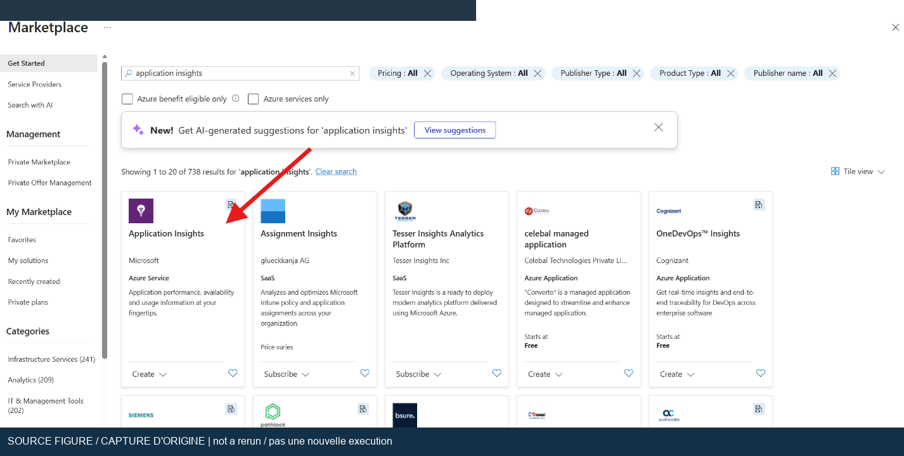
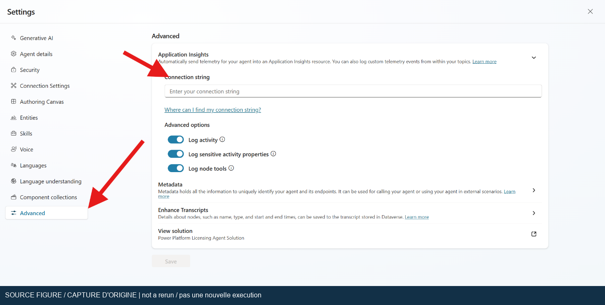
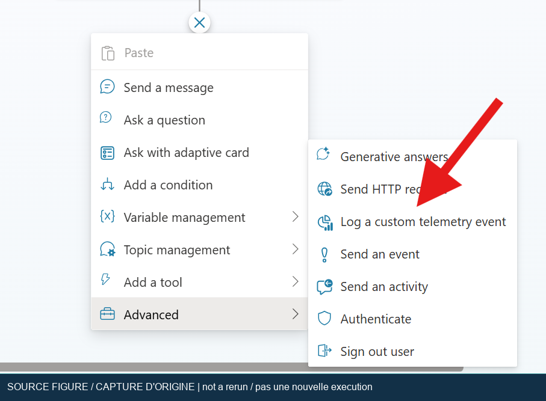
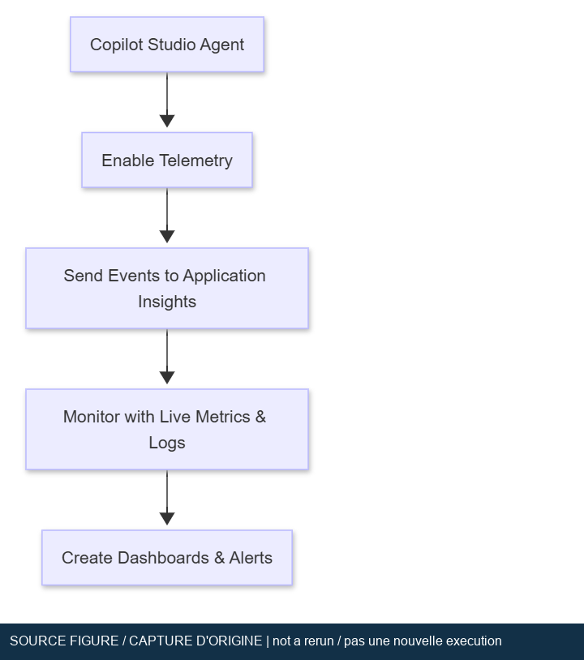

## Lab 03: Monitor an agent with Application Insights

[Workshop index](index.md) | [Français](../fr/lab-03.md) | [Previous: Search](lab-02.md) | [Next: BYOM](lab-04.md)

Capture an agent's telemetry in Azure Monitor Application Insights, then verify a
synthetic event without collecting conversation contents. Allow about 60 minutes,
plus access approval and telemetry ingestion time.

> [!IMPORTANT]
> Initial result: **Native Monitor inspected live; Application Insights/KQL path initially blocked**.
> The signed-in current Monitor displayed no data for October 13-19 and restricted
> transcript access. Existing Preview History independently exposed the earlier
> directory, email and failed-search activities; these were not rerun. The classic
> navigation menu exists, but its destination failed to load during inspection.
> Seven unrelated Application Insights resources were left untouched.
> A later approved paid test created dedicated telemetry resources, emitted one
> explicitly synthetic event with Entra ID, and verified its exact operation/run
> correlation through KQL. This proves the Azure ingestion/query layer, not
> agent-originated telemetry or configuration of the saved agent.
> See the [actual results and screenshots](live-rerun-2026-10-19.md).

### Later connected-agent test passed

On October 20, an isolated **Standard** draft agent was created through the
supported portal and cloned with official PAC. Its native
`LogCustomTelemetryEvent` topic passed 13 schema checks and official offline
packaging, then exactly one topic change was pushed.

The owned Application Insights connection was saved and verified by navigating
away and back. Conversation-detail, sensitive-property and node-execution
logging were all **off** before the single operator trigger at
**19:49:32 UTC**. The actual test chat replied `Telemetry check requested.`

An independent app-scoped KQL query found exactly **one**
`WorkshopTelemetryCheck` event with all five expected synthetic properties,
including the unique correlation marker. No external synthetic emitter or
repeat trigger was used. This passes the actual agent-originated event and
KQL correlation boundary that the earlier Azure-only test could not establish.

The [execution record](../assets/runtime-2026-10-20/agent-telemetry-execution.json)
and [ingestion evidence](../assets/runtime-2026-10-20/agent-telemetry-event.json)
remain separate. Platform event dimensions still include conversation/channel
identifier keys despite those privacy switches; their values are not published.
The timestamps come from separate client/service clocks, not an exact latency
measurement. The existing agents were untouched and no agent was published.
At **19:55:31 UTC**, saved settings were read back after navigation: the
connection was empty, logging was off and all three privacy flags remained off.
The first save had retained the connection despite disabling logging; an
explicit field clear, blur and second save corrected that.
The [disconnection receipt](../assets/runtime-2026-10-20/agent-telemetry-disconnection.json)
proves remote disconnection, not Azure resource deletion.
The separate [cleanup receipt](../assets/runtime-2026-10-20/agent-telemetry-cleanup.json)
verified deletion at **19:58:02 UTC**: the group, workspace, Insights component
and specifically authorized component-scoped alert each returned HTTP 404.
The referenced shared action group returned HTTP 200 before and after and was
untouched. The private connection-string handoff was removed. Historical
ingestion charges may still settle.

### Current-experience observation exercise

1. On the existing agent, select **Monitor** from the Build/Preview/Evaluate/Monitor menu.
2. Record the selected dates and whether the dashboard actually has data.
   The observed range was **Last 7 days, 10/13/26-10/19/26**.
3. Open **Sessions > See all**. The current identity saw zero rows and a transcript
   permission banner. Do not elevate permissions or publish merely to remove it.
4. Inspect the already-recorded conversation through **Preview > History**.
   Its directory, email and failed-directory activity durations were **2.73s,
   1.63s and 4.62s**. Do not rerun the email for monitoring evidence.
5. Keep native Monitor/History evidence separate from the Azure procedure below.
   An empty aggregate is not proof of zero consumption or zero true success.

The actual Monitor header showed zero sessions, zero average duration, 0% success
and zero credits with **No data yet**. The existing History conversation separately
showed **90.33 estimated credits**. These are different scopes, not a discrepancy
to resolve by inventing billing or claiming a free agent execution.

### Objectives and prerequisites

* Connect a development agent to a workspace-based Application Insights resource.
* Emit a harmless custom event with a repeatable test-case marker.
* Query the correct telemetry table for the selected scope.
* Separate test-canvas activity from published-channel activity.
* Explain why a dashboard, empty query, or user count does not prove agent quality.

You need maker access to a disposable copy of the Lab 01 or Lab 02 agent, an
approved Azure subscription, permission to configure Application Insights and its
Log Analytics workspace, and permission to read the resulting logs. Agree on
cost, retention, data residency, and telemetry access before enabling collection.
Use fictitious inputs only.

Open a **standard-harness** agent through **… > Open classic experience** or the
existing agent list. This navigation is not an orchestration switch: the standard
harness can use classic or generative orchestration. These agent-level settings
are not instructions for the GitHub Copilot harness. See [harnesses][harness] and
[standard-agent access][experience].

### Corrected lab numbering and current approach

The monitoring source has an internal “Lab 4” title. It is Lab 03 in this
workshop, following its source-file order. The BYOM exercise is Lab 04.

* Replace “instrumentation key or connection string” with the **Connection
  string** field in **Settings > Advanced > Application Insights**.
  The current article's introductory sentence still mentions a key, but its
  numbered setup procedure explicitly requests the connection string.
* Use workspace-based Application Insights and select its approved Log Analytics
  workspace. A new workspace can incur additional charges and governance work.
* Use **Enable logging**, **Log conversation details**, **Log sensitive Activity
  properties**, and **Node execution events** as applicable to your tenant.
  Older screenshots can call these **Log Activity** or **Log node tools**.
* Keep conversation details and sensitive activity properties off for this lab.
  User IDs, names, message text, and tool arguments can carry personal data.
* Keep the **Copilot Studio Dashboard** workbook optional. Microsoft documents
  this monitoring view as preview, so gallery availability is not a completion gate.
* Do not equate agent-level events with environment-level OpenTelemetry spans.
  The [telemetry overview][overview] identifies `customEvents` for agent-level
  telemetry and `dependencies` for environment-level tracing.

### Exercise 1: Prepare Application Insights

1. Save an export or approved backup of the disposable agent and record its
   existing telemetry configuration without placing credentials in the repository.
2. In Azure portal, locate an approved workspace-based Application Insights
   resource. If none exists, request approval before selecting **Create a
   resource > Application Insights**.
3. Use the authorized subscription, resource group, and region. Select the
   intended Log Analytics workspace or an explicitly approved new one.
4. Review ingestion/retention charges, access permissions, and network policy.
   Do not change shared workspace retention to make this exercise work.
5. After deployment, open the Application Insights overview and locate its
   **Connection string**. Transfer it directly into the approved configuration
   field in Exercise 2. Never include it in screenshots or a shared note.
6. Open **Logs** from this Application Insights resource. Confirm that you can
   query the resource and identify whether the editor is resource-scoped or
   workspace-scoped. Record the scope, not its private identifier.



*Original workshop screenshot, not a new execution. Resource creation requires
approval; use workspace and region settings appropriate to your organization.*

### Exercise 2: Configure collection on the agent

1. In the standard agent, open **Settings > Advanced > Application Insights**.
2. Enter the complete connection string, not a bare instrumentation key.
3. Turn on **Enable logging**. Leave **Log conversation details** and **Log
   sensitive Activity properties** off.
4. Enable **Node execution events** only if needed for this controlled test.
   Record the original value so you can restore it.
5. Save the settings. Open a fresh test conversation after saving. Testing inside
   Copilot Studio can generate telemetry; publishing is not required to prove
   test-canvas collection. Publishing or testing a real channel requires a
   separate approval and is outside this review.



*Original workshop screenshot, not a new execution. Current settings use a
connection string and can display different logging labels.*

### Exercise 3: Add a controlled custom event

1. In the disposable agent, create a topic named `Workshop telemetry check`.
2. In classic orchestration, add the trigger phrase `run workshop telemetry
   check`. In generative orchestration, give the topic a precise description
   limiting it to an explicit request for that check. Do not change the agent's
   orchestration setting solely to obtain a matching screenshot.
3. Add the **Log custom event** node from the node menu. If your tenant does not
   expose this node, record the limitation rather than substituting an unrelated
   connector or sending an external request.
4. Set the event name to `WorkshopTelemetryCheck`. Supply a record of synthetic
   properties, using the formula editor where required:

   ```powerfx
   {
       WorkshopId: "cs-lab-03",
       EnvironmentName: "Workshop",
       TopicName: "TelemetryCheck",
       TestCaseId: "MON-01"
   }
   ```

5. Add a message after the event node: `Telemetry check requested.`
6. End the current topic and save. Run the trigger once in a fresh conversation,
   follow the topic path, and record the UTC time.
7. Do not put user messages, user roles, names, emails, keys, or licensing-guide
   text in the event. `EnvironmentName` is a chosen test label, not a claim about
   the environment's actual deployment stage.



*Original workshop screenshot, not a new execution. The new event uses fictitious
properties and a distinct workshop marker.*

### Exercise 4: Inspect events with KQL

Wait for ingestion, then run the discovery query from **Application Insights >
Logs**. Start with the broad result, because a custom-event node can be surfaced
through a platform envelope such as `OnLogEvent` rather than the label you chose.
Do not filter only on an assumed event name before observing the payload.

```kusto
customEvents
| where timestamp > ago(1h)
| project timestamp, name, customDimensions
| order by timestamp desc
| take 50
```

Locate the event near the recorded UTC time and expand `customDimensions`.
Identify the actual event label and property layout, then use the matching
query. If the node's record is exposed as top-level dimensions:

```kusto
customEvents
| where timestamp > ago(1h)
| where tostring(customDimensions.WorkshopId) == "cs-lab-03"
| project timestamp, name,
    TestCaseId=tostring(customDimensions.TestCaseId),
    TopicName=tostring(customDimensions.TopicName),
    DesignMode=tostring(customDimensions.designMode)
| order by timestamp desc
```

If properties are nested, inspect their actual location and adapt the property
path. An empty result from this convenience filter does not prove that the event
was never emitted. Do not claim a fixed payload shape without capturing it.

At **Log Analytics workspace** scope, Application Insights events use the
`AppEvents` table and the corresponding `TimeGenerated`, `Name`, and `Properties`
columns. Use this discovery query instead of renaming only the table:

```kusto
AppEvents
| where TimeGenerated > ago(1h)
| project TimeGenerated, Name, Properties
| order by TimeGenerated desc
| take 50
```

If the workspace contains multiple applications, add the approved application's
resource filter before interpreting results. Do not export the other applications'
rows. The [AppEvents reference][appevents] documents these column names.

To exclude test-canvas events at Application Insights resource scope:

```kusto
customEvents
| where timestamp > ago(1d)
| where tostring(customDimensions.designMode) == "False"
| summarize EventCount=count() by bin(timestamp, 1h)
```

This last query may correctly return no rows when only the test canvas was used.
It counts recorded event rows, not conversations, users, or unsampled executions.
Anonymous `user_Id` values are not reliable counts of distinct people.

### Exercise 5: Explore the optional workbook

1. In Application Insights, select **Monitoring > Workbooks**.
2. If available, open **Copilot Studio Dashboard** in the gallery.
3. Choose the intended resource and time range. Check whether test traffic is
   included before reading a chart.
4. Inspect topic and tool views, but do not infer request-duration or exception
   coverage from the presence of a tab. The source lab's `requests` and
   `exceptions` queries need actual corresponding telemetry and dimensions.
5. Save a workshop copy only if authorized. Do not create alert actions or send
   email as part of this lab.



*Original workshop screenshot, not a new execution. The diagram is conceptual
provenance, not evidence that telemetry flowed in the reviewed tenant.*

### Validation plan and exact expected results

* `MON-01`: Trigger the workshop topic once. Expect the visible message
  `Telemetry check requested.` and a topic trace reaching the custom-event node.
  This proves the branch ran, not that ingestion succeeded.
* `MON-02`: Run the resource-scoped discovery query. Expect at least one event
  matching the trigger time and workshop marker after ingestion. Record the
  observed envelope, dimensions, and UTC timestamp. Do not require exactly one
  row because retries and delivery behavior can affect row counts.
* `MON-03`: Expand the event. Expect the synthetic test identifier `MON-01`
  and topic label `TelemetryCheck` in the configured properties. Record any
  nesting before adapting the filtered query.
* `MON-04`: Run the published-traffic filter after test-canvas-only activity.
  Expect that the test events are excluded, not that published traffic exists.
* `MON-05`: Inspect the captured payload with sensitive settings off. Expect
  no deliberately logged message text or personal identifiers from this custom
  record. If sensitive data is observed elsewhere, stop export and escalate.
  Turning off a setting does not prove that every platform field is anonymous.

### Troubleshooting

* For no events, verify resource scope, time range, saved connection string,
  logging state, topic execution, ingestion delay, and ingestion caps.
* For a missing `customEvents` table, check whether the query is workspace-scoped
  and needs `AppEvents`, or whether the environment-level telemetry route is being
  inspected instead. Do not interchange event and dependency schemas.
* For a blank property, inspect the raw dynamic object before casting it.
  Property names and case matter; an empty cast can mask a wrong path.
* For forbidden access, request the appropriate monitoring/workspace read
  permission. Copilot Studio maker access does not grant log access.
* For an empty Live Metrics or Performance pane, use Logs as the primary event
  check. Standard agent custom events do not imply streaming Live Metrics or
  automatic request/exception instrumentation.
* For a missing gallery workbook, record “optional preview unavailable” and
  continue with the event queries.

### Rollback, cleanup, and evidence

1. Restore the agent's original connection configuration and logging switches.
   Remove the disposable topic or restore the saved solution.
2. Remove only workshop-specific workbooks and resource permissions approved
   for deletion. Preserve any shared Application Insights resource/workspace.
3. If resources were created exclusively for the lab, obtain approval before
   deleting them. Removing the connection does not purge previously ingested logs.
4. Apply the approved retention and incident process to any accidental sensitive
   telemetry. Do not promise that deleting an agent deletes Azure Monitor data.
5. Keep sanitized configuration evidence, UTC trigger time, topic path,
   discovery/filtered queries, observed event structure, and cleanup outcome.
   Leave all runtime cases **Not run** until executed.

The initial configuration/schema review was documentary only; the later connected
test above supersedes its untested connection, node and delivery status. One native
agent event was correlated in KQL, followed by verified remote disconnection and
separate resource deletion. Do not reset those observed results to Not run.
Published-channel behavior and the required privacy boundary remain open under
[T010](completion-roadmap.md); platform conversation/channel identifier keys were
still present with sensitive logging off. Workbook availability is optional, not
a reason to rerun the completed telemetry trigger or claim full lab acceptance.

### Official references checked

The following Microsoft Learn pages were fetched on 2026-10-19.

* [Agent-level Application Insights configuration and queries][telemetry]
* [Telemetry scopes and their table distinctions][overview]
* [Create a workspace-based Application Insights resource][workspace]
* [AppEvents table and columns][appevents]
* [Copilot Studio harnesses][harness]
* [Access standard agents][experience]

[telemetry]: https://learn.microsoft.com/en-us/microsoft-copilot-studio/advanced-bot-framework-composer-capture-telemetry
[overview]: https://learn.microsoft.com/en-us/microsoft-copilot-studio/telemetry-overview
[workspace]: https://learn.microsoft.com/en-us/azure/azure-monitor/app/create-workspace-resource
[appevents]: https://learn.microsoft.com/en-us/azure/azure-monitor/reference/tables/appevents
[harness]: https://learn.microsoft.com/en-us/microsoft-copilot-studio/harnesses-overview
[experience]: https://learn.microsoft.com/en-us/microsoft-copilot-studio/agents-experience/switch-experiences
