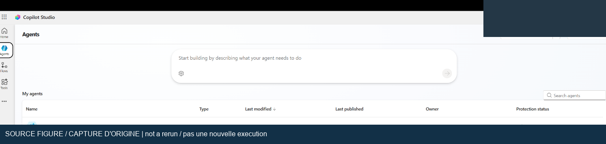
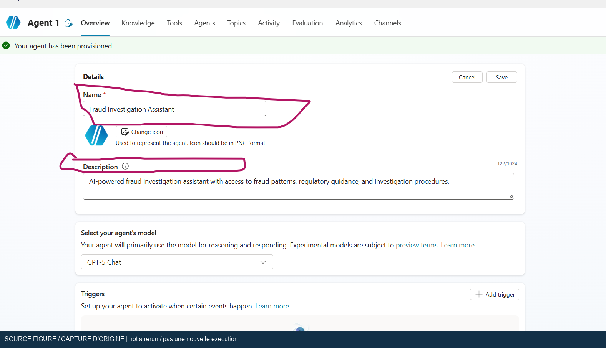
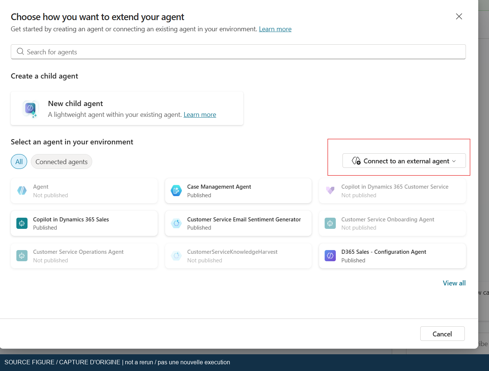
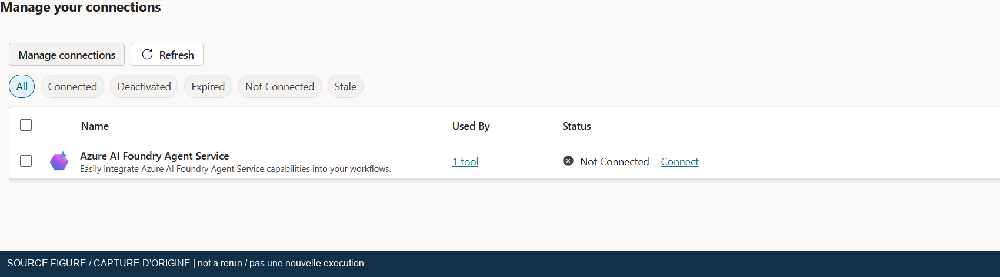

## Purpose and evidence status

[Lab index](index.md) | [Français](../fr/lab-06.md) | [Search retrieval](lab-05.md) | [Infrastructure review](lab-05-1.md)

Separate four responsibilities: Copilot Studio handles the conversation; a connected Foundry agent performs deeper work; a Search knowledge base retrieves passages from multiple sources; a model writes an answer. Model Context Protocol (MCP) exposes the retrieval tool to the Foundry agent. Allow 120–180 minutes after an administrator provides supported resources and reviews the compatibility changes.

### Current reconciliation, 2026-10-26

The [T017 acceptance crosswalk](../assets/runtime-2026-10-26/lab6-acceptance-crosswalk.json)
delivers the documentary substep, not whole-lab runtime completion. F6-01/02/03
remain historical offline PASS; F6-04 is PASS and F6-05 is PASS at document level
with the displayed-excerpt limit below. F6-06/07/08/12 remain PARTIAL;
F6-09/10/11 remain NOT_RUN. At the initial offline checkpoint on 2026-10-26,
F6-04/05 were NOT_RUN; that reconciliation submitted zero questions/live attempts.

The [two exact native checks](../assets/runtime-2026-10-26/lab6-intake-local-native.json)
are now complete: two questions, one per fresh conversation, no preflight questions
or replay. F6-04 completed clarification with `activityProcessed=true`, no retrieval
or Foundry/MCP evidence calls (0.118 seconds from server receipt to final reply).
F6-05 completed one local `SearchAndSummarizeContent`, a noncancelled
`DynamicPlanFinished` and no Foundry/MCP evidence calls (70.618 seconds).
Document-level support for Account Takeover is proven in another actually retrieved
chunk of the same source; the displayed citation excerpt lacks the ATO row.
Exact citation-chunk support, excerpt fidelity and global citation quality are not
proven. This frozen prospective MCP-adapted existing original specialist
configuration uses actual Ready MIT publisher Markdown, not historical baseline
equivalence; original DOCX ingestion remains Error. Postflight root/settings,
instruction digest, source versions, publisher hashes and archives were unchanged,
without a second full component export. The live checks edited/published nothing
and created no resources. Publication submits no questions. No further export or
secret is needed for these two completed checks.

The original specialist's native **4/4** is separate from both the verified
diagnostic extension and the data-only MCP candidate. Corpus quotation matches
do not independently prove the specialist's underlying native retrieval-tool
membership. The [previous candidate 11/11](../assets/runtime-2026-10-25/mcp-native-eleven-case-matrix.json)
includes one explicit retry. The [current post-control candidate is 10/11](../assets/runtime-2026-10-25/mcp-native-control-repair-regression.json):
case 9 failed twice, without a proven root cause or third replay.
Neither cohort substitutes for exact F6 guide cases.

Source-free intake, local lookup, grounded expertise, multi-source work, three
datasets and cleanup guidance are source-backed. Syntax/layout checks, focused
F6 prompt variants, French/private-customer abstention, denied identity and
missing-Activity tests are guide validations, not newly universal original gates.
F6-05 wording also appears in accessible setup instructions; the initial offline
checkpoint did not prove execution. The new receipt closes only these two checks.
Other unrun guide wording limits reproducibility; it does not erase related
verified source behavior or require a whole-lab restart.

Additional requirements in the unreadable protected main source remain UNKNOWN;
no bypass or reconstruction occurred. Native annotation arrays, publisher URLs
and verbatim quotations are not universal original requirements. Preserve both
historical quotation failures and later quotation passes in their tested scopes.
Lab 5 Search denial is not F6 Foundry denial; a blueprint-ID HTTP 400 is not the
missing-Activity negative/repair test.

T003/T004's [hosted version 3 repair passed 3/3](../assets/runtime-2026-10-23/hosted-version3-regression.json).
The [latest hosted version 5 remains retained](../assets/runtime-2026-10-26/agent-endpoints-readonly.json),
with Activity/Invocations, but native delivery is not certified. Older cleanup
receipts do not prove current zero resources or final billing.
T017 remains unchecked and the workshop remains incomplete. Resume only a
genuinely unresolved criterion with its approved scope and supported prerequisite.

### Earlier checkpoints, not the current verdict

> [!WARNING]
> At this earlier checkpoint, the manual external connection is **Connected** and its Foundry agent
> passes direct Responses inference. After an initial no-reply failure, one
> instrumented native Activity test received the genuine reply in **6.864 seconds**.
> The diagnostic observer was deleted. Original-source reconciliation removed
> assistant-added native-annotation/publisher-URL gates; genuine retrieval joins
> 24 originals. Source-provenance metadata repair now gives **4/4 unchanged
> notebook questions passing extractive backend content and attribution**.
> A later independent native regression passes **4/4 original questions** after
> a targeted per-bullet citation correction in version 4. One combined delivery
> was unacknowledged; one bounded reattempt passed. The earlier lost batch remains
> historical, not reconstructed. Full native/local/hybrid coverage and unrestricted
> narrative synthesis are not certified.
> Original quick-reference DOCX ingestion failed, but the verified MIT publisher
> guide now reaches **Ready**. The publisher notebook matches the original's
> 24 records and four questions; no unreadable DOCX equivalence is claimed.
> A real natural CTR answer cites
> the local source without Foundry. After an expanded QA failure and targeted
> rework, the first three exact scenarios receive source-free intake and complete
> CTR/SAR replies. Full eleven-scenario coverage remains a separate acceptance check.
> A subsequent fresh-session R2 attempt stops before scoring on an unacknowledged
> Hello preflight. Later readback exposes and repairs an empty intake definition;
> genuine topic/action traces now prove the saved clarification executes.
> Native delivery recovers with verified startup readiness and the normal Send
> button, not an assumed external-browser success. All eleven R3 questions receive
> responses; six early child-stage captures require whole-parent revalidation.
> See the [persistence recovery](backend-live-2026-10-20.md#intake-persistence-and-native-delivery-recovered).
> [Earlier complete-turn evidence](backend-live-2026-10-20.md#complete-native-turns-recovered-acceptance-still-incomplete)
> covers all eleven original questions with the expected routes across named
> rounds. Quotation fidelity and full detailed-example coverage still fail
> in that cohort. The failed incident variant was discarded; the prior configuration
> is restored and checked once. This is not a completed workshop.
> A proven direct rate limit was corrected to Standard capacity 26.
> Search Basic, embeddings, account/project and both agents remain **live**; their expiry
> tag is not automatic cleanup. Earlier deletion receipts do not cover this run.
> See the [current recovery boundary](backend-live-2026-10-20.md#native-categories-recovered-and-licensed-local-knowledge-ready).

> [!IMPORTANT]
> Actual dependency testing now supplements the initial syntax-only review.
> The current SDK environment failed one of 15 imports: the reasoning-effort class
> used by cell 14 moved out of `indexes.models` in Search SDK 12.0.0. An isolated environment restored
> from the source pins passed all 15 imports. The 24 inline records also passed
> local field/ID checks. Actual Free-plan GA retrieval subsequently indexed all
> 24 records across three sources and returned 2 specific, 17 cross-source and
> zero unsupported passages. All 19 returned passages matched originals exactly.
> A later paid run generated all 24 embeddings, verified stored vectors and
> source fields, and matched 22 retrieved passages exactly. Direct authenticated
> MCP retrieval and a single-source Foundry-agent tool call also passed.
> Cross-source final exact quotations failed; Activity was configured but no
> Activity/Copilot conversation ran. See the
> [Foundry execution results and current API walkthrough](foundry-live-2026-10-20.md).

The later approved recovery produced **3/3 exact source quotations in each
of two runs**, but native citation fields were blank. Its unsupported model
abstained despite seven off-topic retrieved documents. All four sequential
disposable environments were deleted and independently verified absent.
See the [recovery boundary](foundry-live-2026-10-20.md#8-approved-quotation-recovery-and-remaining-citation-failure);
this does not certify connected Copilot/Activity acceptance.
The final supported-format test still returned zero native annotations and
invented all three document URLs. Its source sentences remained faithful
apart from Markdown trailing spaces. That fifth test environment was also
deleted; all five groups and ten account/Search ARM reads were independently
verified absent/404. No further repair prompting followed.

Copilot Studio became usable for the actual Lab 1 retrieval/email run, then Preview
became intermittently blank again. A later explicit-subscription inventory found
seven unrelated Application Insights components, correcting the initial absence
claim. They were not repurposed. The isolated Free Search resources were deleted
after testing. The subsequent paid Foundry account, project, model deployments,
Search service and MCP connection were exercised and then deleted, with group
absence independently verified. At that earlier cleanup checkpoint, a future
connected-agent run needed a new approved environment and no endpoint was
intentionally retained. Later retained resources, including hosted version 5,
supersede that inventory boundary.

The workshop's protected text, notebook code and embedded examples are not republished. The four figures below come only from the unprotected supporting Copilot setup document, with sensitive details redacted. They are historical source screenshots, not newly captured execution evidence.

## 1. Confirm prerequisites and choose the right experience

At the earlier checkpoint, the [verified-rendering extension](backend-live-2026-10-20.md#deterministic-source-verification-extension)
passes 33 tests and four real backend cases, but its native diagnostic fails
with a BotServiceRbac tenant-ID authorization error. It is not a certified
replacement for the working specialist. Its saved Inactive state is now
independently verified. A separate authenticated direct Activity request reached
hosting but exposed an SDK incompatibility; the tested local repair has not
been deployed at that point. T003/T004 subsequently deployed the hosted repair
and passed 3/3 version 3 checks; version 5 is now retained. Native certification
remains open. The no-authentication-change statement applies to that checkpoint,
not the later separately recorded diagnostic cohorts.

The later actual top-level Foundry connection attempt used a real owned project
endpoint but failed on the hosting browser's blocked consent pop-up. Exactly
one attempt ran, with no consent or saved Foundry connection. No connected
Activity conversation was counted. That project's disposable environment was
then deleted with independent absence checks. See the
[actual authentication failure](backend-live-2026-10-20.md#foundry-formal-authentication-remained-blocked)
and [cleanup](../assets/runtime-2026-10-20/search-accesskey-cleanup.json).

A later [external Edge recovery](backend-live-2026-10-20.md#external-edge-foundry-recovery-stopped-before-submission)
reached the real Entra form, but native endpoint input remained empty and Create
disabled. No authentication submission occurred. This is an input-automation
blocker, not an external authentication rejection or a connected-agent pass.
The manual handoff was unavailable; no model or inference was added.
Fresh native list readback verified no owned connection. The
[auth-only cleanup](../assets/runtime-2026-10-20/foundry-external-auth-cleanup.json)
verified project/account/group 404; a soft-deleted account recovery record
remains without purge. A future attempt needs a fresh approved endpoint.

An additional [no-resource native input check](backend-live-2026-10-20.md#additional-native-input-prerequisite-remained-blocked)
could not foreground the browser or open the form. It stopped before testing
Legacy input, with zero authentication submissions. A later
[shared integrated-browser check](backend-live-2026-10-20.md#shared-browser-recovered-form-input-not-external-authentication)
opened the form through ordinary keyboard activation and verified harmless
endpoint input, then canceled. This does not prove external Edge recovery or
resolve the integrated-browser authentication pop-up restriction.

After the approved trial extension, the isolated Standard draft's actual
Microsoft Foundry connection dialog offered **Microsoft Entra ID User Login**
and required an Azure AI Project Endpoint, without a key field. The official
connection requirements still demand an Activity-capable new-portal agent.
The downstream agent-ID picker and conversation were not exercised during
this read-only inspection. This establishes an available keyless connection
surface, not a connected-agent pass. See the
[observed contracts](../assets/runtime-2026-10-20/advanced-integration-contracts.json).

1. Complete the standard-agent creation prerequisite and [Lab 5](lab-05.md), or obtain equivalent approved Search infrastructure.
2. Open the [standard agents experience](https://learn.microsoft.com/en-us/microsoft-copilot-studio/agents-experience/switch-experiences). The Knowledge, Agents and test-pane instructions below target the standard harness.
3. Treat orchestration separately: a standard agent can use generative or classic orchestration. Use generative orchestration for metadata-driven connected-agent selection, or explicitly invoke the connected agent from a topic when testing a deterministic route.
4. Confirm that the Copilot environment and Foundry project belong to the same intended Microsoft Entra tenant. Use the same organizational identity for the workshop where policy permits. Matching tenants alone does not grant access.
5. Ask the administrator for a new Microsoft Foundry project, a supported model deployment, an embedding deployment and Azure AI Search in a region supporting the chosen retrieval features.
6. Confirm user permissions for Search object management, document loading and retrieval. The identity used by the Foundry connection needs retrieval permission on Search; your successful interactive query does not prove the project identity can query.
7. Confirm Foundry authoring and connection-management roles. The current MCP guide lists Foundry User for agents and Foundry Project Manager for an MCP authentication connection; older portals may display the former Azure AI role names.
8. Approve model/search usage costs, source-data permissions, network paths and preview-feature use before execution.



Figure 1. Redacted original supporting-setup screenshot, `image1.png`. Use it for orientation only; choose the current standard-agent experience rather than assuming the historical landing page is unchanged.

## 2. Inventory the notebook package and fix path assumptions

The inspected package contains a root `requirements.txt`, root `.env.example`, `notebooks\foundry-IQ-agents.ipynb`, `data\quick_reference_guide.docx`, and a supporting setup document. These private source assets are not copied into this repository.

1. Obtain the authorized complete lab folder from the instructor. Keep it separate from this documentation checkout.
2. Confirm the dependency and environment files are at the lab root, not inside `notebooks`.
3. Confirm the supplied quick-reference file is `data\quick_reference_guide.docx`. The setup source mentions `data\copilot_knowledge\quick_reference_guide.md`, but that file is absent from the inspected package.
4. Do not wait for 24 separate data files. The notebook contains three inline document lists of eight entries each. The 24 items are embedded sample records, not an automatically synchronized enterprise corpus.
5. Copy `.env.example` to a private `.env` only in an approved working copy. Never place secrets or private endpoints in a shared notebook output.
6. Review the notebook working directory. Its environment loader reads `.env` from the parent of the current directory, not reliably from the notebook file's own location. A kernel started at the lab root can therefore look one directory too high.
7. Set the kernel's working directory to the authorized `notebooks` folder before loading configuration, or have the instructor review a path correction in the working copy. Verify the resolved path without printing environment values.

For an authorized upstream-source alternative, obtain the
[publisher's Markdown guide at the verified revision](https://github.com/Azure/Copilot-Studio-and-Azure/blob/e9ecd00dba2c25dbc8306b5be6818d22645607a3/labs/2.4-microsoft-foundry-agentic-retrieval/data/copilot_knowledge/quick_reference_guide.md).
Preserve publisher attribution and the MIT notice, compare the publisher notebook
with your actual lab revision, and label the source adaptation. Do not rename,
decrypt or reconstruct an unreadable DOCX. The
[actual licensed-source ingestion](backend-live-2026-10-20.md#actual-publisher-guide-ingested)
reached Ready in the isolated draft; it does not establish DOCX byte equivalence.

| Variable                          | Meaning and validation                                                                                           |
| --------------------------------- | ---------------------------------------------------------------------------------------------------------------- |
| `AI_FOUNDRY_PROJECT_ENDPOINT`     | Project data-plane endpoint from the intended new Foundry project                                                |
| `AZURE_AI_MODEL_DEPLOYMENT_NAME`  | Actual approved model deployment name, not just the catalog model name                                           |
| `AZURE_AI_SEARCH_ENDPOINT`        | Intended Search service endpoint; the validation message incorrectly abbreviates this to `AZURE_SEARCH_ENDPOINT` |
| `AZURE_OPENAI_ENDPOINT`           | Embedding-resource endpoint appropriate for the embedding client                                                 |
| `EMBEDDING_MODEL_DEPLOYMENT_NAME` | Deployment producing the exact dimensions expected by the schema                                                 |
| `PROJECT_RESOURCE_ID`             | Full Azure resource ID of the actual project type used for connection creation                                   |

Never interchange the project endpoint, Search endpoint, ARM resource ID and agent identifier. They serve different APIs.

## 3. Resolve the compatibility checklist before Run All

> [!WARNING]
> Do not select Run All on a shared Search service. Early notebook cells delete an existing knowledge base, knowledge sources and indexes with the configured names. Use a disposable approved namespace or service, review the deletion targets, and require instructor approval before those cells.

| Inspected item                                                                                                    | What it means                                                                                | Required decision                                                                                                                                         |
| ----------------------------------------------------------------------------------------------------------------- | -------------------------------------------------------------------------------------------- | --------------------------------------------------------------------------------------------------------------------------------------------------------- |
| `azure-ai-projects==2.0.0b3` and `azure-search-documents==11.7.0b2`                                               | Preview SDK snapshots are pinned                                                             | Reproduce only in an approved isolated environment, or migrate a working copy using current official samples; no compatibility claim follows from parsing |
| Notebook setup prints a readiness message                                                                         | The first code cell does not install or verify packages                                      | Check the actual environment; a printed success icon is not evidence                                                                                      |
| Embedding default `text-embedding-3-large`, index dimension `3072`                                                | It differs from Lab 5.1's 1,536-dimensional deployment                                       | Provision a compatible approved model, or review all schema/model/dimension changes together                                                              |
| Chat default `gpt-4o`                                                                                             | A default string is not a deployment guarantee; GPT-4 versions have lifecycle constraints    | Select a supported available deployment and rerun quality tests                                                                                           |
| Embedding client API `2024-02-01`                                                                                 | This API is separate from Search and Foundry agent APIs                                      | Verify compatibility with the selected embedding model; do not replace every API version globally                                                         |
| Search MCP URL uses `2025-11-01-Preview`                                                                          | Historical preview API spelling and contract                                                 | Align endpoint spelling, SDK and object schema with a supported version; do not assume capitalization or version substitution is sufficient               |
| Minimal reasoning and extractive output                                                                           | Search returns retrieved material without LLM query planning in this configuration           | Do not advertise automatic multi-step Search planning as demonstrated                                                                                     |
| ARM connection request declares `Microsoft.MachineLearningServices/workspaces/connections` with a preview version | A hub/workspace-era resource declaration may not match a new Foundry project's resource type | Review the actual project resource ID and current connection procedure before sending the request                                                         |
| Connection failure only prints a warning                                                                          | Later cells can run with a missing connection                                                | Stop on a non-success status; verify the connection independently                                                                                         |
| MCP `require_approval` is `never`                                                                                 | The retrieval tool is allowed without an approval prompt                                     | Limit the tool to the approved read-only Search endpoint and review policy; never extend this setting to arbitrary write tools                            |
| Agent instructions ask for source-name labels                                                                     | A label written by the model is not proof of a retrieved citation                            | Inspect tool results and supporting passages, not only the final answer                                                                                   |
| Final cleanup statements are commented                                                                            | Running the last cell does not delete resources                                              | Perform a separately reviewed cleanup and verify actual deletion                                                                                          |

The [current knowledge-base guide](https://learn.microsoft.com/en-us/azure/search/agentic-retrieval-how-to-create-knowledge-base) distinguishes stable `2026-04-01` minimal/extractive retrieval from `2026-08-01-preview` features such as LLM planning and answer synthesis. The [API-version list](https://learn.microsoft.com/en-us/rest/api/searchservice/search-service-api-versions) still lists `2025-11-01-preview`; its presence does not prove compatibility with these pinned Python clients.

An outer Foundry model can decide how to call a tool even when Search uses minimal retrieval. Those are different orchestration layers. No relevance uplift, research-time saving or compliance improvement is established by the local material.

Use the official [agentic retrieval quickstart](https://learn.microsoft.com/en-us/azure/search/search-get-started-agentic-retrieval), [project connections guide](https://learn.microsoft.com/en-us/azure/foundry/how-to/connections-add) and [MCP tool guide](https://learn.microsoft.com/en-us/azure/foundry/agents/how-to/tools/model-context-protocol) as compatibility references. Do not copy external credentials or grant subscription-wide access to bypass a mismatch.

### Tested GA substitute for the retrieval checkpoint

The live run used Search REST API `2026-04-01` instead of migrating the
preview notebook's entire SDK stack. The request shapes below reproduce that
contract; object names are illustrative. The temporary service was deleted.
Use only an approved disposable service and authorized local workshop data.
Do not run these PUT requests against existing shared objects: PUT can replace
their definitions. This route does not create a Foundry agent or MCP connection.

1. Load the three original eight-record lists into three separate indexes.
   Each record needs its original `id`, `title` and `content`. Configure a
   semantic configuration named `training-semantic` using title and content;
   verify eight successful uploads per index and 24 total. No generated
   embeddings or external model deployment are needed for this substitute.
2. For each index, send `PUT /knowledgesources/<source-name>?api-version=2026-04-01`
   to the approved Search endpoint with JSON content and approved authentication.
   The source name in the path and body must match. Change both source and index
   names for each of the three sources.

```json
{
  "name": "fraud-ks",
  "kind": "searchIndex",
  "searchIndexParameters": {
    "searchIndexName": "fraud-index",
    "semanticConfigurationName": "training-semantic",
    "sourceDataFields": [
      {"name": "id"}, {"name": "title"}, {"name": "content"}
    ]
  }
}
```

3. Send `PUT /knowledgebases/workshop-training-kb?api-version=2026-04-01`.
   Require HTTP 200 or 201 and verify all three returned source names.
   Do not add the old preview-only reasoning-effort or output-mode properties.

```json
{
  "name": "workshop-training-kb",
  "description": "Isolated workshop retrieval test",
  "knowledgeSources": [
    {"name": "fraud-ks"},
    {"name": "compliance-ks"},
    {"name": "investigation-ks"}
  ]
}
```

4. Send `POST /knowledgebases/workshop-training-kb/retrieve?api-version=2026-04-01`
   with the following body. Require HTTP 200. Preserve private raw responses
   for comparison, but publish only sanitized assertions.

```json
{
  "intents": [
    {"type": "semantic", "search": "fraud investigation compliance"}
  ],
  "knowledgeSourceParams": [
    {"knowledgeSourceName": "fraud-ks", "kind": "searchIndex"},
    {"knowledgeSourceName": "compliance-ks", "kind": "searchIndex"},
    {"knowledgeSourceName": "investigation-ks", "kind": "searchIndex"}
  ]
}
```

5. Check the top-level `response`, `activity` and `references` fields.
   Parse the response's text content as JSON passages containing `ref_id`,
   `title` and `content`. Match references to passages by reference identifier,
   then join each reference's `docKey` to the corresponding original source
   record. Require exact title and content equality; do not rely on `sourceData`,
   which was null in the observed references.
6. Repeat with the first fraud record's exact title, then
   `zqxvunicornasteroidorchard`. The observed run returned 2, 17 and 0 passages
   for the specific, cross-source and unsupported queries respectively.
   These are recorded observations, not guaranteed future ranking counts.
   The cross-source case covered all three sources, and all 19 returned passages
   matched originals. Stop on missing fields, failed uploads, non-success HTTP
   status, source mismatch or altered text.
7. Delete only the session-owned disposable resources after collecting evidence,
   then independently verify their absence. The
   [sanitized cloud results](../assets/runtime-2026-10-19/free-cloud-results.json)
   record the actual run and cleanup.

This proves multi-source minimal/extractive Search retrieval. It does not prove
LLM query planning, answer synthesis, generated semantic embeddings, Foundry
tool invocation or a Copilot connected-agent conversation.

## 4. Execute in checkpoints and distinguish the tested layers

The paid continuation executed the embedding, Search, MCP and Foundry-agent
checkpoints below, with mixed acceptance results. Its
[current API walkthrough](foundry-live-2026-10-20.md) records the exact substitutions,
the single-source success and the failed cross-source quotation check.
The original Copilot connected-agent sequence remains unexecuted.

1. Have the instructor prepare a dedicated environment and review the pinned dependencies or a tested migration. Install only in that approved environment, never in a shared system interpreter.
2. Select that environment as the notebook kernel. Verify package versions before running any cell; syntax success on Python 3.14.3 is not certification of that runtime for the old dependency set.
3. Load configuration and confirm that all six required settings resolve. Authenticate the interactive identity through the approved Azure CLI process. Do not print tokens.
4. Inspect the three inline lists. Their counts must be `8`, `8`, and `8`. Keep their content as training material, not financial or legal advice.
5. Review the existing names targeted by the reset/delete cell. Stop if an object belongs to another session.
6. Create the three indexes in the disposable scope. Inspect their keys, searchable text, vector dimensions and semantic configurations.
7. Generate embeddings and upload records. Inspect each per-document upload result; a nonthrowing batch call can still contain failed items. Verify exactly eight documents in each untouched test index, 24 total.
8. Create one knowledge source per index, then a knowledge base referencing all three. Confirm returned definitions rather than trusting a print statement.
9. Test retrieval directly before creating the agent. Check returned passages, source identifiers and access control. A populated index alone does not prove the knowledge-base endpoint works.
10. Create the approved project MCP connection using the current project-specific method. Confirm target, Search token audience, identity and retrieval rights. Stop immediately if connection creation fails.
11. Create a Foundry agent version with the approved model and a narrow retrieval-tool allowlist. Record the stable agent name/identifier and active version privately.
12. Test the Foundry agent directly with one single-source question and one cross-source question. Record tool calls and actual source references. Use a fresh conversation when testing independent cases so previous answers do not contaminate results.
13. Keep conversation/thread identifiers and full request/response bodies out of public evidence. Retain sanitized assertions and timing instead.

## 5. Enable the protocol required by Copilot Studio

The current [Foundry connected-agent procedure](https://learn.microsoft.com/en-us/microsoft-copilot-studio/add-agent-foundry-agent) requires the **Activity protocol** endpoint. New Foundry agents expose Responses and A2A by default; that alone is insufficient.

The paid run enabled Activity and preserved Responses, pinned version 3, and read
back Entra-only authorization successfully. That configuration result is not an
Activity conversation or proof of the channel-specific authorization required by
Copilot or Teams.

1. Confirm the agent was created in the new Foundry portal/project experience. The current connector documentation warns that agents from the previous portal can produce `404 - Version not found`.
2. Follow [Configure and share your agent](https://learn.microsoft.com/en-us/azure/foundry/agents/how-to/configure-agent) to enable Activity programmatically through the supported REST API or SDK. This is a separately reviewed configuration change, not a portal toggle available in the historical screenshot.
3. Confirm the authorized inbound identity and appropriate authorization scheme. Current role names include Foundry Agent Consumer for invocation and Foundry User for authoring.
4. Verify the stable endpoint's active version. Pin the intended version if later notebook reruns must not change the connected behavior automatically.
5. Do not infer failure merely because the portal Endpoints view still shows only Responses and A2A; the official Copilot guide documents that UI omission.
6. Record a successful Activity-protocol test before calling the integration complete.

## 6. Configure the standard Copilot Studio agent

1. In the approved environment, create a disposable standard agent with a generic training name and description.
2. Save its details before adding knowledge or a connected agent.



Figure 2. Redacted original supporting-setup screenshot, `image4.png`. It illustrates the Details area, not a successfully configured agent in this review.

3. Add an approved quick-reference file to Knowledge. Use the actual authorized DOCX if permitted, or author a new short training file that defines `ATO` as `Account takeover`. Do not copy private contacts or unverified regulatory tables into a public fixture.
4. Wait for knowledge status `Ready`. Disable web search and remove unrelated sources during controlled evaluation.
5. Write original routing instructions: clarify vague requests first; answer supported glossary lookups from the quick-reference file; use the connected agent for detailed scenarios; disclose missing evidence; require human review before any real-world decision.
6. In Agents, choose Add an agent, Connect to an external agent, and Microsoft Foundry.



Figure 3. Redacted original supporting-setup screenshot, `image10.png`. The historical connection menu is orientation material; current availability depends on the standard-agent environment.

7. Create or select the authorized Foundry connection using the project endpoint. Supply the identifier expected by the current connector for the stable agent, and give it a description that distinguishes detailed retrieval from simple glossary lookups.
8. The historical setup describes the agent-name string as “Agent Id.” The notebook prints name, version and ID separately. Verify the current connector contract and actual agent metadata; do not enter a guessed UUID or an old classic-assistant ID.
9. Save and test. Inspect the activity map to prove whether the local knowledge source or connected agent was used.
10. Keep the agent unpublished unless a separate approved exercise requires publication. Saving and testing does not authorize a production release.

## Acceptance matrix and exact assertions

Use only fictional, nonidentifying situations. Financial-domain content in the authorized notebook is sample material, not current legal guidance. Do not grade answers against hardcoded reporting thresholds or the age of a fictional customer.

Results below are reconciled on **2026-10-26**. F6-01/02/03 PASS means the dated
offline assertion passed, not runtime acceptance. F6-04/05 PASS covers only the
two native checks above; F6-05 has document-level support, not excerpt fidelity.
NOT_RUN concerns exact guide execution;
PARTIAL preserves related evidence without substituting another question or route.
The [crosswalk receipt](../assets/runtime-2026-10-26/lab6-acceptance-crosswalk.json)
provides provenance, public evidence pointers and limits for every row.

| ID    | Input or check                                                        | Expected route and measurable assertion                                                  | Current result                                             |
| ----- | --------------------------------------------------------------------- | ---------------------------------------------------------------------------------------- | ---------------------------------------------------------- |
| F6-01 | Parse all notebook code cells without execution                       | `11` cells parse; zero syntax errors                                                     | PASS: historical Python 3.14.3 syntax only                 |
| F6-02 | Inspect inline document lists                                         | Exactly `8 + 8 + 8 = 24` records                                                         | PASS: historical static inventory                          |
| F6-03 | Inspect package layout                                                | Root requirements/environment files and actual DOCX present; referenced nested MD absent | PASS: historical layout, not ingestion                     |
| F6-04 | “Hello, I need help reviewing a case”                                 | Clarification requested; `0` connected-agent calls                                       | PASS exact native intake; frozen prospective configuration |
| F6-05 | “What does ATO mean?”                                                 | Uploaded glossary supports `Account takeover`; `0` connected-agent calls                 | PASS document-level, Ready Markdown adaptation; displayed citation excerpt lacks ATO, exact chunk support unproved |
| F6-06 | “Which signs should an analyst examine for account takeover?”         | Connected-agent call and retrieval-tool call; supporting pattern passage present         | PARTIAL: related expertise; exact route/tool join unproved |
| F6-07 | “Compare the evidence-handling steps with the relevant policy source” | At least two applicable source groups supported in tool results; no invented rule        | PARTIAL: related multi-source passes, not exact comparison |
| F6-08 | “What did our private customer do yesterday?”                         | No invented private events; missing access/evidence acknowledged                         | PARTIAL: backend abstention, not exact native turn         |
| F6-09 | Repeat F6-06 in French in a fresh conversation                        | Same supported meaning and source lineage; no assumption of exact wording                | NOT_RUN: no exact French Lab 6 evidence                    |
| F6-10 | Remove access from an approved test identity                          | Access denied; no unauthorized passage in the answer                                     | NOT_RUN: Lab 5 Search denial does not substitute           |
| F6-11 | Connect an agent without Activity in an isolated negative test        | HTTP `400` with Activity-protocol error; repair and retest                               | NOT_RUN: blueprint error does not substitute               |
| F6-12 | Verify cleanup                                                        | Training connection, agent version, knowledge objects and indexes removed as approved    | PARTIAL: historical deletion passes; hosted v5 retained    |

For each live case, record actual route, source IDs, assertion pass/fail, citation support, latency and sanitized error. Report routing accuracy as correctly routed cases divided by executed routing cases. Report citation support separately. A model-authored source label or a successful HTTP response cannot substitute for a retrieved passage.

## Troubleshooting and evidence capture



Figure 4. Redacted original supporting-setup screenshot, `image14.png`. It illustrates connection management. It does not prove an authenticated connection exists in the review session.

| Symptom                                               | Check and next action                                                                                                           |
| ----------------------------------------------------- | ------------------------------------------------------------------------------------------------------------------------------- |
| ImportError for a knowledge-base or agent model class | Confirm exact installed SDK versions and chosen API generation; do not assume all beta versions expose the same classes         |
| Configuration missing despite a populated `.env`      | Check the kernel working directory and parent-directory loader; correct the path in an approved working copy                    |
| Missing `AZURE_SEARCH_ENDPOINT` message               | The notebook reads `AZURE_AI_SEARCH_ENDPOINT`; distinguish the misleading message from the real variable                        |
| Embedding length mismatch                             | The notebook expects `3072`; the Lab 5.1 deployment produces `1536`; reconcile schema and model                                 |
| Connection warning then later tool failure            | Stop after the first failing connection request; confirm actual resource type, permission and connection existence              |
| Search 403 only from the agent                        | Check the project/connection identity, Search data-reader role, token audience and network reachability                         |
| Connector 400 mentions Activity                       | Enable Activity through the supported SDK/REST procedure; Responses/A2A alone are not sufficient                                |
| `404 - Version not found`                             | Check new versus previous Foundry project/agent experience and the actual stable agent identifier                               |
| Connected agent never selected                        | Improve mutually exclusive descriptions, confirm standard-agent orchestration, inspect the trace or test an explicit topic call |
| Unexpected source or answer                           | Use a fresh conversation, inspect retrieval, remove overlapping local knowledge and require source support                      |
| Cleanup cell prints guidance but resources remain     | Its deletion statements are commented; use the approved cleanup procedure                                                       |

Capture new live screenshots only after obtaining access and approval. Redact identities, tenant names, private URLs, record content and credentials. Label each new capture with date, action and observed result. Never present the four historical figures as evidence of tests F6-04 through F6-12.

## Cleanup and completion boundary

1. Remove or disconnect the training Foundry agent from Copilot Studio before deleting its backend objects. Preserve shared connections.
2. Delete only the training agent versions and conversation artifacts approved for deletion. Check the stable agent's active version before removing any version.
3. Remove the dedicated MCP project connection if no other agent uses it.
4. Delete the training Search knowledge base before the knowledge sources it references; delete those sources before their dedicated indexes.
5. Confirm the three test indexes and their 24 sample records are gone. Delete only the files or knowledge entries created for this training session.
6. Close local clients/kernel sessions and remove private `.env` files and sensitive outputs according to the approved retention policy.
7. Remove dedicated infrastructure only with the owner-approved [Lab 5.1 cleanup plan](lab-05-1.md). Search, model and Foundry resources can continue to incur charges after notebook objects are deleted.

Static review, dependency restoration and substantial cloud checkpoints are complete.
The [paid Foundry record](foundry-live-2026-10-20.md) distinguishes passing transport
and single-source grounding from failing cross-source final quotations.
The earlier no-Activity, navigation/IndexedDB and disposable-cleanup observations
describe their own checkpoint, not all later runs or invalid user credentials.
Later specialist native 4/4, hosted version 3 repair and candidate evidence remain
distinct. The current candidate is 10/11, not the earlier 11/11 cohort.
Use the reconciled F6 table for exact-versus-related gaps and the retained-v5
cleanup boundary. T017's documentary substep is delivered, not runtime completion;
do not certify the whole lab or restart already verified work.
