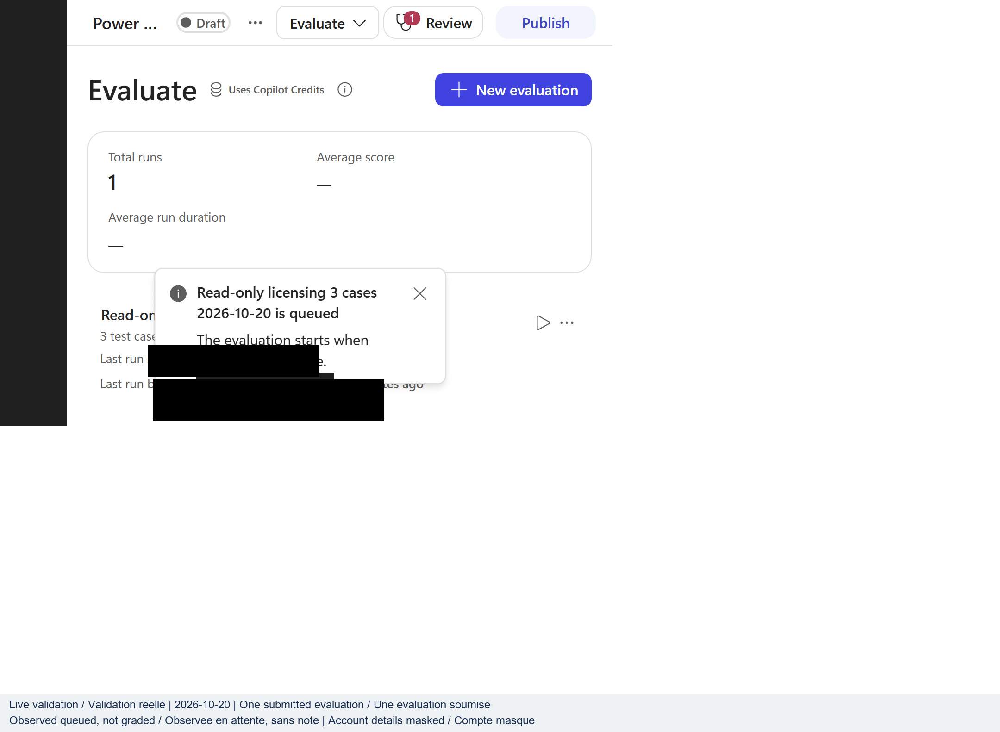

## Résultat et limites

[Tous les labs](index.md) | [English](../en/backend-live-2026-10-20.md) | [Registre réel](live-rerun-2026-10-19.md)

L'échec du portail n'a pas arrêté l'investigation. Les appels authentifiés
Power Platform et Dataverse ont réussi. Le CLI Power Platform officiel a cloné
l'agent de l'atelier, ses deux outils et son PDF de licences téléversé.
Aucune configuration d'agent n'a été modifiée ou publiée. Aucun courriel n'a
été renvoyé et aucune nouvelle ressource Azure payante n'a été créée.

Cela prouve un parcours d'administration pris en charge, pas un parcours de
conversation complet. L'agent sauvegardé utilise le nouveau moteur CLI/GitHub
Copilot. Son clone réussi ne prouve pas l'exécution des rubriques du moteur
standard, des connaissances Search, de la télémétrie, des prompts BYOM ou des
agents Foundry connectés.

## Observations réelles des services

| Contrôle | Résultat observé | Limite d'acceptation |
|----------|------------------|---------------------|
| Environnement Power Apps prévu | HTTP 200 ; provisionnement réussi | Découverte de l'environnement uniquement |
| Dataverse `WhoAmI` | HTTP 200 | Appelant identifié, sans tous les droits de service |
| Agent connu de l'atelier | HTTP 200 | Agent et configuration exportés en privé |
| Composants limités à cet agent | Quatre enregistrements ; aucune page suivante | Deux outils connecteurs, un fichier joint et un composant de paramètres |
| Définitions sérialisées des composants | YAML dans `data` ; `content` null | Lecture des vraies définitions, sans confondre contenu null et outils absents |
| Authentification du CLI officiel | Identité Azure par défaut authentifiée et connectée | Connexion Azure CLI existante réutilisée ; aucune nouvelle inscription d'application |
| Clone officiel de l'agent | Terminé dans un chemin court | Administration/export réussis, pas un nouveau test de conversation |
| Découverte du point Direct Line | HTTP externe 400, 403/code 1002 imbriqué : `Bot does not belong to the tenant.` | Aucun point utilisable ni conversation ; cause non établie |
| Découverte des jeux d'évaluation maker | HTTP 403, `InsufficientDelegatedPermissions` ; permission `CopilotStudio.MakerOperations.Read` absente | Aucune exécution d'évaluation démarrée |

Le recognizer stocké est `CLICopilotRecognizer` et le modèle de création est
`cliagent-1.0.0`. L'authentification intégrée reste activée. Les deux outils
exportés sont **Search for users (V2)** et **Send an email (V2)**, avec
authentification de l'appelant. Identités et références de connexion restent privées.

La liste du CLI affiche l'état du composant Dataverse `Published`, tandis que
le champ `publishedon` de l'agent est null. Aucune de ces observations n'a été
prise pour la preuve d'un canal publié utilisable. L'agent existant n'a pas
été publié pour faire réussir le test.

## Restaurer le CLI officiel sans affaiblir les stratégies

1. Vérifiez l'installation existante avant de modifier les dépendances.
   Ici, `pac` était absent du PATH.
2. Essayez la distribution .NET documentée par Microsoft dans un chemin de
   session. NuGet v3 a échoué en TLS ; l'essai officiel v2 s'est bloqué et a
   été arrêté. Validation des certificats et réglages proxy sont restés intacts.
3. Utilisez la distribution officielle de l'extension VS Code Power Platform
   Microsoft lorsque son CLI intégré est disponible. Résolvez son package
   depuis les métadonnées de l'éditeur Microsoft du Visual Studio Marketplace,
   et non depuis un miroir non fiable.
4. Récupérez le package intégré par son véritable actif CDN HTTPS. La passerelle
   initiale a expiré. Le CDN acceptait les requêtes ordinaires de plages
   d'octets, permettant de récupérer seulement les packages nécessaires.
5. Vérifiez l'intégrité. L'exécutable Windows possédait une signature
   Authenticode **Valid** de **Microsoft Corporation**. CRC ZIP et longueurs
   ont été contrôlés. Cela ne prétend pas à une vérification distincte de la
   signature du package.
6. Gardez le CLI isolé. Les CLI Windows et .NET **2.13.1** ont été obtenus.
   L'outil .NET a été installé depuis le package officiel déjà téléchargé,
   avec une source NuGet exclusivement locale. Aucune installation globale
   n'était nécessaire.

Le CLI Windows .NET Framework indique que son serveur MCP n'est pas pris en
charge. Celui de l'outil .NET s'est initialisé et a fourni ses vrais schémas.
Sa découverte administrative/des évaluations ne constitue pas une conversation.

Le bundle d'administration du plugin Copilot installé a aussi échoué à cause
d'une dépendance native absente. Une restauration isolée a été tentée, mais npm
a renvoyé `EALLOWREMOTE` sous la stratégie de packages configurée. Aucun registre
alternatif ni contournement de stratégie n'a été utilisé. Le parcours PAC
fonctionnel est resté distinct.

## S'authentifier et cloner sans risque

Utilisez la véritable URL Dataverse découverte pour l'environnement prévu.
Ne la remplacez pas par le domaine du locataire et ne la déduisez pas du nom
d'affichage de l'agent. Les exemples utilisent des paramètres fictifs et
omettent les détails privés de connexion.

```powershell
$env:AZURE_TOKEN_CREDENTIALS = 'AzureCliCredential'
& $pac auth list
& $pac auth create --name 'workshop-test' --managedIdentity `
  --environment '<URL HTTPS Dataverse réelle>'
& $pac copilot clone --bot '<ID connu de l agent de l atelier>' `
  --display-name 'lab1' --output-dir '<répertoire privé court>'
```

Ici, `--managedIdentity` désigne la chaîne d'identité Azure par défaut documentée.
Elle a réutilisé l'identité Azure CLI existante ; cela ne signifie pas que le
poste a acquis l'identité managée d'une ressource Azure. Le sélecteur d'identité
limité au processus n'a pas été enregistré comme réglage de la machine.

Notez le profil PAC actif initial et restaurez-le dans `finally` après chaque
opération. Le test a préservé le profil existant et l'a réactivé après chaque
utilisation du profil nommé de l'atelier. Ne supprimez jamais tous les profils.

Le premier clone a rencontré `DirectoryNotFoundException` en écrivant un long
nom de connexion sous le chemin profond de session. Sa sortie partielle n'a pas
été comptée comme un clone réussi. La reprise dans cette destination non vide
a été refusée. Un nouveau chemin privé court a réussi ; un clone persistant
en chemin court a aussi réussi. Aucun réglage global des chemins longs ni
fichier utilisateur n'a été modifié.

## Preuves et travail restant

Configuration brute, PDF source, définitions de connexion et réponses d'identité
restent privées. Les [résultats backend expurgés](../assets/runtime-2026-10-19/backend-results.json)
ne publient que des observations ciblées, nombres et limites d'acceptation.
L'audit indépendant du lab 1 distingue identité de la source et exactitude
de la réponse : un hash PDF égal ne prouve pas chaque affirmation ou citation.

Le PDF fraîchement cloné contient **867 776 octets**. Son SHA-256 égale celui
de l'original approuvé recalculé et le hash antérieurement consigné. L'audit
indépendant a réussi **6 contrôles sur 8**, avec **2 bloqués** et aucun échec.
Il ne revendique aucun nouvel appel réel ni contrôle du contenu PDF.

Le texte complet de la réponse sauvegardée et sa correspondance avec les
cibles de citation restent nécessaires à l'audit complet du lab 1. Les captures
tronquées ne doivent pas être reconstruites en une transcription inventée.
Les six contrôles antérieurs du contenu PDF restent des preuves historiques
tant qu'ils ne sont pas réellement réexécutés.

Avant tout nouveau provisionnement payant, établissez un parcours autorisé
de création et de test d'agent standard. L'évaluation exige une identité
acceptée par cette API ; l'accès Dataverse n'a pas suffi. Ne contournez pas
le 403, ne désactivez pas l'authentification, n'élargissez pas les rôles de
manière spéculative et ne publiez pas l'agent utilisateur pour lever le blocage.

Aucune nouvelle capture produit n'est revendiquée pour cette poursuite backend.
La galerie existante préserve la provenance de ses vraies captures. Tous les
environnements payants antérieurs restent supprimés ; outils locaux et
sauvegarde privée de la source ne sont pas des ressources cloud déployées.

## Suivi : diagnostic précis des droits et essais limités

Le corps de réponse du journal officiel PAC identifie précisément l'échec
d'évaluation maker : `InsufficientDelegatedPermissions`, avec la permission
déléguée `CopilotStudio.MakerOperations.Read` absente de l'application.
Il s'agit d'une erreur API observée, pas d'une supposition concernant les
rôles Azure de l'utilisateur. Ajouter un rôle Azure plus large n'est pas
une correction justifiée. L'erreur distincte Direct Line reste inexpliquée.

La [documentation d'authentification Power Platform](https://learn.microsoft.com/en-us/power-platform/admin/programmability-authentication-v2)
exige une application dotée des permissions API adaptées et un jeton utilisateur
autorisé. Configuration d'application, consentement utilisateur et consentement
administrateur se distinguent d'une connexion Azure CLI ou Dataverse réussie.
Aucune application, permission ou autorisation globale du locataire n'a été créée.

Une demande de jeton limitée au droit de lecture observé a été tentée avec
la connexion existante. Elle n'a fourni aucun résultat de jeton utilisable
avant son arrêt. Cela ne prouve ni consentement réussi, ni jeton corrigé,
ni rejet serveur supplémentaire. La stratégie npm a aussi refusé une
restauration hors ligne des dépendances avec `EALLOWREMOTE` ; aucun
contournement de stratégie n'a été tenté.

Un Test Agent indépendant a essayé le parcours Preview du moteur actuel
historiquement vérifié, sans répéter le parcours classique cassé. L'ancien
onglet navigateur était indisponible. Une seule opération d'ouverture a expiré
sans renvoyer d'identifiant de page ; son effet final est inconnu. Aucune boucle,
question, réponse, vérification de citation ou nouvelle capture n'en a résulté.

La reprise légitime exige une session déléguée application/utilisateur autorisée
pour l'évaluation, ainsi qu'une destination standard accessible pour les tests.
Demander une permission, l'accorder et réussir l'appel API sont trois étapes
distinctes. Une vraie personne autorisée doit effectuer le consentement ou la
connexion interactive nécessaire ; une réponse automatique d'indisponibilité
ne l'autorise pas.

## Reprise du navigateur et trois nouveaux contrôles réels

Le 20 octobre, le parcours navigateur connecté est redevenu accessible.
La configuration et l'historique correspondaient au conseiller de licences
utilisé précédemment. Cela confirme la continuité avec cet agent de
l'environnement Default, pas une vérification indépendante de l'environnement
initialement visé ni d'une destination d'agent standard.

Trois nouveaux contrôles Preview ont satisfait leurs attentes limitées :

* La recherche dans le fichier chargé a renvoyé
  `Power-Platform-Licensing-Guide.pdf`, référence `turn1doc1`, avec une latence
  affichée de 4,9 secondes. La nouvelle réponse complète indique octobre 2026,
  cite une phrase d'introduction et référence le titre du fichier via `cite:1`.
* Une question sur une remise non publiée du locataire fictif Contoso a
  explicitement refusé d'inventer une remise ou un prix négocié propre au client.
* Search for users (V2), appelé une seule fois avec une recherche synthétique
  et `top=-1`, a affiché les entrées correspondantes et
  **Request validation · 400**, avec une latence affichée de 4,5 secondes.
  Aucune nouvelle tentative n'a été observée. Le message plus précis exigeant
  un nombre positif provenait de l'agent, pas du panneau d'erreur développé.

Les [preuves navigateur expurgées](../assets/runtime-2026-10-20/browser-results.json)
conservent les questions exactes, les nouvelles réponses complètes, les sorties
observées et leurs limites. La page, l'édition et la citation doivent encore
être contrôlées indépendamment dans le PDF. Un titre identique ne prouve pas
qu'une ancre de page fonctionne ; cette nouvelle réponse ne reconstitue pas
l'ancienne transcription. L'erreur de l'annuaire prouve la validation des
entrées, pas la récupération après une panne du service en aval.

Evaluate s'ouvre désormais et affiche **Create your first evaluation**, avec
un avertissement sur les Copilot Credits. Aucune évaluation n'a été créée ou
exécutée. Le formulaire d'approbation a signalé l'indisponibilité de
l'utilisateur, pas une autorisation. Cette limite du navigateur est distincte
de l'échec PAC antérieur pour permission déléguée absente, qui reste non corrigé.

Aucun courriel n'a été envoyé ; configuration, permissions, consentement,
authentification et publication de l'agent sont inchangés. Aucune ressource
Azure n'a été créée. L'inférence et la recherche Preview ont bien eu lieu ;
une estimation affichée à zéro crédit ne prouve pas une facturation nulle.
Aucun nouveau fichier de capture n'a été conservé ni ajouté à la galerie.
L'atelier reste incomplet : audit indépendant des citations, notation des
évaluations et parcours connectés Search, télémétrie, BYOM et Foundry.

## Audit indépendant de la nouvelle réponse PDF

Après la reprise, un contrôle indépendant PyMuPDF a examiné le clone PAC
officiel conservé, au lieu de demander à l'agent de se vérifier lui-même.
Les **cinq contrôles ont réussi** : le clone correspond au téléchargement
original et au SHA-256 antérieur ; l'édition, la citation complète et le nom
de section de la nouvelle réponse correspondent à la page physique 3.
Seuls les espaces ont été normalisés pour comparer la citation.
Le PDF contient 30 pages et 867 776 octets.

Les [résultats de l'audit source](../assets/runtime-2026-10-20/pdf-answer-audit.json)
remplacent la réserve précédente sur l'exactitude du contenu pour cette seule
nouvelle réponse. Ils ne vérifient ni l'ancienne réponse complète sur les offres,
ni l'ouverture du fichier et de la page attendus en cliquant sur `cite:1`.
Aucun nouveau téléchargement distant n'a été effectué pour cette comparaison
locale. La navigation des citations du lab 1 et l'acceptation complète de
l'atelier restent donc à vérifier.

## Évaluation approuvée et soumise, notation non observée

Le propriétaire a ensuite approuvé les Copilot Credits et les ressources Azure.
Le parcours Evaluate connecté a enregistré
**Read-only licensing 3 cases 2026-10-20** et soumis exactement
**une exécution**, avec un début affiché à 7 h 25.
Les trois cas utilisent le véritable évaluateur **General quality** de l'interface :

* Retrouver l'édition du guide chargé et une phrase d'introduction
* Refuser une remise et un prix négocié propres à un locataire inventé
* Rejeter un produit fictif et une capacité gratuite illimitée non documentés

General quality contrôle la pertinence et l'exhaustivité, sans comparaison à
une réponse attendue. Aucun évaluateur de correspondance exacte ni score final
n'est revendiqué. La notification réelle annonçait une mise en attente jusqu'à
disponibilité de capacité. La vue d'ensemble affichait **Waiting**, sans
réponses par cas, notes ni total de crédits. Une durée croissante et le champ
de crédits Running n'ont pas été considérés comme une preuve d'exécution.



À **11:36:20 UTC**, deux essais limités de réouverture de la même exécution
ont échoué : l'interface existante a signalé `ERR_CONNECTION_RESET` ;
une nouvelle page ciblant cette même exécution s'est interrompue pendant
la redirection Microsoft. L'état actuel est donc **inconnu**. Waiting est
la dernière observation historique, pas un état nouvellement vérifié.
L'exécution soumise reste en place et peut démarrer ultérieurement.
Aucune exécution en double ni annulation n'a été demandée.

Une dernière vérification différée à **13:01:03 UTC** a rencontré la même
réinitialisation de connexion et s'est arrêtée après une navigation.
Aucun nouvel état, score ni total de crédits n'était accessible.
Le [registre de cette dernière vérification](../assets/runtime-2026-10-20/evaluation-final-recheck.json)
conserve cette observation sans modifier les preuves historiques d'attente.

Les [preuves d'évaluation](../assets/runtime-2026-10-20/evaluation-results.json)
conservent questions, évaluateur réel, état d'attente et échecs horodatés.
Configuration, authentification, permissions et consentement de l'agent sont
inchangés. L'opérateur n'a demandé ni envoyé de courriel. Sans traces terminées,
le comportement éventuel des connecteurs de l'évaluation ne peut pas être
certifié indépendamment. Ce test navigateur n'a nécessité aucune ressource Azure.

Une question distincte sur la navigation des citations a renvoyé une URI de
fichier en texte brut, sans citation cliquable exposée. Aucun fichier ni cible
de page n'a été ouvert. L'audit indépendant du contenu source reste valable,
mais la navigation des citations demeure non vérifiée. L'atelier est incomplet.

## Erreur de l'onglet restauré et preuves backend récentes

Lors de la poursuite suivante, le nouvel onglet Agents partagé a été inspecté
avant toute navigation. Il affichait **Dataverse isn't set up in this environment**
à la racine de l'agent existant, pas sur les résultats d'évaluation.
Le retour direct à l'exécution déjà soumise a expiré, puis la connexion
au navigateur a échoué. Aucun nouvel état, réponse, score ni total de crédits
n'a été obtenu. Aucune capture n'est revendiquée pour cette inspection.

Le [registre de l'onglet restauré](../assets/runtime-2026-10-20/evaluation-restored-tab.json)
conserve le message réel et distingue les événements de console conservés
des nouvelles observations. Ce seul message ne prouve ni suppression,
ni absence de base, ni nécessité de créer une infrastructure de remplacement.

De nouveaux contrôles backend en lecture seule à **17:25 UTC**, selon
l'horloge de l'hôte d'exécution, ont ensuite renvoyé :

* Découverte de l'environnement HTTP **200**, état **Succeeded**, avec
  le même point d'accès Dataverse que dans les preuves précédentes
* WhoAmI Dataverse HTTP **200**, même utilisateur et même organisation
* Agent d'atelier exact HTTP **200**, correspondant à l'agent du portail,
  avec nom et schéma inchangés

La [comparaison backend](../assets/runtime-2026-10-20/evaluation-backend-diagnosis.json)
confirme donc que l'environnement et l'agent existants restent lisibles.
Elle ne prouve pas tous les prérequis du portail et n'explique pas l'erreur
d'affichage. L'API d'évaluation précédemment refusée n'a pas été rappelée.
Aucune base, environnement, identité, permission, consentement ou configuration
d'agent n'a été modifié. L'état de l'unique évaluation soumise reste inconnu.
Rétablissez une session de portail autorisée fonctionnelle ou obtenez une voie
applicative déléguée approuvée avant d'annoncer des résultats ; ne créez pas
de base de remplacement uniquement pour faire disparaître ce message.

## Résultats de l'évaluation terminée récupérés dans la session fonctionnelle

Vers **19:13 UTC**, la session SPA connectée fonctionnelle a exposé la page
Results de l'exécution d'origine et ses détails par cas. Aucune nouvelle
exécution n'a été soumise. L'évaluation terminée a utilisé **7 Copilot Credits**
et affiché **00:02:44** : **une réussite et deux échecs**, selon General quality.

| Cas | Note réelle | Retour observé |
|-----|-------------|----------------|
| Produit fictif et capacité gratuite illimitée | Pass | Pertinent, complet et fondé sur les connaissances |
| Remise inventée propre à un locataire | Fail | Pertinence en échec ; refus d'inventer reconnu ; contrôles suivants ignorés |
| Édition du guide et phrase d'introduction | Fail | Pertinent, mais incomplet et sans références de connaissances selon l'évaluateur |

Les [preuves de l'évaluation terminée](../assets/runtime-2026-10-20/evaluation-completed.json)
conservent réponses réelles et retours de notation. Le refus suggère un possible
écart entre évaluateur et objectif du cas négatif, pas une autorisation
d'annuler l'échec enregistré. La réponse PDF contient des marqueurs visibles
et une entrée de connaissance ; cela n'invalide pas la note et ne prouve
pas la navigation des citations. Les traces complètes n'ont pas été examinées.

La même session a atteint Overview d'un agent **Standard** existant, avec
Test **Connected**, sélection Azure AI Search et paramètres Application Insights.
Ces contrôles établissent un point de départ utilisable, pas la réussite
des parcours connectés Search, télémétrie, BYOM ou Foundry.
Aucun agent existant n'a été modifié pendant cette reprise.
L'ancienne erreur de configuration n'a pas été reproduite ; sa cause
initiale reste non prouvée.

## Connexion Search sans clé bloquée par le navigateur hôte

Après prolongation approuvée de l'essai, un service Basic Search jetable et un
compte d'embeddings sans clé ont été créés. Les index distincts contenaient
30 pages du PDF de licences et trois documents hôteliers d'origine. Deux vraies
requêtes avec vectorisation en langage naturel ont retourné le texte source
exact. Le PDF de l'éditeur correspondait octet pour octet au fichier autorisé ;
aucune URL navigable d'hôtel n'était disponible ni inventée.

Dans le brouillon Standard isolé, le formulaire **Microsoft Entra ID Integrated**
a activé Create avec l'adresse HTTPS Search. Des activations distinctes prises
en charge ont retourné la même erreur :

> The connection consent pop-up window has been blocked by the browser. Please
> allow pop-ups in your browser and try again.

Aucun véritable écran de connexion ou de consentement ne s'est ouvert. Après
annulation, le sélecteur affichait **Not connected**, **No connections available**
et **Next** désactivé. Aucun index, mappage ou source n'a été sauvegardé ; zéro
question Copilot exécutée. Le blocage vient du navigateur hôte, non d'un échec
établi des droits Azure ou du point de terminaison. Les tests du vectoriseur ne
valident ni l'ancrage connecté ni la navigation des citations.

La [tentative nettoyée](../assets/runtime-2026-10-20/search-connected-attempt.json)
conserve ces limites. L'utilisateur était indisponible pour le formulaire de
reprise ; aucun consentement ni changement de sécurité n'a été déduit. Tout
provisionnement supplémentaire, dont la réutilisation Foundry, a été arrêté.
Le nettoyage dédié a été autorisé sous réserve de vérifier l'absence de connexion
distante. La suppression exige une preuve distincte. À **20:42:56 UTC**, la relecture
après navigation a vérifié Knowledge et Tools sauvegardés vides et aucune connexion
Search disponible ; l'assistant non sauvegardé a été abandonné. Cela établit la
préparation au nettoyage visible dans le portail, non un inventaire des connexions
du locataire ni une suppression Azure. Reprenez via les contrôles
normaux de fenêtres contextuelles ou une session interactive fonctionnelle ;
arrêtez si un nouveau consentement de permissions ou administrateur apparaît.

La [preuve de nettoyage](../assets/runtime-2026-10-20/search-cleanup.json)
distincte vérifie la suppression à **20:48:11 UTC**. Groupe dédié, service Search,
compte IA, déploiement d'embeddings et quatre attributions de rôles dédiées
ont renvoyé HTTP 404. Le fichier privé de connexion a été supprimé ; les identités
sans rapport et destinations de politiques externes sont restées intactes.
Aucune ressource active de ce test ne subsiste ; des frais horaires Search et de
jetons d'embeddings antérieurs peuvent encore apparaître. Le nettoyage ne
transforme pas les tests Copilot bloqués en réussites.

## Connexion formelle par clé et quatre vraies questions exécutées

Une autre voie prise en charge a utilisé le formulaire normal **Power Apps >
Connections > New connection > Azure AI Search**. Les règles héritées examinées
n'interdisaient pas les clés Search ; l'obligation sans clé Cognitive Services
est restée active. Un nouveau service jetable isolait l'accès administrateur
aux données de ce seul service. Les vecteurs en cache ont été réutilisés, sans
nouveaux jetons d'embedding documentaire. Aucune écriture manuelle YAML/API
de connexion, nouveau consentement ou modification de sécurité du navigateur.

La connexion formelle affichait **Connected** sans fenêtre OAuth, et la source
Search a atteint **Ready**. Quatre vraies questions ont été exécutées :

| Cas | Résultat réel | Limite restante |
|-----|---------------|-----------------|
| Citation de licences | Phrase complète auditée, édition octobre 2026, page physique 3 et cible PDF/page authentique conformes | Navigation par clic et page du lecteur non vérifiées |
| Produit de licences absent | Échec : absence reconnue puis droits probables extrapolés avec citations sans rapport | Corriger et retester l'exigence de preuves sources |
| Localisation hôtelière | Qatar correspond au véritable champ de localisation source | Le jeu de test attendait la ville Doha ; écart source/attente, non Qatar inventé |
| Navette hôtelière non documentée | Abstention réussie sans horaire inventé | Aucune URL externe authentique du document hôtelier |

La citation hôtelière a ouvert le contenu source interne, non un lecteur PDF
original. L'index hôtelier a été sauvegardé séparément, avec l'index de licences
exclu ; aucune contamination observée. Le portail n'exposait pas le mappage :
le schéma Azure n'est donc pas présenté comme une relecture du portail.

L'[exécution nettoyée](../assets/runtime-2026-10-20/search-accesskey-execution.json)
conserve l'échec d'origine. L'acceptation globale reste échouée en attente de
correction. À cette observation, source, connexion formelle et ressources étaient
conservées. Les preuves de suppression antérieures ne concernent que les
environnements précédents.

## Correction native de l'ancrage et trois questions de régression

L'auteur a réconcilié le brouillon réel avec PAC officiel avant de proposer
une seule propriété `additionalInstructions` sur le vrai nœud génératif classique.
Douze contrôles de schéma ont réussi, mais l'empaquetage PAC 2.13.1 a rejeté le
dossier de connaissances et le fichier de références de connexion légitimes.
Aucun fichier n'a été retiré et aucune poussée CLI effectuée.

La propriété native de personnalisation du prompt a fourni une autre voie.
Les trois paragraphes généraux exigeant des preuves ont été sauvegardés à
**22:35:50 UTC**, puis relus après navigation et réouverture à **22:37:49 UTC**.
Références sources et orchestration conservées. Trois nouvelles conversations
sur l'index de licences seul ont ensuite été exécutées :

* Le produit fictif n'a plus entraîné de droits inventés, mais un repli générique
  demandant de reformuler, sans explication spécifique aux sources.
* Une autre question sur des minutes de téléphone satellite non documentées a
  provoqué une abstention explicite, sans capacité inventée.
* La régression positive a conservé la phrase auditée complète, l'édition
  octobre 2026, la page physique 3 et la cible PDF/page authentique.

Les [preuves de correction](../assets/runtime-2026-10-20/search-portal-rework.json)
conservent l'échec d'origine, les sept questions connectées et les limites.
Le jeu hôtelier demande désormais la **localisation source, Qatar**, non une
ville déduite ; le corpus d'origine est inchangé et aucune question hôtelière
supplémentaire n'est comptée. L'ouverture directe du PDF authentique a expiré :
la navigation dans le lecteur reste non vérifiée. Le traitement de l'absence
de réponse doit encore préciser les limites des preuves sources. Ces résultats
ne certifient pas l'atelier complet ni la suppression des ressources conservées.

## Traitement explicite de l'absence de réponse réussi

La dernière correction a ajouté uniquement une branche `elseActions` à la
condition de réponse existante dans Conversational boosting. Une réponse vide
déclenche l'abstention précisant les limites des sources, puis termine le dialogue.
Réponse automatique non vide, citations, trois paragraphes d'ancrage, références
sources et réglages conservés. Repli global et traitement d'erreurs inchangés.
La sauvegarde native à **22:52:26 UTC** et la réouverture à **22:53:55 UTC**
ont vérifié la persistance ; aucune poussée CLI.

Deux nouvelles conversations sur les licences seules ont réussi. La demande
non documentée d'origine a reçu :

> I could not establish the requested information from the configured source
> evidence. I will not infer an answer.

Aucune citation ni droit inventé. La régression positive a conservé phrase exacte,
édition octobre 2026, page physique 3 et cible PDF/page authentique, avec une
seule réponse finale sans message d'abstention. Les
[preuves finales](../assets/runtime-2026-10-20/search-source-noanswer.json)
comptent **neuf questions Search connectées**, avec l'échec d'origine et le
repli générique intermédiaire conservés. Cela valide le traitement de l'absence
de preuve, non la navigation PDF externe ni l'atelier complet.

## Authentification formelle Foundry toujours bloquée

Le compte IA jetable existant ne gérait initialement pas les projets. Un PATCH
de fonctionnalité pris en charge l'a activé sans modifier l'authentification
sans clé imposée ni la sécurité réseau. Un seul projet enfant dédié avec identité
managée a été créé ; aucun nouveau rôle de projet, modèle, agent ou appel.

Avec le véritable point de terminaison renvoyé par ARM, une seule tentative
formelle **Power Apps > Connections > Azure AI Foundry Agent Service >
Microsoft Entra ID User Login** a échoué à **23:01:40 UTC**, avec la même erreur
de fenêtre bloquée. Après annulation, l'actualisation native à **23:02:28 UTC**
affichait zéro connexion Foundry, sans référence ni point enregistré dans le
brouillon. Aucun consentement, nouvel essai, extraction de jeton ou contournement
de sécurité.

La [preuve d'authentification](../assets/runtime-2026-10-20/foundry-formal-auth.json)
distingue cet échec observé des appels modèle ou Activity, non exécutés.
La suppression prise en charge de la nouvelle source/connexion Search et le
nettoyage dédié ont ensuite été autorisés. Leur suppression exige une nouvelle
preuve ; les anciens nettoyages ne couvrent pas cet environnement.

## Environnement actuel par clé déconnecté

À **23:15:35 UTC**, la relecture du portail a vérifié la source Search absente
après navigation, Tools vide et aucune permission de connexion de l'agent.
Les instructions corrigées et les deux branches de réponse restaient sauvegardées,
sans référence dédiée de point de terminaison, source ou connexion dans la rubrique.

Avant suppression, la vue native des dépendances indiquait qu'aucune application
ou aucun flux n'utilisait la connexion. Seule la connexion Search jetable nommée
a été supprimée. L'actualisation native à **23:13:27 UTC** montrait zéro connexion
Search dédiée et zéro Foundry ; les autres connexions ont été préservées.
La [preuve de suppression distante](../assets/runtime-2026-10-20/search-accesskey-removal.json)
est limitée au portail, non à un inventaire backend brut ni à une suppression
Azure. Aucune nouvelle question, authentification, navigation PDF ou publication.

Le [nettoyage Azure de cette exécution](../assets/runtime-2026-10-20/search-accesskey-cleanup.json)
a terminé à **23:20:01 UTC**. Des lectures indépendantes ont renvoyé HTTP 404
pour projet enfant, rôle dédié unique, groupe, Search, compte IA et déploiement.
La destination de gouvernance externe renvoyait HTTP 200 avant et après, sans
modification. Les fichiers éphémères de secret et de point de projet ont été
supprimés. Aucune ressource dédiée active de ce test ne subsiste ; les frais
mesurés et de diagnostics imposés peuvent encore apparaître. La rubrique
corrigée non publiée et tous les résultats historiques sont préservés.

## Le navigateur natif a confirmé le lecteur PDF de l'éditeur

Un contrôle ultérieur en lecture seule, via les contrôles d'accessibilité Windows
normaux, a trouvé le PDF déjà chargé dans la fenêtre exacte de l'espace VS Code.
L'adresse correspondait à l'URL publique vérifiée avec `#page=3`. Le document
natif indiquait **30 pages**, le numéro courant **3**, et le groupe **Page 3**
contenait **Using This Guide** et la phrase auditée complète.

La [preuve du lecteur natif](../assets/runtime-2026-10-20/native-pdf-viewer.json)
lève l'ancienne impossibilité d'observer le lecteur sans effacer les expirations.
Elle prouve le contenu accessible à la cible authentique, non l'origine de
l'onglet ni le clic initial sur la citation du chat. Aucune nouvelle question,
ressource, affirmation de hachage natif, capture publiée, extraction de jeton
ou modification de sécurité du navigateur.

## Reprise Foundry via Edge externe

Le navigateur Edge externe normal a atteint **Power Apps | Connections** via la
session SSO professionnelle existante. Le compte prévu a été vérifié sans
publier son identité. Il s'agissait d'une autre voie de navigation prise en
charge, sans contournement des fenêtres ni répétition de l'échec du navigateur
intégré.

Un nouveau compte S0 sans clé et son projet enfant à identité managée ont été
créés uniquement pour l'authentification. Aucun modèle, agent, rôle ni appel
d'inférence ajouté. Le vrai formulaire **Azure AI Foundry Agent Service**
proposait **Microsoft Entra ID User Login** et exigeait un **Azure AI Project
Endpoint**. Le nom persistait, mais le focus natif, la saisie clavier normale et
ValuePattern d'UI Automation ne conservaient pas le point de projet réel.
À **23:44:08 UTC**, le champ était vide et **Create** désactivé. Le formulaire
non soumis a été annulé.

La [preuve d'authentification native externe](../assets/runtime-2026-10-20/foundry-external-native-auth.json)
consigne **zéro invocation de Create et zéro soumission d'authentification**.
Aucun rejet d'authentification, comportement de fenêtre externe ni cause racine
n'a été établi. L'absence de connexion sauvegardée n'était pas vérifiée
indépendamment à l'arrêt de la saisie. Aucun consentement, mot de passe, MFA,
extraction de jeton, changement de sécurité ni inspection d'autres onglets.

Une inspection en lecture seule a trouvé **Azure AI Foundry Inference**, sans
exposer ses champs d'authentification. Ses choix et sa compatibilité avec le
prompt BYOM natif restent non vérifiés. Cela ne change ni le formulaire natif
observé exigeant une clé ni sa limitation face à la politique sans clé imposée.
Le relais manuel demandé n'était pas disponible ; aucune autre authentification
ni création de modèle n'a été tentée.

Une lecture ultérieure de la [référence officielle du connecteur Inference](https://learn.microsoft.com/en-us/connectors/azureaifoundryinference/)
n'a trouvé que l'authentification **Default**, avec **Target Uri** et **API Key**
obligatoires. Ce contrat publié ne documente pas d'alternative Entra. Il répond
à la question documentaire sans inventer de lecture native du formulaire ni
prouver la compatibilité avec le sélecteur de modèle du prompt. Aucun modèle
de remplacement ni passerelle n'a été provisionné sur cette base.

La navigation normale a retrouvé le document exact Connections. À **23:55:42 UTC**,
une liste actualisée non filtrée du bon environnement ne contenait aucune
connexion Foundry dédiée. Cela remplace l'ancien constat non vérifié : preuve
d'interface native, non inventaire brut du backend. Le contrôle de fermeture de
l'onglet exact n'a pas pu être identifié avec certitude ; l'onglet Power Apps
est resté ouvert pour ne pas risquer de fermer un onglet sans rapport.

Le [nettoyage d'authentification seule](../assets/runtime-2026-10-20/foundry-external-auth-cleanup.json)
s'est terminé à **23:58:49 UTC**. Les GET indépendants du projet, du compte et du
groupe ont tous renvoyé **404**. L'espace de gouvernance externe est resté à
**200** avant et après, sans modification. Le fichier privé de point de projet
a été supprimé et aucune ressource dédiée active ne subsiste. Un **enregistrement
de récupération du compte supprimé reste présent**, avec HTTP 200 ; aucune purge
autorisée ni tentée. Des frais antérieurs peuvent encore apparaître.
Toute future connexion manuelle exige un nouveau point de projet approuvé, non
celui supprimé. L'atelier complet reste incomplet.

## Prérequis supplémentaire de saisie native toujours bloqué

Après la demande de poursuite autonome, un contrôle distinct sans ressource a
été autorisé pour la méthode normale **LegacyIAccessiblePattern.SetValue**.
Aucun essai antérieur de cette méthode n'était consigné. Les demandes natives
New connection n'ont pas ouvert le formulaire et le contrôle de premier plan
de la fenêtre exacte a échoué. Arrêt avant d'atteindre le champ : **zéro sonde
de saisie Legacy**, invocation de Create, soumission ou nouvelle ressource.

À **00:06:08 UTC le 21 octobre**, une lecture native actualisée et non filtrée
montrait toujours le bon document Connections, recherche vide, aucune ligne
Foundry et aucun formulaire ouvert. La [preuve du prérequis](../assets/runtime-2026-10-20/foundry-native-input-prerequisite.json)
ne déclare pas Legacy non pris en charge ni testé. Aucun accès au presse-papiers,
aux mécanismes internes du navigateur, aux réglages de sécurité ou aux autres
onglets.

L'action requise est de mettre manuellement au premier plan l'onglet Power Apps
autorisé et d'ouvrir le formulaire Agent Service vide. L'intervention demandée
n'était pas disponible. Aucun nouveau projet n'a été créé pour répéter ce
blocage ; le nettoyage vérifié reste valide. L'acceptation réelle complète
reste bloquée, non terminée.

## Saisie rétablie dans le navigateur partagé, non authentification externe

La page Connections partagée ensuite était lisible avec les outils du navigateur
intégré. Les clics expiraient même après la mise au premier plan normale.
L'activation clavier ordinaire a ouvert New connection et le vrai formulaire
Agent Service. La sonde inoffensive `https://example.invalid` persistait après
perte du focus et activait Create. Le formulaire sélectionnait toujours
**Microsoft Entra ID User Login**.

La [preuve du navigateur partagé](../assets/runtime-2026-10-20/foundry-shared-browser-input.json)
prouve donc la saisie sur cette page intégrée et lève le besoin de mise au premier
plan manuelle pour cette seule voie. Elle ne prouve ni la reprise de saisie dans
Edge externe ni la levée du blocage de fenêtre d'authentification déjà observé
dans le navigateur intégré. Create n'a jamais été invoqué. Le formulaire a été
annulé, sa fenêtre fermée et la navigation normale est revenue aux connexions
sauvegardées. Aucune ressource, consentement, soumission ou modification de
sécurité. La seule saisie ne justifie pas un autre environnement payant et ne
compte pas comme conversation Activity connectée.

## Connexion externe manuelle réussie, réponse Activity non vérifiée

La capture Edge externe fournie à **01:07:15 UTC le 21 octobre** affichait
**Workshop Foundry Validation**, Azure AI Foundry Agent Service (Preview),
**Connected** dans le bon environnement. Le blocage d'authentification est levé
pour cette connexion seulement, sans déduire les détails du consentement.

Un nouveau compte/projet dédié sans clé a été préparé pour ce formulaire, puis
complété par un déploiement **GPT-4.1-mini 2025-04-14 Standard capacité 1** et
un agent activé **workshop-validation-specialist**, version **1**, avec Activity
et Responses. Aucun rôle ni source de recherche ajouté. Ces ressources sont
**actuellement actives et conservées pour diagnostic**. Le tag d'expiration
**04:58:55 UTC le 21 octobre** ne supprime rien automatiquement. Les preuves
de nettoyage antérieures concernent d'autres exécutions, non celle-ci.

L'agent connecté a été ajouté via la connexion existante au brouillon isolé,
puis rouvert pour vérifier la persistance. Action native :
`InvokeExternalAgentTaskAction`, `ActivityProtocolMetadata`, `SendActivityV2`,
avec le bon identifiant et les droits Invoker. Orchestration classique,
rubriques Search/télémétrie existantes et état non publié préservés.

La première question générique a produit l'abstention Search existante, non
un appel connecté. Une rubrique dédiée **Workshop Foundry connection check**
a ensuite été sauvegardée et rouverte avec zéro erreur/avertissement.
Son déclencheur exact, `workshop foundry connection check`, appelle l'action
connectée via `BeginDialog`, sans réponse de réussite codée en dur.

Un seul test correctif neuf à **01:41:26 UTC** a prouvé l'exécution de rubrique
et la liaison de cible via `DialogTracing` et `DynamicPlanStepBindUpdate`.
À **01:50:45 UTC**, aucune réponse ni erreur. C'est un échec d'observation
d'acceptation réelle, non un délai renvoyé par la plateforme ni une erreur
d'authentification établie. Envoi, exécution distante et retour restent non vérifiés.

Un diagnostic Responses direct distinct a réussi en **5,78 secondes**, avec
**I am the workshop validation specialist. Foundry connection verified.**
Coût mesuré : **75 jetons d'entrée + 13 de sortie = 88**, sans reprise.
Cela valide l'inférence pour l'identité CLI, non celle du connecteur ni le
transport Activity. Les métadonnées confirmaient déjà Activity/Responses actifs ;
aucune preuve ne justifie publication, rôle ou protocole supplémentaire.

La [preuve d'exécution connectée](../assets/runtime-2026-10-20/foundry-manual-connection-runtime.json)
préserve ces limites et l'échec initial. Le prochain diagnostic exige une
corrélation serveur connecteur/runtime pour la conversation
`46bdd592-bb45-40ae-adaf-e031960c70fa`, activité
`0da156dc-11ae-4f3a-98d8-2b81be3e3c2b`, à **01:41:26 UTC**.
La cause du blocage reste inconnue. L'atelier complet reste incomplet.

## Test synthétique Activity connecté instrumenté réussi

La corrélation serveur en lecture seule a trouvé un POST Projects accepté avec
**HTTP 202** à **01:41:30.591 UTC**, corrélation
`362a8914-f06a-4b9e-877a-ce407d2eeae5`. L'heure correspond au test bloqué,
sans identifiants natifs, chemin précis ni appelant effectif. Candidat temporel,
non preuve de cet envoi Activity ni de son résultat.

Le projet proposait Audit/Trace, sans paramètre de diagnostic. Un espace isolé
Pay-as-you-go, rétention 30 jours et plafond relu **0,023 Go/jour**, a été créé
dans le même groupe dédié ; seuls Audit/Trace du projet ont été activés.
Ce plafond n'est pas une limite de facturation stricte. Les diagnostics imposés
du compte n'ont pas été modifiés.

Une seule nouvelle conversation native instrumentée,
`84c7430d-3e15-4832-996e-1d36f82349fc`, a envoyé le déclencheur exact une fois
à **02:27:09.715 UTC**. Les traces prouvent encore la rubrique et la liaison
de cible. À **02:27:16.579 UTC**, le chat a reçu **I am the workshop validation
specialist. Foundry connection verified.**, avec visibilité confirmée.
Durée : **6,864 secondes**. La rubrique parente ne contient pas cette réponse
en dur. Le test synthétique Activity connecté réussit, non les citations/recherches.

Un événement navigateur `net::ERR_ABORTED` précédait la réponse ; il n'est donc
pas interprété comme un échec final. La requête Audit/Trace ciblée réussissait
mais renvoyait zéro ligne après observation bornée. L'ingestion et un lien causal
entre journalisation et reprise restent non vérifiés. L'ancien test sans réponse
reste conservé comme échec historique réel.

À **02:39:14 UTC**, le nettoyage du seul observateur a vérifié **404** pour
l'espace temporaire et le paramètre de diagnostic du projet. Les diagnostics
imposés du compte sont inchangés. Compte, projet, petit modèle, agent et connexion
fonctionnels restent **actifs et conservés** : pas de nettoyage complet.

Un précontrôle actuel de provenance a réussi **117 vérifications de preuve**,
sans trouver de correction distincte prise en charge pour les anciens échecs
d'annotations et d'association aux sources. Les documents intégrés n'ont pas
d'URL éditeur vérifiée : ces champs restent `null`. Une URL `citationUrl`
authentifiée n'est ni une URL éditeur ni une preuve de transmission native
par Activity. Aucun environnement de recherche, embedding ou nouveau test
connecté n'a été créé pour répéter cette stratégie en échec.

La [preuve de réussite Activity et de nettoyage observateur](../assets/runtime-2026-10-20/foundry-connected-activity-success.json)
distingue transport synthétique fonctionnel, critères multisources/citations
natives encore ouverts et conflit BYOM avec la politique sans clé.
L'atelier reste incomplet ; aucun agent d'origine ni politique modifié.

## Critères d'origine réconciliés et recherche réelle exercée

Le notebook et le guide d'installation accessibles du Lab 6 exigent des réponses
ancrées avec attribution visible, recherche par domaine et combinée, et scénarios
connectés direct/référence rapide/expertise/hybride. Ils n'exigent pas explicitement
de tableaux d'annotations natives, d'URL éditeur pour les données synthétiques
ni de citations verbatim. Ces anciens critères ajoutés par l'assistant restent
des preuves d'amélioration, non les critères d'origine. Le document principal
protégé est resté illisible, sans contournement ; ses éventuelles exigences
supplémentaires sont inconnues. L'exécution d'un vrai prompt Foundry personnalisé
au Lab 4 reste une exigence d'origine, non une amélioration facultative.

Dans ce périmètre corrigé, **workshop-retrieval-specialist** a été créé dans le
projet dédié actuel, en préservant l'agent synthétique fonctionnel. Search
**Basic, une unité**, un petit déploiement d'embeddings **GlobalStandard,
capacité 1**, trois index et un outil MCP de base de connaissances authentifié
ont été provisionnés. Les 24 enregistrements ont été joints exactement aux
originaux, huit par source. Rôles d'identité managée ciblés, ressources et versions
figurent dans le suivi de propriété/nettoyage. Authentification Cognitive sans
clé et gouvernance existante préservées.

Un second rattachement natif et une rubrique classique explicite ont été
sauvegardés puis rouverts. Quatre tentatives par domaine ont produit trois
messages natifs confirmés. Fraude, investigation et cas combiné ont atteint la
cible, sans réponse dans l'observation bornée. Livraison réglementaire non
confirmée, avec **Unable to connect** visible. Aucune réussite connectée ancrée.

Un diagnostic direct distinct a prouvé la recherche MCP des 24 originaux, puis
échoué en génération avec **rate_limit_exceeded** : limites réelles
**1 000 TPM / 1 RPM**. Erreur prouvée pour cet appel direct, non corrélée
définitivement aux blocages natifs. Après vérification du quota régional, seule
la capacité Standard est passée de **1 à 26**, relue indépendamment comme
**26 000 TPM / 26 RPM**. L'estimation prudente était de 25 529 jetons/minute pour
contexte, appels multiples et marge de sortie, non une consommation mesurée.
Aucun débit provisionné, changement de modèle/version, MCP, droits ou sécurité.

Trois régressions directes bornées ont chacune terminé sans reprise, avec
24 jointures exactes :

| Version recherche | Consommation réelle | Résultat |
|-------------------|---------------------|----------|
| 1, correction de capacité seule | 5 244 entrée + 564 sortie = 5 808 jetons | Limitation résolue ; cinq familles d'affirmations non étayées/trop larges |
| 2, règles de preuve et conditions | 5 643 entrée + 740 sortie = 6 383 jetons | Quatre familles d'erreurs de portée/attribution restantes |
| 3, adaptation extractive | 5 541 entrée + 999 sortie = 6 540 jetons | Neuf phrases sources complètes inchangées et conditions préservées ; contenu parfois non pertinent et limites d'applicabilité incomplètes |

La version 3 affichait les titres des documents d'origine, non les noms de
sources demandés. Cet écart est distinct de l'authenticité des extraits : aucun
identifiant ni URL inventé. La sortie extractive n'est pas certifiée comme
synthèse narrative complète. Les anciens échecs d'obligations, délais,
conservation et attribution restent conservés ; une génération terminée ou des
mots-clés de sources corrects ne suffisent pas à valider l'ancrage.

La [preuve de validation recherche](../assets/runtime-2026-10-20/foundry-original-lab-retrieval-validation.json)
consigne périmètre corrigé, capacité et échecs d'ancrage. Les reprises payantes
ont été arrêtées. Search, compte/projet, modèles de conversation/embeddings,
deux agents Foundry et connexions/rubriques natives restent **actifs et conservés**,
avec propriété et nettoyage suivis. Les tags ne suppriment rien. Couverture
connectée complète et vrai BYOM restent incomplets ; aucun agent d'origine ni
politique de sécurité modifié.

## Références officielles

* [Installation PAC](https://learn.microsoft.com/en-us/power-platform/developer/howto/install-cli-net-tool)
* [Authentification PAC](https://learn.microsoft.com/en-us/power-platform/developer/cli/reference/auth)
* [Commandes PAC Copilot](https://learn.microsoft.com/en-us/power-platform/developer/cli/reference/copilot)
* [Commandes d'évaluation PAC Copilot Studio](https://learn.microsoft.com/en-us/power-platform/developer/cli/reference/copilot-studio)
* [Référence des permissions API Power Platform](https://learn.microsoft.com/en-us/power-platform/admin/programmability-permission-reference)
* [Extension Microsoft Power Platform VS Code](https://marketplace.visualstudio.com/items?itemName=microsoft-IsvExpTools.powerplatform-vscode)
