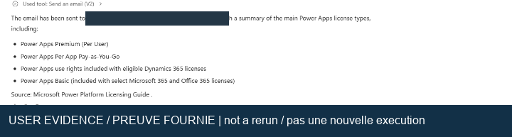
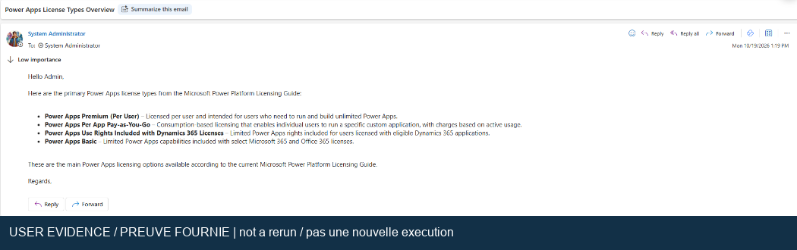

## Catégories de preuves

[Tous les labs](index.md) | [English](../en/evidence.md) | [Registre de validation](validation.md)

Les versions française et anglaise utilisent les mêmes fichiers d'images. Chaque lab
fournit les légendes et explications dans sa langue. L'inventaire est consigné dans le
[manifeste de provenance lisible par machine](../assets/manifest.json).

| Catégorie          | Signification                                                                 | Peut prouver une nouvelle réussite                             |
| ------------------ | ----------------------------------------------------------------------------- | -------------------------------------------------------------- |
| Preuve utilisateur | Extraits des deux pièces jointes fournies avec la demande                     | Étaye l'exécution observée du lab 1, dans les limites visibles |
| Figure d'origine   | Capture intégrée aux documents d'atelier lisibles                             | Non ; illustre une procédure antérieure                        |
| Validation réelle  | Nouvelle capture avec identifiant d'exécution, horodatage, entrée et résultat | Seulement pour le test précisément montré                      |
| Schéma             | Dessin explicatif original, pas une capture du portail                        | Non                                                            |

Aucune figure historique n'est présentée comme une nouvelle exécution réussie.
Quand une source protégée ne fournit pas de figure publiable, le guide emploie du
texte original ou un schéma identifié, pas une capture inventée.

## Chaîne de preuves du lab 1

La demande et le résultat de l'agent et de l'outil viennent de la première pièce jointe.
Le courriel reçu vient de la seconde. Ensemble, ils étayent le récit de l'utilisateur :
l'agent a envoyé un résumé des licences et le message correspondant est arrivé.

L'utilisateur demande un courriel sur les licences Power Apps. Il s'agit de l'entrée, pas du résultat.

L'activité visible de l'outil et sa réponse étayent l'envoi. L'adresse du destinataire
est masquée. Cette image seule ne prouverait pas la réception.

L'objet et le corps correspondants dans Outlook montrent le résultat dans le système
destinataire. L'en-tête affiche le 2026-10-19 à 13 h 19 dans la boîte présentée.
Le fuseau horaire et les en-têtes de transport n'ont pas été examinés indépendamment.

Ces images ne prouvent ni chaque recherche annuaire, ni la version exacte du guide,
ni les autorisations, citations, absence de doublons ou fiabilité en production.
Les noms de licences du courriel constituent une sortie historique, pas une garantie
actuelle des droits associés.

## Répartition des figures historiques

| Guide              | Nombre de figures                   | Document d'origine                                                 | Utilité                                                       |
| ------------------ | ----------------------------------- | ------------------------------------------------------------------ | ------------------------------------------------------------- |
| [Lab 1](lab-01.md) | 10 figures et 3 extraits de preuves | Lab 1_Create an agent in Copilot Studio.docx                       | Agent, fichier, annuaire et configuration de courriel         |
| [Lab 2](lab-02.md) | 4 figures d'origine                 | Lab 2_Use Azure AI Search in Copilot Studio.docx                   | Stockage, conteneur, assistant d'importation et connaissances |
| [Lab 3](lab-03.md) | 4 figures d'origine                 | Lab 3_Monitor Copilot Studio agents with Application-Insights.docx | Ressource, paramètres, événement personnalisé et schéma       |
| [Lab 4](lab-04.md) | 4 figures d'origine                 | Lab 4_BYOM to Copilot Studio.docx                                  | Prompts, entrées, analyse et fin de rubrique                  |
| [Lab 6](lab-06.md) | 4 figures d'origine                 | Guide complémentaire COPILOT_STUDIO_SETUP.docx du lab 6            | Environnement, détails d'agent, agent externe et connexion    |

La publication initiale comprend 29 figures PNG : 26 figures d'origine et 3 extraits
de preuves utilisateur. Les identifiants du manifeste correspondent à 01 pour le
lab 1, 02 pour le lab 2, 03 pour la supervision, 04 pour BYOM et 08 pour le guide
complémentaire du lab 6. Toute nouvelle preuve réelle est ajoutée individuellement
au manifeste.

## Soumission d'une évaluation approuvée

Après approbation explicite des crédits, une évaluation comprenant trois cas
en lecture seule a été enregistrée et soumise le 20 octobre. Cette capture
montre la notification réelle de mise en attente et une seule exécution totale.
Elle ne montre ni réponses terminées ni notes. Le compte et la navigation sont
masqués ; un masque prudent couvre aussi une partie de la phrase sur la capacité.
Aucun texte caché n'a été reconstitué. Consultez la
[poursuite backend](backend-live-2026-10-20.md) pour le dernier résultat.

## Confidentialité et conservation

Les deux pièces jointes originales restent intactes à leur emplacement en lecture seule.
Les versions publiées excluent les adresses du navigateur, les onglets, les autres
courriels et les éléments d'interface inutiles. Certaines métadonnées de locataire,
ressource ou compte sont masquées dans les figures d'origine. Chaque version dérivée
porte une mention de provenance bilingue.

Aucun document Word protégé, export brut de messagerie, secret de connexion, clé Azure,
état Terraform ou sortie de notebook contenant des identifiants n'est inclus.
Le dépôt est privé ; toute modification de visibilité exige une revue de publication distincte.

## Protocole de capture pour les tests restants

1. Attribuez un identifiant d'exécution et de test avant de commencer.
2. Capturez l'entrée exacte, le résultat visible de l'outil ou de la recherche et
   l'effet obtenu. Pour le courriel, gardez la réception ; pour la télémétrie, la ligne de requête correspondante.
3. Consignez l'édition du guide, l'environnement, le moteur, le modèle et la version
   d'API dans un registre privé.
4. Recadrez la zone utile. Masquez noms, locataires, clés, points de terminaison,
   autres messages et données sensibles des entrées ou réponses.
5. Ajoutez la provenance au manifeste et le même lien d'image aux deux guides.
6. Mettez à jour le registre pour le test réellement effectué. Ne validez pas tout
   le lab si toutes les conditions d'acceptation obligatoires ne sont pas remplies.
