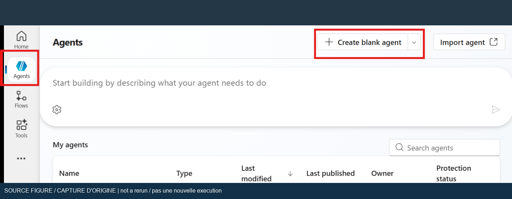
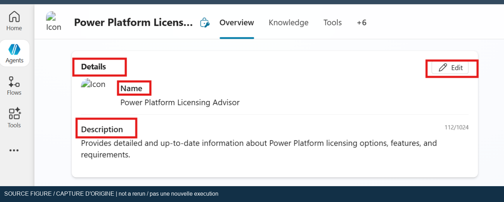
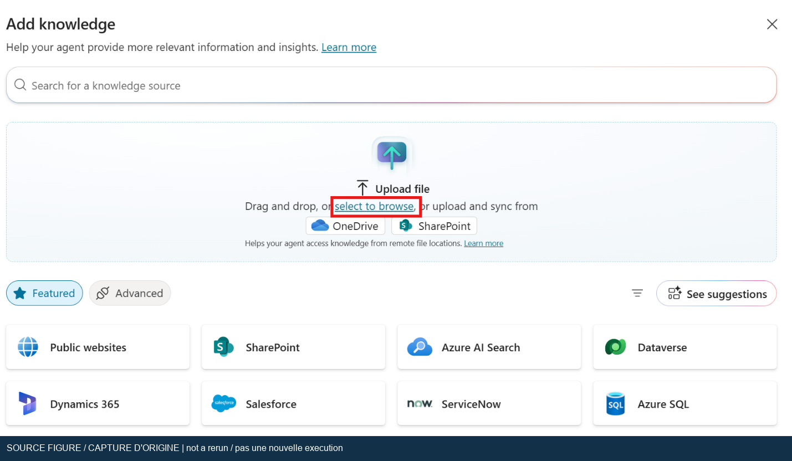
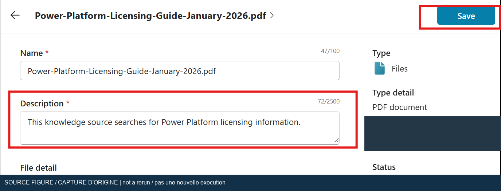
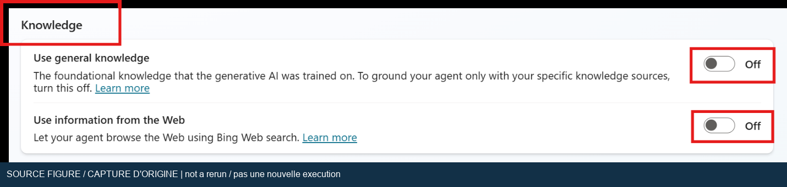
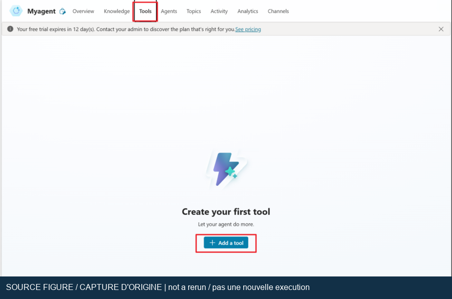
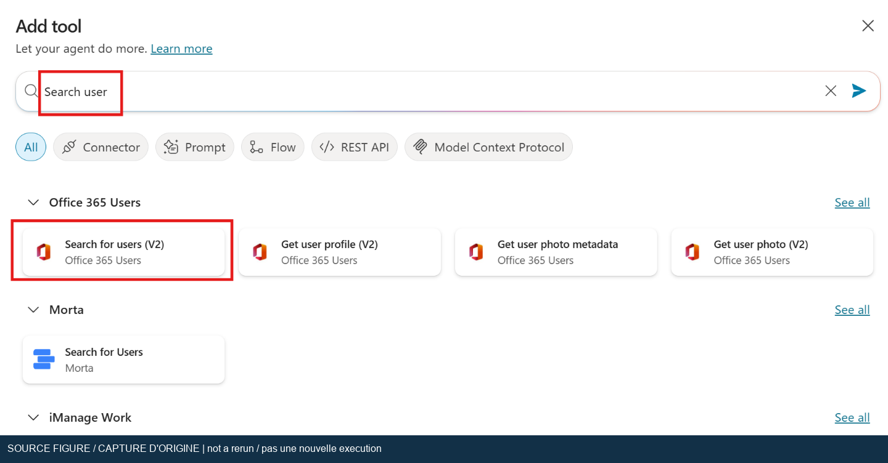
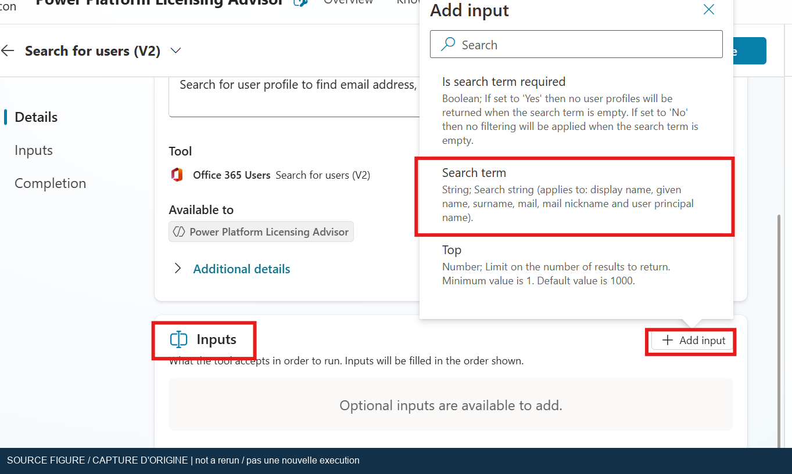
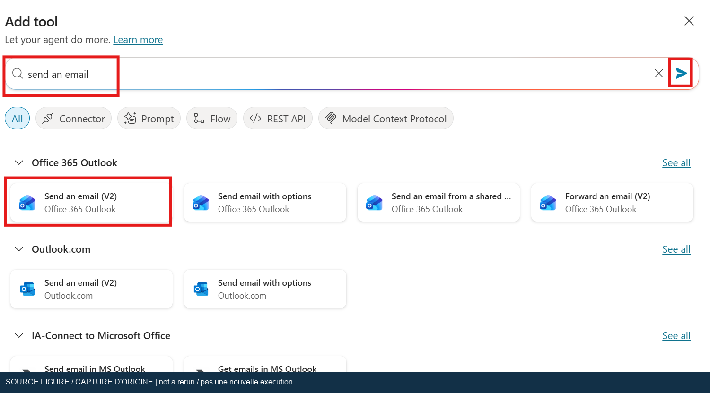
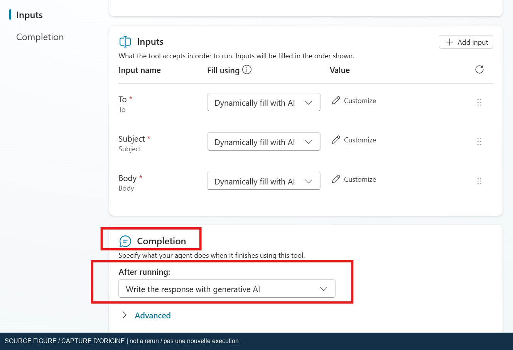

## Objectif, prérequis et preuves

[Tous les labs](index.md) | [English](../en/lab-01.md) | [Prérequis](lab-00.md) | [Suite : Search](lab-02.md)

Créez un conseiller de licences Power Platform, fondez ses réponses sur un guide
approuvé, puis envoyez un résumé à une boîte de test contrôlée. Le support d'origine
prévoit 45 minutes ; ajoutez du temps pour les licences, le consentement et l'indexation.

Vous devez disposer d'un environnement de création autorisé, des connaissances par
fichier, de connexions Office 365 Users et Outlook, d'un PDF de licences pris en charge
et d'une boîte aux lettres que vous possédez ou êtes autorisé à utiliser.

État : la **réexécution réelle du 2026-10-19 par l'assistant** a actualisé l'agent
enregistré, exécuté la recherche PDF, refusé une remise non documentée, identifié
un compte vérifié et envoyé un seul courriel à ce compte. L'outil d'envoi s'est terminé
en **1,6 seconde** ; le message correspondant a été vérifié dans Inbox et Sent Items.
Les outils enregistrés ont été conservés.
Consultez les [nouveaux résultats d'exécution](live-rerun-2026-10-19.md) et leurs limites.

Les deux captures antérieures ci-dessous restent des preuves fournies par l'utilisateur
pour l'exécution initiale, pas des captures du nouveau test. Aucune de ces exécutions
ne constitue un audit complet de l'exactitude des réponses de licences.
Un test conversationnel ultérieur de destinataire ambigu a réussi sans connecteur.
History a ensuite confirmé l'entrée et l'activité échouée de l'appel au paramètre
invalide ; son code HTTP et corps d'erreur restent annoncés par le modèle.
Le téléchargement de la source confirmé par l'utilisateur correspond au SHA-256
du PDF contrôlé ; les six contrôles d'édition et de résumé ont de nouveau réussi.

La [poursuite navigateur du 20 octobre](backend-live-2026-10-20.md)
ajoute une nouvelle réponse fondée sur le fichier, un refus de prix inventé et
une erreur HTTP 400 de validation d'entrée visible indépendamment pour `top=-1`.
L'édition, la citation introductive complète et la section en page 3 de cette
nouvelle réponse ont satisfait cinq contrôles indépendants du PDF source.
Cela ne certifie ni l'ancienne réponse complète ni la navigation par clic
sur une citation. Aucun courriel n'a été envoyé pendant cette poursuite.

Le [test de navigation du 25 octobre sur l'agent d'origine](../assets/runtime-2026-10-25/licensing-pdf-navigation.json)
vérifie le compte du site, le conseiller de licences existant et le PDF Ready.
Une question inchangée recherche ce PDF; deux passages choisis correspondent
au guide conservé d'octobre 2026 aux pages physiques 6–7. Le clic réel sur la source
n'expose ni lecteur PDF, ni dialogue de détails, ni ancre de page. L'acceptation
de navigation reste donc échouée. Un téléchargement non observé ne prouve pas
son absence. La [tentative d'audit historique complet](../assets/runtime-2026-10-25/lab1-full-answer-audit.json)
vérifie l'empreinte du PDF, mais ne retrouve pas la réponse complète du 19 octobre
avec provenance vérifiable. Ce critère reste ouvert/indisponible; aucune réponse
n'est reconstruite ni remplacée par une plus récente. Le corps d'erreur du
connecteur reste non évalué; aucun courriel ni changement de configuration.

Le [contrôle historique du 26 octobre en lecture seule](../assets/runtime-2026-10-26/lab1-dataverse-history.json)
ne retrouve toujours pas la réponse originale complète. L'accès Graph rétabli de
l'administrateur et une lecture administrative Power Platform réussie ne donnent
pas les droits de transcription Dataverse : requête limitée refusée en 403 et
permission absente confirmée par un nouvel audit. Aucun rôle/politique modifié,
aucune auto-élévation générale ni nouvelle question. History du 19 octobre reste
In progress; T009 n'est pas terminé.

## 1. Choisir l'expérience d'agent équivalente

1. Ouvrez [Copilot Studio](https://copilotstudio.microsoft.com/) et sélectionnez l'environnement prévu.
2. Pour suivre le parcours d'origine avec les rubriques, connaissances et outils,
   ouvrez l'expérience des agents standard. Si la nouvelle page d'accueil diffère,
   consultez [Accéder aux agents et flux standard](https://learn.microsoft.com/en-us/microsoft-copilot-studio/agents-experience/switch-experiences).
3. Créez un agent vide uniquement si l'environnement le permet. Nommez-le
   **Power Platform Licensing Advisor** et limitez son périmètre à l'explication
   des licences à partir de la documentation Microsoft approuvée.
4. Consignez le moteur, le modèle et le mode d'orchestration réellement sélectionnés.
   Conservez un modèle par défaut pris en charge sauf nécessité explicite du lab.
5. Si vous reproduisez le résultat avec un moteur plus récent, indiquez qu'il s'agit
   d'un résultat équivalent, pas d'une reproduction exacte de l'interface d'origine.

Capture du support d'origine, avec masquage de confidentialité. Elle guide la navigation
et ne prouve pas que cet assistant a créé un agent.

Capture du support d'origine : le nom et la description expriment le périmètre prévu.

## 2. Définir un comportement fondé et encadré

Décrivez dans les instructions de l'agent les comportements suivants avec vos propres mots :

* Répondre aux questions de licences Power Platform à partir du guide approuvé et citer la source.
* Indiquer l'édition du guide sans présenter un ancien PDF comme la politique la plus récente.
* Expliquer les incertitudes et renvoyer les décisions d'achat ou de conformité au responsable des licences.
* Ne pas inventer de prix, de droits, de disponibilité ou de conseils contractuels.
* Résoudre le destinataire avant l'envoi et demander une précision si plusieurs utilisateurs correspondent.
* Envoyer uniquement à une boîte de test approuvée après confirmation du destinataire et de l'objet.
* Annoncer la réussite seulement après un résultat positif de l'outil d'envoi.

La comparaison par utilisateur/par application du texte d'origine n'est pas une règle
de licence permanente. Vérifiez les noms d'offres et les droits dans l'édition réelle
du guide. La liste visible dans le courriel fourni n'est pas une table de licences
de référence pour 2026.

## 3. Ajouter le PDF et attendre sa disponibilité

1. Téléchargez le [guide officiel de licences](https://go.microsoft.com/fwlink/?LinkId=2085130).
   Notez son édition, son URL source et sa date de téléchargement.
2. Ouvrez **Connaissances > Ajouter des connaissances** et importez le PDF approuvé non chiffré.
3. Ajoutez une description utile précisant l'édition et le rôle de source pour les
   questions de licences Power Platform.
4. Attendez que la source soit utilisable, par exemple à l'état **Ready** dans
   l'expérience standard. Une importation terminée n'est pas une indexation terminée.
5. Enregistrez. En cas d'échec, vérifiez la recherche Dataverse, la capacité de
   stockage, le format, la taille et le chiffrement avant de réessayer.

Capture d'origine : sélectionnez ou déposez le fichier au lieu d'ajouter un site sans rapport.

Capture d'origine avec les métadonnées de l'auteur masquées. Le nom daté de janvier 2026
est historique ; utilisez l'édition approuvée pour votre exécution.

Suivez les [instructions actuelles d'importation](https://learn.microsoft.com/en-us/microsoft-copilot-studio/knowledge-add-file-upload).
Elles excluent explicitement les fichiers chiffrés ou protégés par mot de passe.

## 4. Isoler le test des connaissances

1. Pour un exercice de réponses strictement fondées, désactivez les connaissances
   générales et les informations web lorsque ces options existent dans l'expérience standard.
2. Ne supposez pas que ces options remplacent tous les contrôles d'instructions et d'outils de chaque moteur.
3. Démarrez une nouvelle conversation dans **Tester votre agent** ou **Aperçu**.
4. Demandez : `Quelles options de licences Power Apps sont décrites dans le guide importé ? Citez le guide.`
5. Examinez la vue d'activité ou des outils. Vérifiez la consultation de la source
   prévue, puis comparez la réponse à la page correspondante du PDF.
6. Posez une question à laquelle le PDF ne répond pas, par exemple une remise non
   publiée propre à votre locataire. L'agent doit indiquer que la source ne l'établit pas.

Capture d'origine. Les libellés et leur disponibilité dépendent de l'expérience choisie.

La [documentation actuelle de l'orchestration générative](https://learn.microsoft.com/en-us/microsoft-copilot-studio/advanced-generative-actions)
explique la sélection des connaissances et outils du moteur standard. La vue d'activité
fournit une preuve visible d'exécution, sans remplacer la vérification de la réponse.

## 5. Ajouter la recherche d'utilisateurs et l'outil de courriel

1. Ouvrez **Outils > Ajouter un outil**. Développez les choix de connecteurs si nécessaire.
2. Sélectionnez **Office 365 Users > Search for users (V2)** et utilisez une connexion approuvée.
3. Décrivez l'outil comme un moyen de résoudre le profil et l'adresse de courriel d'un utilisateur.
4. Exposez l'entrée **Search term**. Vérifiez que le destinataire est identifié de
   manière unique. Ne retenez pas le premier résultat d'un nom ambigu.
5. Ajoutez **Office 365 Outlook > Send an email (V2)** avec la connexion de boîte approuvée.
6. Configurez le destinataire, l'objet et le corps selon l'interface. Pour ce lab,
   privilégiez un destinataire de test fixe approuvé ou une confirmation explicite.
7. Si le corps utilise HTML, vérifiez le format accepté. La réponse de fin doit
   correspondre au résultat réel de l'outil.
8. Enregistrez et vérifiez les identités des connexions. L'identité propriétaire de
   la connexion détermine l'envoi ; ce n'est pas forcément la personne qui converse.

Capture du support d'origine.

Capture d'origine : choisissez le connecteur Microsoft Office 365 Users.

Capture d'origine : le nom ou texte recherché est une entrée, pas une adresse devinée.

Capture d'origine : cette action entraîne un véritable effet externe.

Capture d'origine. Les destinataires déterminés dynamiquement exigent des garde-fous ;
cette image ne recommande pas l'envoi à des adresses arbitraires.

Référence actuelle : [Ajouter des outils aux agents](https://learn.microsoft.com/en-us/microsoft-copilot-studio/add-tools-custom-agent).
Si une stratégie bloque le connecteur, demandez une configuration approuvée.
Ne contournez pas les stratégies avec une connexion Outlook personnelle.

## 6. Effectuer un envoi contrôlé

1. Démarrez une nouvelle conversation pour éviter de réutiliser un ancien destinataire.
2. Demandez l'envoi d'un résumé à votre utilisateur de test approuvé. Précisez la
   boîte si le nom d'affichage n'est pas unique.
3. Confirmez le destinataire et l'objet avant l'exécution. Si un consentement est
   demandé, vérifiez l'identité et la portée avant de sélectionner **Connecter**.
4. Observez la fin de l'outil d'envoi. En cas d'échec, conservez l'erreur et refusez
   une réponse en langage naturel qui annonce quand même une réussite.
5. Vérifiez les **Éléments envoyés**, puis la boîte du destinataire. Rapprochez l'objet,
   le contenu et les horodatages. « Envoyé » dans la conversation ne prouve pas la réception.
6. Ne relancez pas automatiquement un envoi retardé ; recherchez d'abord un éventuel doublon.

La capture suivante conserve le libellé exact de la demande fournie, y compris ses
imperfections. Elle ne vous demande pas d'utiliser le même utilisateur.

Preuve d'exécution fournie par l'utilisateur, extraite de la première pièce jointe.

Preuve fournie par l'utilisateur. Le destinataire est masqué. Le message de réussite
ne prouverait pas, à lui seul, la réception.

Preuve fournie par l'utilisateur. Le message reçu porte l'objet
**Power Apps License Types Overview** et contient le résumé correspondant.
Les autres messages de la boîte et les éléments du navigateur sont exclus.

## Tests d'acceptation et interprétation

Le tableau ci-dessous conserve la **preuve initiale**, antérieure à la nouvelle
exécution du 2026-10-19. Les [derniers résultats](live-rerun-2026-10-19.md)
remplacent les anciennes mentions « non exécuté » ou non démontrées pour L1-02 à L1-05.
Une recherche PDF est désormais observée pour L1-01, sans audit complet de l'exactitude
de la réponse. L1-06 possède désormais un test conversationnel réussi, pas une
preuve de blocage lors d'un véritable envoi. L1-07 comporte désormais une activité
de connecteur échouée et une entrée observées indépendamment, sans sortie HTTP brute
vérifiée. Le dernier registre compare le hash du téléchargement confirmé par
l'utilisateur au PDF contrôlé et vérifie sa couverture et ses pages résumées.
Un audit complet des citations reste en dehors de ces contrôles de source.

| ID    | Test                                              | Résultat exigé                                             | Preuve observée                                                                                |
| ----- | ------------------------------------------------- | ---------------------------------------------------------- | ---------------------------------------------------------------------------------------------- |
| L1-01 | Question de licences couverte                     | Réponse conforme au guide approuvé et fondée sur sa source | Résumé et mention de source visibles ; audit complet d'exactitude non effectué                 |
| L1-02 | Question de prix non couvert                      | Aucun prix propre au locataire inventé                     | Non exécuté                                                                                    |
| L1-03 | Destinataire contrôlé unique                      | Boîte prévue vérifiée, sans supposition                    | Destinataire final visible dans l'original ; recherche annuaire non démontrée par les extraits |
| L1-04 | Demande d'un seul résumé par courriel             | Outil d'envoi terminé avec succès                          | Outil et réponse de réussite visibles                                                          |
| L1-05 | Réception dans le système destinataire            | Message correspondant dans la boîte contrôlée              | Capture de réception fournie                                                                   |
| L1-06 | Nom ambigu                                        | Demande de précision avant envoi                           | Non exécuté                                                                                    |
| L1-07 | Connexion bloquée ou défaillante dans un test sûr | Échec explicite, sans fausse réussite ni doublon           | Non exécuté                                                                                    |

## Dépannage et nettoyage

Si le fichier est indisponible, attendez l'indexation et vérifiez ses caractéristiques.
Si la réponse cite le web malgré l'isolation prévue, examinez le moteur réel, les sources
activées et les outils sélectionnés plutôt que de reformuler sans cesse la question.
Si l'utilisateur reste introuvable, vérifiez les droits d'annuaire et utilisez une
identité non ambiguë. Si le courriel manque, comparez la boîte de connexion, les
Éléments envoyés, le destinataire, le courrier indésirable et les traces d'administration.
Ne présentez pas un message absent comme livré.

Conservez l'agent pour le lab 2 et effectuez une copie ou un export avant de modifier ses
connaissances. Après l'atelier, supprimez seulement les messages de test et connexions qui
vous appartiennent et ne servent plus. Gardez les preuves masquées et le registre.
Ne publiez jamais de jetons de messagerie, d'identifiants de connexion ou de captures brutes de boîte.
