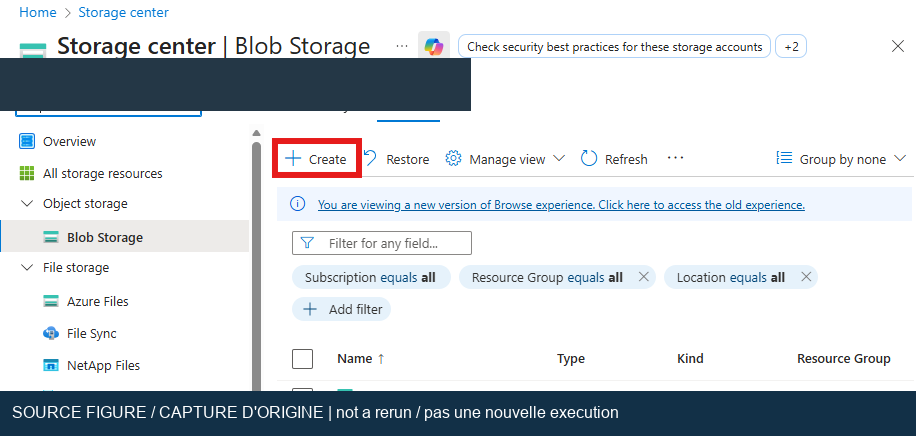
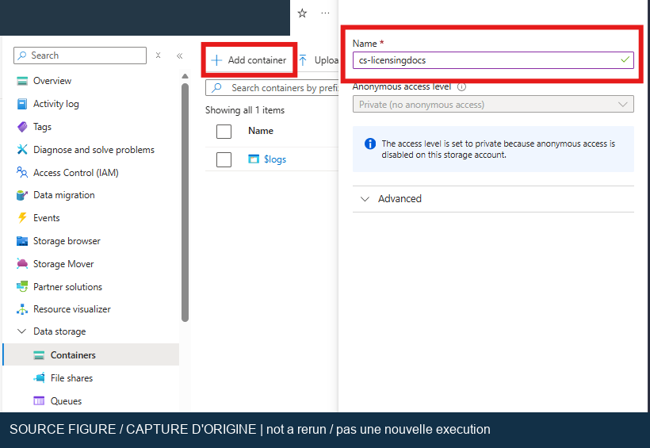
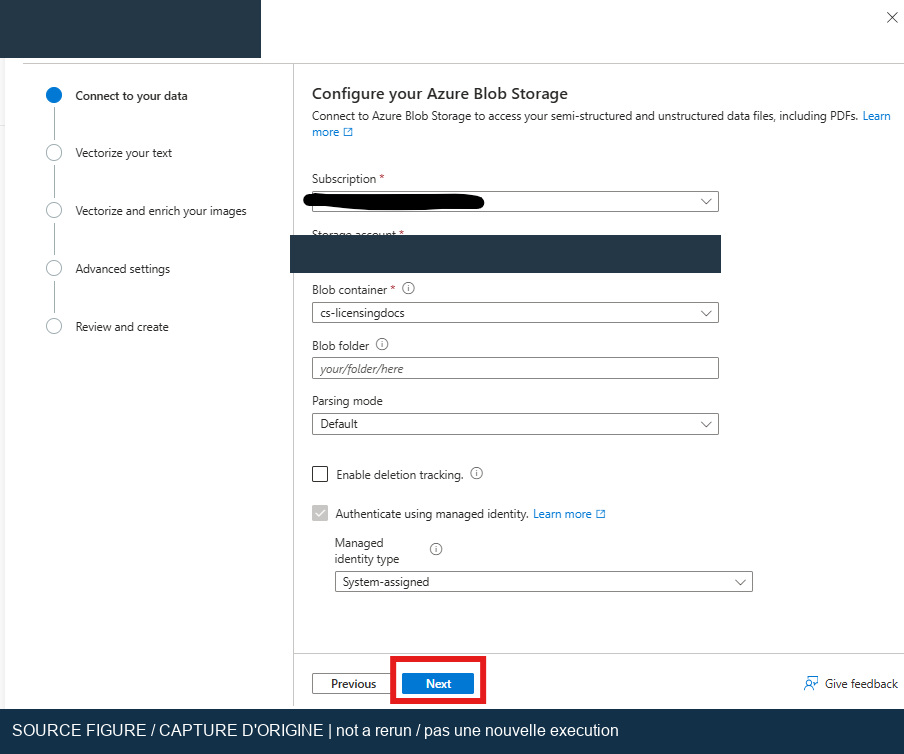
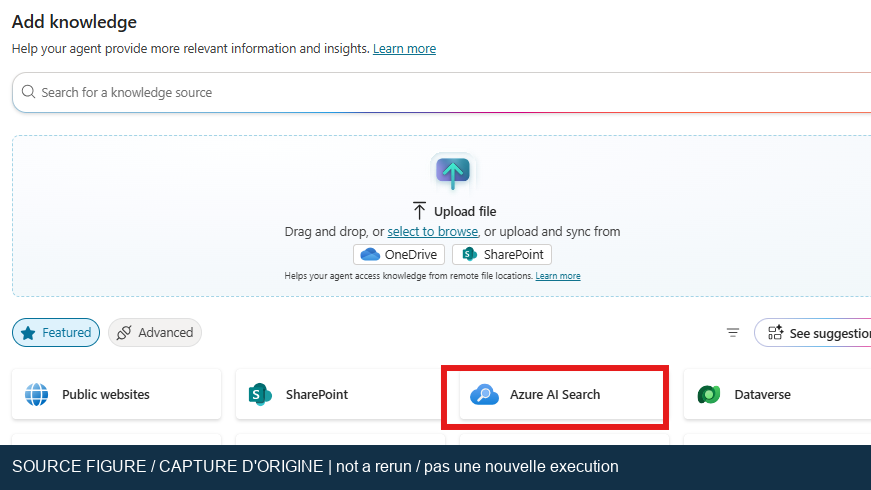

## Lab 02 : Ancrer les réponses d’un agent avec Azure AI Search

[Index de l’atelier](index.md) | [English](../en/lab-02.md) | [Suite : supervision](lab-03.md)

Utilisez un index Azure AI Search pour retrouver des passages dans un guide de
licences approuvé. Distinguez la recherche, la génération de réponses et la
provenance documentaire afin de tester chaque étape. Prévoyez environ 90 minutes,
hors autorisations et délais d’indexation.

> [!IMPORTANT]
> Résultat actuel : l'index de licences isolé et les contrôles de réponses connectées
> par AccessKey formelle ont réussi dans leur périmètre consigné. La navigation
> du lecteur PDF externe et la preuve de source connectée actuelle restent ouvertes ;
> consultez le [registre de validation](validation.md).
> Point historique : **Chaîne de recherche testée ; intégration Copilot complète bloquée**.
> Équivalent de suivi : **Retrieval pipeline tested; complete Copilot integration blocked**.
> Le 2026-10-19, la connexion a réussi et l’accueil Copilot Studio était visible.
> La navigation vers Agents et les rechargements suivants ont toutefois affiché
> une page vide, empêchant l’inspection de l’agent de licences et une nouvelle
> question de connaissances. Le premier inventaire annonçait l'absence de Search
> et d'Application Insights. Un contrôle ultérieur limité explicitement à l'abonnement
> a corrigé ce dernier point : sept composants Application Insights sans rapport
> existent et sont restés intacts. Un service Search Free jetable a ensuite servi
> à l'indexation et à la recherche réelles, pas au vectoriseur intégré ou à la
> connexion Copilot à cette étape. Une exécution payante approuvée a ensuite validé
> de vrais embeddings et la vectorisation des requêtes par identité managée ;
> un autre test privé du corpus hôtelier a réussi 25 contrôles : trois PDF originaux,
> neuf passages enfants projetés par Search, embeddings intégrés et recherche hybride.
> L'isolation du corpus de licences et la connexion Copilot étaient alors non vérifiées.
> Consultez les [derniers résultats](live-rerun-2026-10-19.md).
> L'inventaire initial est limité à cet abonnement et ne prouve pas l’absence
> d’une connexion ailleurs. Une vérification documentaire n’est pas un test
> d’exécution réussi. La revue initiale n'a créé aucune ressource ni modifié d'agent.

### Objectifs et critères d’acceptation

Dernier résultat : la voie AccessKey formelle a réellement connecté Search.
Réponse/édition/citation/page/cible et abstention finale explicite ont réussi,
après un échec consigné et deux corrections natives. La
[chronologie des neuf questions](backend-live-2026-10-20.md#traitement-explicite-de-labsence-de-réponse-réussi)
ne certifie pas la navigation du lecteur PDF externe. Cognitive est resté
sans clé ; les clés Search étaient permises sur ce service isolé.

Une tentative antérieure du 20 octobre a créé un index de licences de 30 pages,
distinct de l'index hôtelier, avec un vrai test du vectoriseur réussi.
Le test Standard connecté s'est arrêté à la fenêtre Entra bloquée par le
navigateur hôte : aucune connexion, mappage, source ou question sauvegardée.
Cela lève l'incertitude sur l'isolation de l'index, non la limite d'acceptation
de l'agent connecté. Voir
[l'échec réel de connexion](backend-live-2026-10-20.md#connexion-search-sans-clé-bloquée-par-le-navigateur-hôte).

* Créer un conteneur documentaire privé et un index au contenu textuel récupérable.
* Employer la vectorisation intégrée pour l’ingestion et les requêtes en langage naturel.
* Connecter un index vectoriel par une connexion de données Copilot Studio prise en charge.
* Prouver que les réponses utilisent la bonne source, et non un fichier chargé en parallèle.
* Consigner des tests positifs, négatifs et d’isolation avec des preuves expurgées.

### Prérequis et limites de sécurité

1. Terminez le Lab 01 et obtenez l’accès créateur à son agent dans un environnement
   de développement.
2. Ouvrez l’expérience des agents standard. Depuis l’accueil de Copilot Studio,
   utilisez **… > Open classic experience**, ou ouvrez votre agent standard dans
   **Agents**. Le moteur standard prend en charge l’orchestration classique et
   générative. Ouvrir l’expérience classique ne sélectionne pas automatiquement
   l’orchestration classique. Consultez les [moteurs d’exécution][harness] et le
   [changement d’expérience][experience].
3. Faites approuver l’abonnement, la région, le groupe de ressources, le budget et
   les droits de création et d’attribution des rôles. Une licence créateur
   n’accorde pas de droits Azure. Obtenez l’accord avant d’engager des dépenses.
4. Vérifiez que les stratégies de données autorisent le connecteur Azure AI Search
   et que l’environnement peut joindre les points de terminaison.
5. Obtenez auprès de l’éditeur un guide de licences actuel dont l’usage est
   autorisé. Consignez son titre, sa date de publication, sa date de téléchargement
   et son URL. Ne redistribuez pas le PDF sans autorisation. Les réponses de
   l’atelier sont pédagogiques et ne remplacent pas un avis contractuel.
6. Enregistrez un export de solution ou une sauvegarde approuvée de l’agent, de
   ses sources, de ses instructions et du mode d’orchestration. Effectuez les tests
   d’isolation sur une copie jetable, sans retirer de sources de production.

### Parcours d’origine et adaptations actuelles

Le Lab 2 d’origine associe stockage, embeddings, indexation et connexion de
l’agent. L’architecture est conservée, mais les hypothèses suivantes évoluent :

* Remplacez le niveau **Free** proposé par défaut par **Basic ou supérieur** pour
  le parcours à identité managée du démarrage rapide actuel. La disponibilité
  de la recherche vectorielle gratuite ne garantit pas celle de tout ce parcours.
* Utilisez **Import data**, **Import data (new)** ou **Import and vectorize data**
  selon le portail, puis le parcours RAG/vectorisation sur Stockage Blob.
* Choisissez un déploiement d’embeddings pris en charge, tel que
  `text-embedding-3-small` ou `text-embedding-3-large`, et non un modèle de
  conversation. Vérifiez disponibilité, quota, dimensions et cycle de vie dans
  l’abonnement et la région retenus.
* Remplacez les droits Contributor trop larges par les rôles et identités précis
  indiqués ci-dessous. Un indexeur en lecture seule n’a pas besoin du rôle
  Storage Blob Data Owner.
* Préférez une connexion **Microsoft Entra ID Integrated** du connecteur. Ne
  collez pas d’URL et de clé dans une configuration de connaissances non prise en charge.
* Considérez le classement sémantique comme une fonction optionnelle à configurer,
  et non comme un autre nom de la vectorisation ou un prérequis universel.

L’[article actuel sur les connaissances][knowledge] décrit l’authentification par
clé, mais signale aussi que des connexions non prises en charge peuvent bloquer
le dialogue au niveau de l’environnement et recommande les connexions formelles
avec Entra ID pour la récupération. La [référence du connecteur][connector]
énumère les méthodes d’authentification ; sa connexion par identité managée est
réservée à Logic Apps. Cette limite n’empêche pas le service Search d’utiliser sa
propre identité pour lire les blobs et appeler le modèle d’embeddings.

### Exercice 1 : Préparer le document et le stockage

1. Dans Azure portal, ouvrez **Storage accounts > Create** si aucun compte
   d’atelier approuvé n’existe. Sélectionnez l’abonnement et le groupe autorisés.
2. Choisissez un nom unique et une région approuvée. Utilisez un compte standard
   à usage général v2 ; LRS constitue une option économique si la stratégie
   l’autorise. Vérifiez réseau, chiffrement et accès public avant création.
3. Sous **Data storage > Containers**, créez `licensing-docs` en désactivant
   l’accès anonyme.
4. Chargez le PDF approuvé. Vérifiez que sa taille n’est pas nulle et qu’une
   identité autorisée peut l’ouvrir. N’incluez aucun jeton SAS dans les preuves.
5. Si nécessaire, demandez **Storage Blob Data Contributor** à la portée la plus
   limitée possible pour le chargement. Le rôle Contributor sur une ressource
   ne donne pas automatiquement accès aux données Blob.

*Capture de l’atelier d’origine, pas d’une nouvelle exécution. Original workshop
screenshot, not a new execution. Employez les paramètres de sécurité, d’abonnement
et de région approuvés, sans recopier les valeurs visibles.*

*Capture de l’atelier d’origine, pas d’une nouvelle exécution. Original workshop
screenshot, not a new execution. Conservez un conteneur privé.*

### Exercice 2 : Configurer les embeddings et les accès Search

1. Demandez au propriétaire un déploiement Azure OpenAI d’embeddings approuvé, ou
   l’autorisation d’en créer un. Le [démarrage rapide du portail][vectors] exige,
   pour ce parcours, une ressource Azure OpenAI compatible avec sous-domaine
   personnalisé, créée dans Azure portal. Une entrée Cognitive Services dans
   l’inventaire ne prouve pas qu’un modèle compatible est déployé.
2. Dans Foundry, examinez le modèle, sa version, le nom du déploiement, la région
   et le quota disponible. Consignez le nom du déploiement sans conserver de clé.
3. Créez ou choisissez un service Azure AI Search **Basic ou supérieur** après
   examen du coût. Utilisez une région compatible avec le modèle et l’assistant.
   Le souhait de rapprocher les ressources ne remplace pas cette vérification.
4. Activez les accès par rôles et l’identité attribuée par le système sur Search.
5. Sur le stockage, accordez à cette identité **Storage Blob Data Reader**, à la
   portée du conteneur ou du compte prise en charge par votre indexation.
6. Sur Azure OpenAI, accordez-lui **Cognitive Services OpenAI User**, sans lui
   substituer par défaut le rôle étendu Cognitive Services Contributor.
7. Pour la personne qui construit et teste la chaîne, suivez les rôles Search du
   démarrage rapide : **Search Service Contributor**, **Search Index Data
   Contributor** et **Search Index Data Reader**. Séparez les droits d’ingestion
   et d’écriture des futures connexions de lecture.
8. Pour l’identité du connecteur, utilisez **Search Index Data Reader** pour les
   requêtes. Si l’énumération ou la configuration des index nécessite **Search
   Service Contributor**, faites approuver cet accès supplémentaire au plan de
   gestion. Réévaluez les droits après installation.

> [!WARNING]
> L’assistant actuel du portail exige des points de terminaison accessibles
> publiquement pendant la configuration. Ne désactivez pas le pare-feu de
> l’entreprise ou un point de terminaison privé pour terminer l’atelier.
> Si la stratégie l’interdit, demandez une implémentation réseau privée approuvée.
> La réussite de l’assistant ne prouve pas que Copilot Studio peut joindre le service.

### Exercice 3 : Importer, vectoriser et examiner l’index

1. Ouvrez la ressource Search et lancez l’assistant d’importation/vectorisation.
2. Sélectionnez **Azure Blob Storage**, le compte et le conteneur approuvés.
   Indiquez le dossier voulu ou laissez le filtre vide si le conteneur ne
   contient que les documents de l’atelier.
3. Choisissez l’authentification par identité managée et le déploiement
   d’embeddings de l’exercice 2. Prenez connaissance des frais d’utilisation.
4. Restez sur du texte et ignorez l’enrichissement d’images facultatif. Vérifiez
   les noms de la source de données, du skillset, de l’index et de l’indexeur.
5. Attendez la fin de l’indexation et ouvrez l’historique d’exécution. Le résultat
   attendu est une exécution réussie, au moins un document source traité et aucun
   élément en échec. Le nombre de fragments peut différer du nombre de PDF.
6. Examinez le schéma de l’index. Relevez les vrais noms des champs texte, titre,
   identifiant et vecteur. Les champs texte/titre utilisés doivent être récupérables.
7. Vérifiez que le profil de recherche du champ vectoriel est associé au bon
   vectoriseur de requêtes. Des embeddings produits uniquement à l’ingestion
   ne suffisent pas à traiter une requête vectorielle en langage naturel.
8. Dans Search explorer, choisissez le mode de requête texte-vers-vecteur proposé
   par le portail. Posez une question sur les licences et contrôlez la pertinence
   des passages retournés. Une recherche par mots-clés réussie ne valide pas
   la vectorisation.
9. Si vous activez le classement sémantique, configurez-le séparément et vérifiez
   région, niveau et facturation. Conservez une requête vectorielle de référence.

*Capture de l’atelier d’origine, pas d’une nouvelle exécution. Original workshop
screenshot, not a new execution. Les libellés et champs générés peuvent avoir changé.*

### Exercice 4 : Connecter et isoler la source de connaissances

1. Dans l’agent standard, ouvrez **Knowledge > Add knowledge > Featured >
   Azure AI Search**. Certaines interfaces utilisent **Data sources**.
2. Créez une connexion de données formelle. Préférez **Microsoft Entra ID
   Integrated**, avec l’identité de lecture approuvée. Respectez le format du
   point de terminaison demandé, sans inventer de schéma d’URI.
3. Confirmez la création, sélectionnez le véritable index vectoriel, puis
   **Add to agent**. Une seule sélection d’index vectoriel est prise en charge.
4. Attendez l’état **Ready**. Consignez le nom de l’index, le type de connexion
   et l’état, jamais une clé ou un jeton.
5. Dans la copie jetable de l’agent, désactivez ou retirez temporairement le PDF
   chargé directement et les sources concurrentes. Notez comment les rétablir.
6. Pour un test d’ancrage strict, désactivez les connaissances générales et les
   informations du Web lorsque ces réglages existent. Gardez les anciennes valeurs.
7. Lancez une nouvelle conversation et ouvrez la carte d’activité. Posez la
   question positive ci-dessous, examinez la source appelée et comparez chaque
   affirmation à l’édition enregistrée du PDF.

*Capture de l’atelier d’origine, pas d’une nouvelle exécution. Original workshop
screenshot, not a new execution. Utilisez la connexion prise en charge et votre
index, sans reprendre les identifiants de la capture.*

### Plan de validation et résultats attendus précis

Exécutez ces tests lorsque les prérequis sont disponibles. La formulation générée
peut varier ; les observations suivantes constituent les critères d’acceptation.

* `SRCH-01` : Examinez l’historique de l’indexeur. Résultat attendu : exécution
  réussie, au moins un document traité et zéro élément en échec. Conservez le
  résumé expurgé.
* `SRCH-02` : Demandez « Quelles options de licences Power Apps le guide indexé
  décrit-il ? ». Résultat attendu : au moins un fragment pertinent et une réponse
  dont chaque affirmation sur les licences renvoie à cette édition du guide.
  Conservez la carte d’activité et les références ; la réponse seule ne suffit pas.
* `SRCH-03` : Demandez « Que dit ce guide du produit fictif WorkshopNebula-999 ? ».
  Résultat attendu : aucun droit de licence inventé. L’agent indique que la source
  ne permet pas de répondre, ou refuse de conclure. Un voisin vectoriel peut
  malgré tout être retourné ; sa présence ne prouve pas sa pertinence.
* `SRCH-04` : Dans la copie jetable, désactivez Search et recommencez la
  conversation en gardant les autres sources désactivées. Résultat attendu :
  la carte d’activité ne peut pas attribuer une recherche à cette source
  désactivée. Rétablissez Search. Si la réponse reste ancrée, cherchez un autre parcours.
* `SRCH-05` : Examinez les preuves. Résultat attendu : aucune clé, URL SAS,
  donnée personnelle, citation protégée du PDF ou information de ressource sans rapport.

### Dépannage et récupération

* En cas de 403 à l’indexation, vérifiez les rôles Blob reader et OpenAI user de
  l’identité Search, les accès réseau et la propagation des rôles. N’accordez
  pas le rôle Owner de l’abonnement pour contourner l’erreur.
* En cas d’échec d’embeddings, contrôlez disponibilité, quota, dimensions, skillset
  et schéma vectoriel. Ne recréez que des éléments jetables si une correction
  sûre du schéma n’est pas possible.
* Si les mots-clés fonctionnent mais pas la requête vectorielle en langage
  naturel, examinez vectoriseur, champ, profil et accès au modèle avant le prompt.
* Si la source n’atteint pas Ready, contrôlez identité, visibilité de l’index,
  stratégies de connecteur et traitement des métadonnées.
* Si le dialogue de connexion échoue immédiatement, ne multipliez pas les
  variantes URL/clé. Faites traiter le problème de connexion au niveau de
  l’environnement. Microsoft mentionne une réinitialisation de l’accès externe
  ou la recréation d’un agent jetable ; aucune n’est un nettoyage automatique.
* Si l’ancien fichier est utilisé, recommencez la conversation et examinez toutes
  les connaissances au niveau de l’agent et des rubriques.

### Retour arrière, nettoyage et preuves

1. Rétablissez les sources, les réglages de connaissances générales/Web et le
   mode d’orchestration sauvegardés. Vérifiez la question du Lab 01 dans une
   nouvelle conversation avant de réutiliser l’agent.
2. Retirez uniquement la connexion de connaissances d’atelier si aucun exercice
   suivant ne l’utilise. Conservez index et embeddings pour le Lab 04 si cela
   a été approuvé.
3. Après les exercices dépendants, supprimez uniquement les éléments autorisés :
   indexeur, skillset, source, index, document/conteneur, déploiements et services
   dédiés. Ne supprimez jamais un groupe de ressources partagé.
4. Révoquez les rôles et connexions propres à l’atelier. Faites renouveler toute
   clé exposée. Supprimer un blob ne retire pas nécessairement ses fragments
   indexés ; vérifiez la détection de suppression ou retirez l’index d’atelier.
5. Conservez date, édition du guide, orchestration, schéma résumé, critères testés,
   résultat d’indexation, captures expurgées et résultat du nettoyage. Indiquez
   **Non exécuté** pour chaque cas tant qu’aucune observation réelle n’existe.

La revue documentaire initiale a vérifié les parcours, les types d'authentification,
le niveau requis par l'assistant, les embeddings et la séparation des rôles.
La page vide et l'état non vérifié de l'index ou de la connexion étaient historiques,
pas le résultat actuel. L'index de licences isolé et la connexion AccessKey formelle
ont ensuite réussi les contrôles limités de réponse, de source et d'abstention
décrits plus haut. La navigation du lecteur PDF externe et la preuve de source
connectée actuelle restent ouvertes. Conservez séparément l'échec de la fenêtre
Entra : il ne constitue ni un échec de la voie AccessKey testée ensuite ni une
preuve de réparation de la connexion Entra. Reprenez [T010](completion-roadmap.md)
à partir des preuves conservées, sans réinitialiser tous les cas SRCH ni répéter
l'ingestion terminée.

### Références officielles vérifiées

Ces pages Microsoft Learn ont été consultées le 2026-10-19.

* [Source de connaissances Azure AI Search][knowledge]
* [Connecteur Azure AI Search, authentification et actions][connector]
* [Démarrage rapide vectoriel et prérequis du portail][vectors]
* [Principes du classement sémantique][semantic]
* [Moteurs d’exécution de Copilot Studio][harness]
* [Accès à l’expérience des agents standard][experience]

[knowledge]: https://learn.microsoft.com/en-us/microsoft-copilot-studio/knowledge-azure-ai-search
[connector]: https://learn.microsoft.com/en-us/connectors/azureaisearch/
[vectors]: https://learn.microsoft.com/en-us/azure/search/search-get-started-portal-import-vectors
[semantic]: https://learn.microsoft.com/en-us/azure/search/semantic-search-overview
[harness]: https://learn.microsoft.com/en-us/microsoft-copilot-studio/harnesses-overview
[experience]: https://learn.microsoft.com/en-us/microsoft-copilot-studio/agents-experience/switch-experiences
