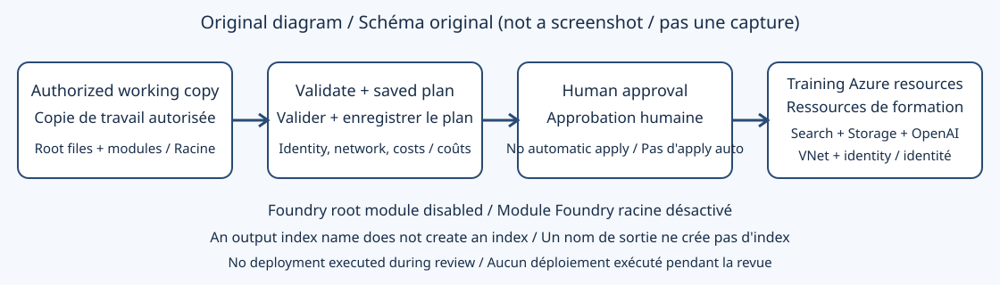

## Objectif et état des preuves

[Index des ateliers](index.md) | [English](../en/lab-05-1.md) | [Poursuivre avec l'atelier 5](lab-05.md) | [Prérequis Foundry IQ](lab-06.md)

Préparez l'infrastructure Search sans supposer qu'un déploiement Terraform réussi crée aussi un index, configure un nouveau projet Foundry ou autorise l'utilisateur connecté. Prévoyez 45 à 90 minutes pour la revue et un déploiement approuvé ; les demandes de quota peuvent prendre davantage de temps.

> [!IMPORTANT]
> Le paiement a été explicitement approuvé et les 15 instances ont été déployées
> après correction de GPT-4o vers `2024-11-20` et conservation, dans la copie,
> des réglages sans clé et Storage privé imposés par stratégie.
> Ce n'est pas un apply des sources inchangées. Les vrais appels modèle/recherche
> ont réussi. Le nettoyage et la vérification indépendante d'absence figurent dans les
> [preuves de réexécution](live-rerun-2026-10-19.md).

La procédure ci-dessous reste le guide opérateur complet. Seules les commandes
identifiées dans le registre ont été exécutées ; un apply ne certifie pas toute
l'intégration d'agent. N'effectuez aucun déploiement ni suppression sans l'accord du propriétaire.

### Rapprochement récent des sources d'origine

Le [rapprochement actuel](../assets/runtime-2026-10-23/terraform-reconciliation.json)
restaure Terraform officiel 1.16.6 avec empreinte vérifiée et contrôle une copie
privée identique des 23 fichiers d'origine. `init` et `validate` retournent 0;
validation sans erreur ni avertissement. Le plan enregistré retourne 2 avec
15 instances proposées. Versions résolues : AzureRM 4.45.1, AzAPI 1.15.0,
AzureAD 2.48.0, Random 3.6.1 et HTTP 3.6.3. L'inscription automatique des
fournisseurs est désactivée. Aucun apply/destroy; l'absence du groupe réservé
au plan est vérifiée indépendamment.

D5-02 et D5-03 sont fermés, pas toute la séquence de déploiement. Le plan
d'origine propose encore GPT-4o `2024-05-13`, déjà refusé, des valeurs
publiques/authentification locale, aucune identité Search, aucun endpoint privé
ni projet Foundry. L'ancien apply corrigé, les surcharges préservant la stratégie
et la configuration d'identité à l'exécution restent des preuves distinctes;
ne les réappliquez pas pour les reproduire.

## Architecture et prérequis



Figure 1. Schéma explicatif original, pas une capture d'écran. Le module Foundry facultatif est désactivé dans la configuration racine fournie.

Vous devez disposer des éléments suivants :

* Un abonnement autorisé, un groupe de ressources de formation dédié, un responsable du budget et les régions des ressources et des modèles
* Azure CLI et une installation Terraform prise en charge sur votre poste
* Le droit de créer des ressources et d'attribuer des rôles ; Contributor seul ne permet pas l'attribution de rôles
* Un quota Azure OpenAI suffisant pour la région, le modèle, le type de déploiement et la capacité retenus
* Le répertoire `scripts` autorisé complet, y compris les sous-répertoires locaux `modules`
* Un stockage sécurisé pour l'état Terraform et les identifiants, ainsi qu'une conception réseau approuvée

Le support propose Azure CLI 2.50 ou ultérieur et Terraform 1.5 ou ultérieur. La configuration racine accepte réellement Terraform `>= 1.4.6` : il s'agit d'une contrainte minimale, pas d'une preuve de test de toute version plus récente. Conservez une chaîne d'outils et un fichier de verrouillage revus plutôt que de choisir uniquement selon la date.

## 1. Inventorier les fichiers avant toute exécution

1. Travaillez sur une copie locale autorisée du répertoire `scripts` complet. Ce dépôt de documentation ne redistribue pas le code source protégé.
2. Vérifiez la présence de `main.tf`, `providers.tf`, `variables.tf` et `outputs.tf` à la racine.
3. Vérifiez les modules locaux `vnet`, `mi`, `st`, `openai` et `search`. Le répertoire `ai-foundry` existe aussi, mais son appel depuis la racine est commenté.
4. Examinez les contraintes : la racine déclare AzureRM `~> 4.45.1`, AzAPI `~> 1.0`, AzureAD `2.48.0` et Random `3.6.1`.
5. Lisez chaque module enfant, pas seulement les variables racine. La présence d'une variable ne prouve pas que sa valeur est utilisée.
6. Conservez une version de source ou un inventaire d'empreintes approuvé dans votre espace de preuves privé. Ne publiez pas les chemins privés, les détails du locataire ni l'état.

### Écarts statiques vérifiés par rapport au parcours initial

| Domaine                        | Comportement observé                                                                                                                     | Conséquence avant déploiement                                                       |
| ------------------------------ | ---------------------------------------------------------------------------------------------------------------------------------------- | ----------------------------------------------------------------------------------- |
| Hub/projet Foundry             | Appel racine `ai_foundry` et sorties de projet correspondantes commentés                                                                 | Le déploiement actif ne crée pas l'ensemble hub/projet/Key Vault annoncé            |
| Niveau Search                  | Le module enfant choisit `standard`                                                                                                      | Prévoyez le coût Standard ; ce n'est pas un service Search gratuit                  |
| Classement sémantique          | `semantic_search_sku` vaut `free`                                                                                                        | Il s'agit d'une allocation de requêtes sémantiques, pas d'un service Search gratuit |
| Règles IP Search               | La racine transmet `allowed_ips`, mais la ressource enfant impose `null`                                                                 | Modifier la variable n'implémente pas de liste d'adresses autorisées                |
| Commutateur Entra              | `enable_entra_id_authentication` est déclaré mais non référencé dans la configuration active                                             | Ce commutateur n'applique pas de politique d'authentification                       |
| Authentification locale Search | La ressource l'active explicitement                                                                                                      | Ne présentez pas la configuration comme exclusivement sans clé                      |
| Identités managées             | Une identité attribuée par l'utilisateur reçoit des rôles Search/OpenAI ; la ressource Search active n'attache pas d'identité de service | Ces rôles n'autorisent pas automatiquement l'indexeur Search ni votre utilisateur   |
| Réseau                         | Un VNet est créé ; OpenAI autorise explicitement l'accès public ; aucun point de terminaison privé n'est déclaré dans les modules actifs | Un VNet ne signifie pas une connectivité privée                                     |
| Index Search                   | `ai_search_index_name` renvoie un libellé littéral par défaut                                                                            | Cette sortie ne prouve pas la création d'un index du plan de données                |
| Modèles                        | Plongement `text-embedding-ada-002` version `2` ; conversation `gpt-4o` version `2024-05-13`                                             | Vérifiez cycle de vie, disponibilité régionale, quotas et dimensions                |

Le [calendrier officiel de retrait des modèles](https://learn.microsoft.com/en-us/azure/foundry/openai/concepts/model-retirement-schedule) classe actuellement cette version de GPT-4o comme dépréciée, avec un retrait annoncé le 2026-12-09. Revérifiez avant déploiement ; ne remplacez pas un nom sans vérifier API et qualité. Cette revue n'a pas résolu les modules fournisseurs ni démontré leur compatibilité avec le plan de contrôle Azure actuel.

## 2. Définir les limites d'autorisation et de coût

1. Faites approuver abonnement, groupe, régions, plafond de dépense et date de nettoyage par le propriétaire.
2. Distinguez identité de déploiement, utilisateur de l'atelier, identité du service Search et identité du projet Foundry. Elles ne sont pas interchangeables.
3. Vérifiez que l'identité de déploiement peut attribuer des rôles au bon périmètre. Utilisez Owner, User Access Administrator, Role Based Access Control Administrator ou un rôle personnalisé approprié, avec les droits de création nécessaires.
4. Faites confirmer les inscriptions des fournisseurs, notamment `Microsoft.Search`, `Microsoft.CognitiveServices`, `Microsoft.Storage`, `Microsoft.Network` et `Microsoft.ManagedIdentity`. Ajoutez `Microsoft.KeyVault` et `Microsoft.MachineLearningServices` seulement si la conception révisée les utilise réellement.
5. Estimez les coûts des niveaux de ressources, des capacités de modèles, du stockage, des plongements, des requêtes sémantiques et des futurs agents. `terraform plan` n'est pas un moteur de tarification.
6. Choisissez la politique réseau. Si l'accès privé est obligatoire, arrêtez-vous jusqu'à l'implémentation des points de terminaison privés, du DNS et d'un parcours Power Platform autorisé.

La [référence RBAC Search](https://learn.microsoft.com/en-us/azure/search/search-security-rbac) distingue gestion des objets et lecture/écriture des documents. Le [guide d'authentification Terraform](https://learn.microsoft.com/en-us/azure/developer/terraform/authenticate/authenticate-to-azure) décrit les parcours d'identité pris en charge.

## 3. Configurer un espace opérateur jetable

1. Ouvrez PowerShell dans votre copie de travail autorisée de `scripts`, pas dans le répertoire source en lecture seule.
2. Vérifiez les outils sans modifier l'infrastructure :

   ```powershell
   az --version
   terraform version
   ```

3. Connectez-vous uniquement selon le processus de votre organisation, puis sélectionnez l'abonnement approuvé. Ne laissez pas d'identifiants réels dans les transcriptions partagées.
4. Créez un fichier de variables privé utilisant les noms fournis. Renseignez au minimum `subscription_id`, `resource_group_name`, `location` et `location_azopenai`. Les deux régions sont indépendantes.
5. Gardez des noms uniques ou le suffixe aléatoire revu. Un plan local ne garantit pas la disponibilité mondiale d'un nom.
6. Vérifiez que `.env`, variables secrètes, état et sauvegardes, `.terraform` et plans enregistrés sont exclus de la publication. Conservez le fichier de verrouillage selon la politique d'équipe.
7. Examinez les constats réseau et identité avec l'animateur. Arrêtez-vous si des contrôles obligatoires manquent. La documentation ne corrige pas silencieusement la configuration fournie.

Ne publiez jamais une sortie complète `terraform output -json`, l'état, les journaux détaillés ou les fichiers d'environnement dans un ticket ou une capture. Une valeur marquée sensible peut rester présente dans l'état.

## 4. Initialiser, valider et examiner le plan

Ces commandes téléchargent modules/fournisseurs ou interrogent Azure lorsque l'opérateur les exécute. Elles ne constituent pas des preuves hors ligne de cette revue.

1. Initialisez uniquement la copie approuvée :

   ```powershell
   terraform init
   ```

2. Vérifiez formatage et configuration :

   ```powershell
   terraform fmt -check -recursive
   terraform validate
   ```

3. Résolvez les modules locaux manquants, arguments non pris en charge et contraintes incompatibles avant de continuer. Ne mettez pas tous les fournisseurs à jour comme contournement non revu.
4. Produisez un plan enregistré :

   ```powershell
   terraform plan -out=training.tfplan
   terraform show -no-color training.tfplan
   ```

5. Faites examiner chaque création, modification et suppression par le propriétaire. Vérifiez abonnement, deux régions, versions et capacités des modèles, accès public, bénéficiaires de rôles et remplacements inattendus.
6. Comparez le plan à l'inventaire prévu : groupe, VNet, identité attribuée par l'utilisateur, attributions de rôles, stockage, compte/déploiements OpenAI et service Search. N'attendez pas de projet Foundry du module désactivé.
7. Protégez le plan, qui peut contenir des données sensibles. Obtenez l'approbation humaine explicite de ce plan précis avant apply.

Un plan sans création n'est pas automatiquement correct : il peut viser le mauvais état ou environnement. Un code Terraform non nul signale un échec à analyser. Si vous utilisez volontairement `-detailed-exitcode`, distinguez `0` (aucune modification), `2` (modifications) et `1` (erreur).

## 5. Appliquer seulement le plan approuvé et inspecter Azure

1. Après autorisation, appliquez le fichier revu :

   ```powershell
   terraform apply training.tfplan
   ```

2. L'approbation intervient avant l'application d'un plan enregistré : aucune seconde confirmation interactive n'est proposée. N'ajoutez pas `-auto-approve` pour rendre l'exercice autonome.
3. Inspectez seulement les sorties non secrètes nécessaires :

   ```powershell
   terraform output -raw resource_group_name
   terraform output -raw ai_search_service_name
   terraform output -raw ai_search_endpoint
   terraform output -raw openai_embedding_deployment_name
   ```

4. Dans le portail Azure, vérifiez l'existence de chaque ressource dans le groupe et la région autorisés. Confirmez versions et capacités réellement déployées.
5. Dans Search, vérifiez réseau et authentification effectifs. Dans Storage/OpenAI, vérifiez l'identité réellement bénéficiaire de chaque rôle.
6. Faites attribuer à l'utilisateur interactif les rôles de données nécessaires. Configurez séparément l'identité Search si l'indexeur doit utiliser une identité managée.
7. Continuez avec l'[atelier 5](lab-05.md) pour créer les objets du plan de données et prouver ingestion et recherche.
8. Avant l'[atelier 6](lab-06.md), créez ou sélectionnez un nouveau projet Foundry pris en charge selon le processus approuvé. Le module hub commenté n'est pas un remplacement direct pour ce nouveau projet.

## Tests d'acceptation et points de contrôle exacts

Le tableau associe les contrôles actuels des outils sur source originale au
déploiement corrigé historique. Cet apply et son nettoyage ne sont ni un apply
sans modification de source ni une preuve de suppression d'une ressource
actuellement conservée. D5-04, D5-08 et D5-09 manquent encore de preuves complètes
pour leurs assertions exactes ; les travaux Search et Foundry ultérieurs de portée
limitée ne doivent pas les clôturer implicitement.

| ID    | Contrôle                                             | Résultat requis                                                          | Preuve de revue            |
| ----- | ---------------------------------------------------- | ------------------------------------------------------------------------ | -------------------------- |
| D5-01 | Fichiers et modules actifs présents                  | Quatre fichiers racine et cinq chemins de modules actifs                 | Vérifié localement         |
| D5-02 | Installation Terraform                               | Version prise en charge affichée                                         | Portable 1.16.6 vérifié actuellement |
| D5-03 | `terraform validate`                                 | Code `0` et message de validation réussie                                | Code actuel 0; aucune erreur ni avertissement |
| D5-04 | Revue du plan enregistré                             | Aucune suppression, exposition, attribution ou remplacement non approuvé | Non exécuté                |
| D5-05 | Apply et inventaire réel                             | Code apply `0` ; ressources conformes au plan approuvé                   | Apply corrigé historique réussi ; pas un apply sans modification de source |
| D5-06 | Utiliser la sortie du nom d'index comme preuve       | Rejeter cette inférence ; vérifier l'index réel séparément               | Écart statique confirmé    |
| D5-07 | Modifier `allowed_ips` à la racine fournie           | Ne pas attendre de changement du pare-feu avec la ressource actuelle     | Écart statique confirmé    |
| D5-08 | Interroger l'index de l'atelier 5 avec l'utilisateur | Succès autorisé ; refus pour une identité sans droit                     | Non exécuté                |
| D5-09 | Vérifier le prérequis Foundry                        | Nouveau projet présent indépendamment du module hub désactivé            | Non exécuté                |
| D5-10 | Inventaire après nettoyage                           | Ressources de formation absentes ; ressources partagées conservées       | Nettoyage historique du déploiement corrigé vérifié ; périmètre conservé actuel distinct |

Conservez l'approbation assainie, les versions des outils, l'état réel du déploiement et les tests. Ne remplacez pas une preuve manquante par un message Terraform attendu.

## Dépannage et nettoyage sûr

| Symptôme                                    | Diagnostic et action                                                                             |
| ------------------------------------------- | ------------------------------------------------------------------------------------------------ |
| Échec d'initialisation                      | Vérifiez modules locaux complets, accès autorisé aux registres et contraintes                    |
| AuthorizationFailed sur attribution de rôle | Le déployeur doit avoir ce droit ; ne retirez pas les rôles pour faire passer apply              |
| Modèle indisponible                         | Vérifiez cycle de vie, région OpenAI, type de déploiement et quota                               |
| Nom de ressource déjà pris                  | Vérifiez la propriété ; choisissez un nom de formation au lieu d'importer une ressource inconnue |
| Search renvoie 403                          | Contrôlez rôles de données et authentification locale/Entra ; Contributor ne suffit pas          |
| `allowed_ips` sans effet                    | La ressource enfant examinée ignore l'entrée ; une correction revue est nécessaire               |
| État verrouillé                             | Identifiez le détenteur et les exécutions actives ; ne déverrouillez pas une opération en cours  |
| Apply partiellement échoué                  | Préservez l'état, inspectez Azure et faites revoir un nouveau plan avant reprise                 |

1. Arrêtez les tests d'agents et exportez uniquement des preuves assainies.
2. Vérifiez que l'état appartient à ce déploiement et ne gère aucune ressource partagée.
3. Préparez et examinez un plan de destruction :

   ```powershell
   terraform plan -destroy -out=cleanup.tfplan
   terraform show -no-color cleanup.tfplan
   ```

4. Après accord explicite du propriétaire, exécutez `terraform apply cleanup.tfplan`. Les ressources listées seront supprimées définitivement.
5. Confirmez leur disparition dans Azure. Tenez compte des verrous, de la rétention après suppression réversible et des ressources créées hors Terraform.
6. Ne supprimez pas le groupe comme raccourci s'il contient des ressources d'autres exercices. Ne jetez pas l'état tant que des ressources facturables subsistent.
7. Retirez plans locaux et secrets selon la politique de conservation ; protégez les preuves d'état nécessaires.

## Limite de validation

L'ancien déploiement corrigé et son nettoyage ont réussi dans le périmètre
consigné. L'exécution actuelle valide seulement les sources d'origine et le plan;
elle ne recrée pas le déploiement et ne certifie ni réseau privé, ni nouveau
projet, ni requête/refus connecté, ni lab complet. Séparez ces critères restants
des contrôles d'outils et de schéma désormais vérifiés.
