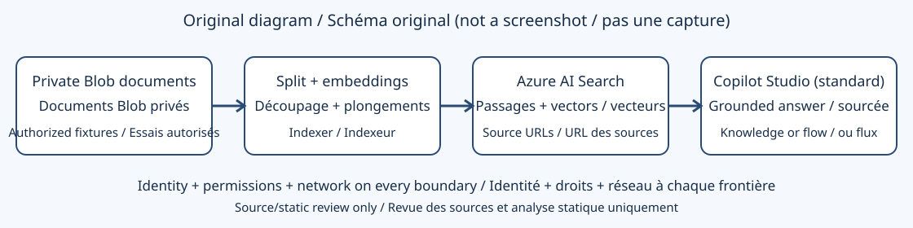

## Objectif et état des preuves

[Index des ateliers](index.md) | [English](../en/lab-05.md) | [Infrastructure préalable](lab-05-1.md) | [Suite : Foundry IQ](lab-06.md)

Construisez une chaîne de génération augmentée par récupération (RAG) : ingérez des documents, découpez-les en passages, produisez leurs vecteurs, retrouvez les passages pertinents, puis fondez la réponse sur ceux-ci. Prévoyez 90 à 120 minutes une fois l'infrastructure disponible. La recherche et la génération sont deux étapes distinctes ; une réponse plausible ne prouve pas que la recherche a fonctionné.

> [!IMPORTANT]
> Une exécution réelle Search Free complète désormais la revue initiale.
> Les trois PDF ont été indexés et testés par recherche lexicale, filtres, facettes,
> recherche sémantique, contrat vectoriel, hybride et cas négatifs. Les 17 contrôles
> d'hôtels ont réussi après suppression du paramètre `queryLanguage` non pris en
> charge par l'API actuelle. Ces vecteurs Free étaient des caractéristiques de ville.
> Une exécution payante approuvée a ensuite réussi 14 contrôles sans clé, avec
> vrais embeddings de 1 536 dimensions, vectorisation des requêtes par identité
> managée et recherche hybride sémantique. Ce premier découpage restait local.
> Un autre test privé Search Basic a réussi 25 contrôles : trois PDF originaux,
> indexeur Blob privé, neuf projections enfants, embeddings intégrés et recherche
> hybride sémantique. La connexion Copilot reste non exécutée. Consultez la procédure
> privée détaillée, le nettoyage et les [résultats réels](live-rerun-2026-10-19.md).

Ces consignes pédagogiques originales ne reproduisent ni le texte ni le code du support protégé. Les trois PDF de démonstration existent localement, mais ne sont pas redistribués. Aucune capture d'écran protégée n'est incluse.

Le nouvel environnement isolé sans clé a indexé les trois documents hôteliers
d'origine et réussi une vraie requête avec vectorisation en langage naturel.
La connexion Entra Copilot a été bloquée avant authentification par le navigateur
hôte ; aucune question connectée exécutée. Les URL sources hôtelières restent
aussi indisponibles : leur navigation exige une preuve distincte même après reprise.
Voir le [registre de connexion](backend-live-2026-10-20.md#connexion-search-sans-clé-bloquée-par-le-navigateur-hôte).

## Architecture et prérequis



Figure 1. Schéma explicatif nouvellement créé, et non capture d'écran ou preuve d'un système déployé.

Vous devez disposer des éléments suivants :

* Un abonnement Azure autorisé, un groupe de ressources, une région, un budget et un quota de modèle de plongement disponibles
* Azure AI Search, de préférence au niveau Basic ou supérieur pour l'identité managée sortante, et un conteneur Blob privé
* Un déploiement de plongements dont le modèle et les dimensions correspondent à l'indexation et à la vectorisation des requêtes
* Search Service Contributor pour gérer les objets, Search Index Data Contributor pour charger les documents et Search Index Data Reader pour les requêtes, selon les opérations
* Storage Blob Data Contributor pour l'identité qui téléverse ; Storage Blob Data Reader pour l'identité Search qui lit les objets blob
* Un agent Copilot Studio utilisant le harnais standard, l'accès à l'environnement, les licences et les autorisations de connexion ou de flux nécessaires
* L'[atelier 5.1](lab-05-1.md) terminé, ou une infrastructure équivalente fournie par un administrateur

Le rôle Contributor sur un groupe de ressources ne donne pas, à lui seul, accès aux documents Search. Les rôles, le réseau et l'authentification sont des contrôles indépendants. Consultez les [définitions des rôles Search](https://learn.microsoft.com/en-us/azure/search/search-security-rbac) au lieu de choisir un rôle dont le nom semble proche.

Ouvrez l'[expérience des agents standard](https://learn.microsoft.com/en-us/microsoft-copilot-studio/agents-experience/switch-experiences) pour les étapes Rubriques, Connaissances et flux ci-dessous. Le harnais est l'environnement d'exécution ; l'orchestration générative ou classique est un réglage distinct de l'agent standard. Préférez l'orchestration générative pour sélectionner automatiquement un outil ; appelez explicitement un flux depuis une rubrique pour un routage déterministe.

## 1. Préparer un corpus autorisé et reproductible

1. Dressez l'inventaire des fichiers autorisés, de leurs titres attendus, de leur langue et des droits de lecture prévus. N'utilisez pas de données de clients réels ni de documents dont la redistribution est interdite.
2. Pour un exercice débutant prévisible, créez deux fichiers texte UTF-8 avec les contenus fictifs originaux ci-dessous. Ces établissements inventés sont des jeux d'essai, pas des recommandations hôtelières.
3. Nommez le premier fichier `harbor.txt` :

   ```text
   Harbor Training Hotel
   City: Harbor City
   The training hotel has a rooftop garden and bicycle storage.
   The bicycle desk opens at 07:00.
   ```

4. Nommez le second fichier `forest.txt` :

   ```text
   Forest Training Lodge
   City: Pine Town
   The training lodge has a reading room and indoor pool.
   The reading room closes at 21:00.
   ```

5. Dans le portail Azure, ouvrez le compte de stockage autorisé, sélectionnez Conteneurs et créez `training-documents` sans accès anonyme.
6. Téléversez seulement ces deux fichiers pour le test contrôlé. La liste doit contenir exactement `harbor.txt` et `forest.txt`. Utilisez un autre conteneur pour évaluer ultérieurement les PDF autorisés de l'atelier.

Conservez les mêmes textes anglais dans les deux versions du guide pour comparer les tests multilingues. Deux fichiers d'entrée ne signifient pas exactement deux passages indexés : le nombre dépend du découpage et de l'extraction.

## 2. Créer l'ingestion et la vectorisation

1. Ouvrez le service Azure AI Search et lancez l'assistant actuel **Import data**. D'anciens supports utilisent **Import and vectorize data**. Choisissez un parcours de vectorisation/RAG, pas une importation limitée aux mots-clés.
2. Sélectionnez Azure Blob Storage et le conteneur privé. Préférez l'identité managée du service Search pour lire le stockage. Configurez son identité et ses rôles avant de lancer l'assistant.
3. Sélectionnez l'extraction et le découpage du texte. Pour commencer, essayez 1 000 caractères par passage avec un chevauchement de 200 caractères. Notez l'unité réellement choisie : caractères et jetons ne sont pas interchangeables.
4. Choisissez un déploiement de plongements autorisé. Vérifiez le nom du modèle, celui du déploiement et le nombre réel de dimensions. Le déploiement examiné utilise `text-embedding-ada-002` sur 1 536 dimensions. Un autre modèle convient seulement si l'index, la compétence de plongement et le vectoriseur des requêtes concordent.
5. Nommez l'index `training-rag` et notez les noms générés pour la source de données, l'ensemble de compétences et l'indexeur. Ne supposez pas qu'ils reprennent les noms d'un ancien atelier.
6. Examinez le schéma avant création. Conservez du texte et des métadonnées récupérables, un champ vectoriel interrogeable et une configuration sémantique donnant priorité au titre et au passage.
7. Préservez une URL de citation récupérable, telle que `metadata_storage_path`, qui pointe vers un document accessible aux utilisateurs autorisés. Un titre n'est pas un lien exploitable et l'URL d'un objet blob privé n'est pas automatiquement accessible à tous.
8. Créez les objets et lancez l'indexeur. Attendez son état final ; examinez chaque avertissement et erreur au lieu de vous contenter d'un indicateur vert.
9. Dans Search explorer, récupérez quelques documents. Vérifiez que le texte et le titre ou l'identité de source sont renseignés, ainsi que le champ vectoriel s'il est récupérable.

Le [démarrage rapide du portail actuel](https://learn.microsoft.com/en-us/azure/search/search-get-started-portal-import-vectors) constitue le point de départ recommandé. L'assistant peut produire d'autres noms de champs ; les exemples suivants supposent que vous les adaptez à `chunk`, `title` et `text_vector`.

### Variante manuelle et vérification des projections

Pour comprendre les objets individuels, suivez la [procédure de vectorisation intégrée](https://learn.microsoft.com/en-us/azure/search/search-how-to-integrated-vectorization) plutôt que de recopier un ancien schéma JSON.

1. Créez la source Blob, puis un index avec une clé `Edm.String` par passage, un champ `parent_id` filtrable, du texte interrogeable et un vecteur `Collection(Edm.Single)`.
2. Dans l'ensemble de compétences, découpez le contenu et vectorisez chaque passage enfant. Configurez les projections un-à-plusieurs depuis le contexte des passages.
3. Projetez texte, vecteurs, titre et métadonnées de citation dans l'index enfant. Laissez les projections gérer l'association parent au lieu de mapper manuellement cette clé.
4. Utilisez `projectionMode` avec `skipIndexingParentDocuments` pour un index contenant uniquement des passages. Vérifiez que la projection et l'indexeur ciblent le même index.
5. Associez l'ensemble de compétences à l'indexeur. Créer seulement une source et un index ne charge ni texte ni vecteurs.

Consultez les [projections d'index](https://learn.microsoft.com/en-us/azure/search/search-how-to-define-index-projections). Le schéma initial de passages ne fournit pas de métadonnées de citation complètes : ajoutez explicitement l'URL de source aux champs titre, texte et vecteur pour obtenir des citations cliquables.

## 3. Comparer les méthodes avant de connecter l'agent

1. Ouvrez Search explorer en mode JSON. Confirmez l'index sélectionné et utilisez les noms de son schéma réel.
2. Exécutez une recherche lexicale de référence :

   ```json
   {
     "search": "rooftop garden",
     "select": "title,chunk,parent_id",
     "top": 3,
     "count": true
   }
   ```

3. Exécutez une requête purement vectorielle avec un vectoriseur configuré pour les requêtes :

   ```json
   {
     "vectorQueries": [
       {
         "kind": "text",
         "text": "Where can I store a bicycle?",
         "fields": "text_vector",
         "k": 50
       }
     ],
     "select": "title,chunk,parent_id",
     "top": 3
   }
   ```

4. Ajoutez `"search": "bicycle storage"` à cet objet pour la recherche hybride. Celle-ci fusionne les résultats lexicaux et vectoriels par fusion réciproque des rangs, et non par addition de scores bruts différents.
5. Pour tester le reclassement sémantique, ajoutez `"queryType": "semantic"` et `"semanticConfiguration": "YOUR_CONFIGURATION_NAME"` à l'objet hybride. Remplacez ce dernier nom par celui de votre configuration. Conservez un texte de recherche significatif et assez de candidats.
6. Testez un filtre sur un champ déclaré filtrable. Copiez un `parent_id` renvoyé et utilisez `"filter": "parent_id eq 'COPIED_PARENT_ID'"`. Doublez une apostrophe présente dans la valeur. Tous les résultats doivent appartenir à ce parent.
7. Comme test négatif, filtrez sur `chunk` s'il n'est pas filtrable. Attendez une erreur HTTP 400 indiquant un champ invalide, et non une réponse réussie vide.
8. Conservez la requête, la méthode, les premiers résultats, la latence et le passage attendu. Rejouez le même ensemble après chaque modification.

Pour REST ou un flux HTTP, `2025-09-01` reste une version stable de l'API de recherche de documents ; `2026-04-01` est la dernière version stable de la [référence des versions](https://learn.microsoft.com/en-us/rest/api/searchservice/search-service-api-versions). Utilisez une version prise en charge de manière cohérente. N'introduisez pas de propriétés réservées à une préversion dans une requête stable.

### Expérience facultative sur les profils de score

L'index du support examiné déclare une liste vide de profils de score. Cela ne constitue pas un exercice de pondération terminé.

1. Dans un index d'essai distinct ou une mise à jour de schéma revue, ajoutez un profil donnant plus de poids à `title` qu'à `chunk`.
2. Exécutez la même requête lexicale avec et sans `scoringProfile`. Notez la définition et le changement d'ordre.
3. Comparez la pertinence, pas les valeurs de scores entre BM25, hybride et sémantique. Ne gardez le profil que si le jeu de questions annotées s'améliore.

Les [conseils sur les requêtes hybrides](https://learn.microsoft.com/en-us/azure/search/hybrid-search-how-to-query) décrivent la sélection des candidats et le reclassement. Ajouter des réplicas ne corrige ni une dimension vectorielle erronée ni une citation inutilisable.

## 4. Connecter les connaissances à l'agent standard

1. Ouvrez l'environnement et l'agent standard prévus. Vérifiez qu'il s'agit d'un agent de formation jetable, pas d'un agent de production.
2. Sélectionnez Connaissances, Ajouter des connaissances, À la une, puis Azure AI Search. Créez une connexion de données formelle avec une authentification autorisée dans votre environnement.
3. Préférez Microsoft Entra ID lorsqu'il est disponible. Ne collez jamais d'identifiants dans les instructions, les descriptions d'index, les captures ou ce dépôt.
4. Sélectionnez l'unique index vectoriel prévu et ajoutez-le à l'agent. Attendez l'état `Ready`.
5. Rédigez vos propres instructions : répondre uniquement à partir des documents de formation, identifier la source et indiquer l'absence d'information lorsqu'aucun document n'étaye une affirmation.
6. Désactivez la recherche web et écartez les connaissances sans rapport pendant l'évaluation contrôlée.
7. Posez les questions du tableau de tests. Examinez la trace d'activité et les citations : une réponse seule ne révèle pas le chemin emprunté.

Le [guide officiel de connexion](https://learn.microsoft.com/en-us/microsoft-copilot-studio/knowledge-azure-ai-search) contient actuellement des exemples avec clé et des consignes de récupération fondées sur Entra. Utilisez son parcours formel et l'option autorisée par votre locataire. Ne contournez pas le problème avec une connexion de connaissances non prise en charge.

## 5. Variante avec un flux HTTP contrôlé

Choisissez ce parcours pour imposer des filtres ou des paramètres de requête. Évaluez-le séparément du parcours Connaissances pour identifier celui qui répond.

1. Créez un flux d'agent standard avec le déclencheur de demande de l'agent et une entrée texte `question`.
2. Ajoutez une action HTTP envoyant un POST à l'opération de recherche de documents de votre index. Conservez l'adresse et les identifiants dans une connexion ou une configuration autorisée ; activez la sécurisation des entrées et sorties si disponible.
3. Déclarez le type de contenu JSON. Utilisez une connexion Entra et un parcours de jeton approuvés, ou une clé de requête si cette authentification est explicitement autorisée. N'exposez pas de clé d'administration aux utilisateurs.
4. Construisez un objet JSON contenant la question comme valeur, sans concaténer du texte utilisateur non échappé. Fixez côté serveur `top`, `select` et les filtres d'autorisation.
5. Analysez le tableau `value` de la réponse et renvoyez un volume borné de passages, de titres et d'URL de citation. Renvoyez un état explicite « aucun résultat » si le tableau est vide.
6. Ajoutez le flux comme outil de l'agent. Décrivez quand l'appeler et imposez une réponse fondée sur ses passages. Un succès HTTP ne prouve pas qu'une réponse est étayée.
7. Pour un test déterministe, appelez le flux depuis une rubrique et inspectez son exécution. En routage génératif, vérifiez l'outil choisi dans la trace.
8. Si un connecteur personnalisé est nécessaire, déclarez la même opération POST, une connexion authentifiée, une entrée typée et une réponse bornée. Importer une opération ne crée pas à lui seul une source de connaissances en temps réel.

Les actions HTTP, les connecteurs personnalisés et les types de connexion peuvent avoir des licences et des contraintes de prévention des pertes de données distinctes. Aucun flux ni connecteur n'a été créé pendant cette revue.

## Tests d'acceptation et relevé d'évaluation

Les valeurs exactes concernent uniquement le jeu fictif original. La formulation naturelle et les scores générés ne sont pas des contrats de correspondance exacte.

| ID    | Action                                                  | Assertion attendue                                                            | Résultat actuel |
| ----- | ------------------------------------------------------- | ----------------------------------------------------------------------------- | --------------- |
| S5-01 | Examiner le conteneur d'essai                           | Exactement les deux fichiers nommés                                           | Non exécuté     |
| S5-02 | Examiner la dernière exécution de l'indexeur            | `status` vaut `success` ; `itemsFailed` vaut `0` ; passages lisibles présents | Non exécuté     |
| S5-03 | Rechercher `rooftop garden`                             | Un passage Harbor pertinent figure parmi les trois premiers                   | Non exécuté     |
| S5-04 | Demander l'heure d'ouverture du service vélos           | Réponse avec `07:00` et citation Harbor                                       | Non exécuté     |
| S5-05 | Appliquer le filtre du parent copié                     | Chaque résultat porte exactement le `parent_id` retenu                        | Non exécuté     |
| S5-06 | Filtrer sur `chunk` non filtrable                       | HTTP `400` et erreur de champ exploitable                                     | Non exécuté     |
| S5-07 | Demander le prix de la navette aéroport du lodge        | Absence de source explicitement signalée ; aucun prix inventé                 | Non exécuté     |
| S5-08 | Examiner la trace connaissances/flux                    | Source ou outil prévu invoqué ; citation accessible au testeur autorisé       | Non exécuté     |
| S5-09 | Répéter en français                                     | Faits `07:00` et `21:00` conservés ; sources correctes                        | Non exécuté     |
| S5-10 | Retirer l'autorisation du testeur dans un test approuvé | Accès refusé ; aucune fuite par un chemin de repli                            | Non exécuté     |

Pour au moins dix questions annotées, notez les identifiants de documents pertinents avant les essais. Calculez hit@3 comme le nombre de questions avec un passage pertinent parmi les trois premiers, divisé par le nombre testé. La justesse des citations est le nombre d'affirmations citées étayées divisé par les affirmations citées examinées. Publiez médiane/p95 seulement avec assez de mesures, en précisant leur nombre. Ne produisez pas de pourcentage pour un test non exécuté.

## Dépannage et nettoyage

| Symptôme                                       | Vérification et action sûre                                                                         |
| ---------------------------------------------- | --------------------------------------------------------------------------------------------------- |
| Téléversement Blob refusé                      | Vérifiez le rôle de données de votre identité ; renouvelez la session après propagation             |
| Lecture du stockage impossible pour l'indexeur | Contrôlez séparément le rôle de lecteur de l'identité Search et le réseau                           |
| Longueur vectorielle incorrecte                | Comparez sortie du modèle, compétence et index ; réindexez dans un index compatible                 |
| Aucun résultat                                 | Contrôlez erreurs d'indexation, texte extrait, nom d'index, filtre et langue avant les instructions |
| Erreur sémantique ou limitation                | Vérifiez configuration, quota, niveau et limites ; réduisez la concurrence                          |
| Citations inaccessibles                        | Corrigez URL et droits de lecture ; n'activez pas l'accès Blob anonyme                              |
| Échec du dialogue de connaissances             | Appliquez le parcours officiel de récupération avec l'administrateur d'environnement                |
| Réponse fluide mais non étayée                 | Isolez les sources, désactivez le web, inspectez la recherche et imposez l'abstention               |

1. Exportez uniquement des preuves assainies : méthode, assertion, résultat, libellé de source anonymisé et horodatages. Excluez clés, jetons, texte protégé et URL privées.
2. Supprimez le flux/connecteur d'essai ou son association, puis les connaissances de formation de l'agent jetable.
3. Supprimez seulement l'indexeur, l'ensemble de compétences, la source, l'index et les objets blob de cette session après avoir confirmé qu'ils ne sont pas partagés.
4. Si l'infrastructure relève de l'atelier 5.1, suivez son plan Terraform de nettoyage revu. Supprimer un index ne met pas fin à la facturation du service Search.

## Limite de validation

Les constats statiques sont vérifiés, pas le comportement des services. Terminez seulement lorsque chaque test obligatoire a été exécuté sur des ressources autorisées et son résultat réel consigné. L'opérateur doit rétablir une session Copilot authentifiée et fournir les ressources Search manquantes. Aucune préparation à la production, économie ou amélioration de pertinence n'est affirmée.
