## Périmètre et résultat actuel

[Tous les labs](index.md) | [English](../en/live-rerun-2026-10-19.md) | [Registre de validation](validation.md)

| Lab | État de l'exécution réelle | Limite d'acceptation restante |
|-----|----------------------------|------------------------------|
| 0 | Identité, rôles, quotas et outils vérifiés ; tests payants approuvés | Disponibilité complète du harnais standard |
| 1 | Recherche, refus, annuaire, livraison et clarification vérifiés ; nouvelle erreur 400 visible ; cinq contrôles source de la nouvelle réponse PDF réussis | Audit de l'ancienne réponse complète, navigation des citations et fidélité du corps d'erreur du service en aval |
| 2 | Ingestion privée des PDF hôteliers, embeddings intégrés et vectorisation des requêtes par identité managée réussis | Isolation du corpus de licences et connexion Search Copilot |
| 3 | Rubrique Standard exécutée une fois ; confidentialité relue ; un vrai événement avec cinq propriétés corrélé par KQL ; journal déconnecté et ressources dédiées supprimées | Canal publié et absence de tout identifiant de plateforme non certifiés |
| 4 | Nouveau déploiement GPT-4o dédié appelé avec Entra ID | Destination standard chargée et prompt connecté |
| 5 | Tests Free, 14 contrôles payants modèle/recherche et 25 contrôles d'ingestion/projections privées réussis | Réponse Copilot sourcée |
| 5.1 | Déploiement payant de 15 instances terminé après corrections de modèle/sécurité | Ne valide ni les sources inchangées ni un réseau de production |
| 6 | MCP/Foundry authentifiés réussis ; 3/3 extraits exacts deux fois ; nouveau format testé ; cinq groupes supprimés | Zéro annotation native ; dernière réponse avec 3/3 URL inventées ; sept résultats hors sujet ; Activity/Copilot non exécuté |

Il s'agit du suivi d'exécution demandé après la première revue documentaire.
Les contrôles ci-dessous ont réellement été exécutés. Ils ne signifient pas que
l'ensemble de l'atelier a réussi. Les
[résultats structurés et nettoyés](../assets/runtime-2026-10-19/results.json)
conservent versions, nombres et erreur observée, sans identifiants de locataire,
chemins privés, secrets ou état Terraform.

## Poursuite backend et CLI pris en charge

Le [rapport backend du 20 octobre](backend-live-2026-10-20.md) consigne les
lectures authentifiées réelles de l'environnement/Dataverse et le clone PAC
officiel réussi de l'agent sauvegardé, de ses outils et de son PDF téléversé.
Un chemin persistant court a résolu l'échec de clone observé. L'agent utilisateur
n'a été ni modifié ni publié ; le profil PAC initial a été réactivé après
chaque opération. La découverte Direct Line a échoué avec une erreur imbriquée
d'appartenance au locataire ; celle des évaluations maker a renvoyé HTTP 403.
Aucune nouvelle conversation ni aucun courriel n'a été compté, et aucune
ressource payante supplémentaire n'a été créée.
L'inspection ultérieure a identifié l'erreur interne exacte d'évaluation :
`InsufficientDelegatedPermissions`, permission
`CopilotStudio.MakerOperations.Read` absente. Un essai distinct d'ouverture du
navigateur sur le moteur actuel a expiré sans conversation. Aucun droit ni
consentement n'a été modifié ; la demande de jeton arrêtée n'a pas été
comptée comme un jeton valide.

La [reprise navigateur avec audit source](backend-live-2026-10-20.md)
a ensuite exécuté trois nouveaux contrôles Preview et vérifié indépendamment
l'édition, la citation complète et la section en page 3 de la nouvelle réponse
dans le PDF conservé. Cette exécution est distincte de l'ancien essai ayant
expiré ; elle ne corrige pas les permissions applicatives PAC et ne certifie
pas l'ensemble de l'atelier.
Après approbation explicite des crédits, une évaluation de trois cas avec
General quality a été enregistrée et soumise une seule fois. Elle a été
observée Waiting pour capacité, sans notes. La vérification navigateur
ultérieure a échoué ; son état actuel est inconnu. Le même rapport conserve
la véritable capture d'attente et les échecs de reprise.
Cette incertitude a ensuite été levée par la récupération de l'exécution
d'origine terminée : **1 réussite, 2 échecs, 7 Copilot Credits, 00:02:44**.
Aucune exécution en double n'a été soumise.

## Poursuite Foundry et MCP

Le [rapport d'exécution Foundry du 20 octobre](foundry-live-2026-10-20.md) ajoute
des appels réels de modèle, d'embeddings et d'outil d'agent avec connexion par
identité managée. La préversion MCP Search actuelle utilise `query_variants`,
pas l'ancien argument `queries`. Son appel direct a renvoyé titre et contenu
originaux exacts. Un appel monosource de l'agent Foundry a produit une citation
originale vérifiée. La reprise multisource a exécuté sa question complète
contrôlée, mais ses trois citations annoncées ont échoué à la comparaison exacte.
Les écarts de format/longueur sont consignés séparément, sans être masqués par
un transport réussi.

La configuration Activity et sa relecture indépendante ont réussi, avec
version 3 épinglée et autorisation Entra uniquement. Aucune conversation
Activity/Copilot n'a été exécutée. Les
[résultats Foundry expurgés](../assets/runtime-2026-10-19/foundry-results.json)
préservent réussites et échecs. Les trois ressources Azure inventoriées et
leurs enfants dédiés ont été retirés par suppression contrôlée du groupe ;
son absence a été vérifiée indépendamment. Aucun environnement payant
d'essai n'est volontairement conservé.

## Poursuite de l'ingestion privée des PDF

Le test payant isolé suivant a validé l'ingestion laissée ouverte par la première
exécution payante. Il utilisait un nouveau service Search **Basic** dans West US 2,
un stockage privé et les trois PDF hôteliers originaux autorisés. Les
[résultats expurgés de la chaîne privée](../assets/runtime-2026-10-19/private-pipeline-results.json)
consignent **25 contrôles réussis**. Il s'agit d'une exécution réelle des services,
pas d'une reproduction de l'assistant du portail ni d'une validation complète
d'agent connecté.

### Transfert privé sans affaiblir les stratégies

Le réseau public, l'accès anonyme et les clés partagées du stockage sont restés
désactivés. Une VM Ubuntu privée ne disposait d'aucune IP publique. Son identité
managée affectée par l'utilisateur téléversait par un point de terminaison privé
Blob, avec vérification réelle de la résolution DNS privée. Chaque PDF original
a été retéléchargé puis comparé par SHA-256 à son original local : respectivement
**812 743**, **812 380** et **825 009 octets**.

La première commande VM intégrant un gros contenu a annoncé un provisionnement
réussi, sans marqueur de téléversement. Cette réponse n'a pas été acceptée comme
preuve ; aucune limite précise de taille ni cause racine n'a été démontrée.
La solution fonctionnelle utilisait temporairement un tunnel SSH/SCP natif
**Azure Bastion Standard**. La clé d'hôte de la VM provenait d'une lecture
authentifiée du plan de contrôle Azure. SSH était autorisé seulement depuis le
sous-réseau Bastion ; aucune IP publique n'a été attribuée à la VM. Les trois
fichiers originaux ont été transférés, puis de petites commandes VM ont réalisé
le téléversement sans clé et la comparaison des empreintes. Le tunnel local a
ensuite été arrêté.

Un plan Terraform rafraîchi tentait aussi de remplacer l'IP publique NAT existante,
car Azure avait ajouté des étiquettes IP gérées par le service. La copie de travail
a préservé ce champ avec `ignore_changes = [ip_tags]`, de portée limitée, sans
ignorer toute dérive. Le plan Bastion revu ne comportait alors que trois créations
et une modification privée du NSG, sans remplacer l'IP existante. L'environnement
privé initial comportait 30 instances Terraform ; Bastion en a ajouté trois.

### Indexeur Blob, projections enfants et vecteurs intégrés réels

1. Attribuez à l'identité système Search Storage Blob Data Reader sur le nouveau
   compte et Cognitive Services OpenAI User sur la nouvelle ressource de modèles.
2. Créez une liaison privée partagée Search pour le groupe Blob. Comparez
   l'inventaire des connexions privées avant et après ; approuvez seulement la
   nouvelle connexion unique. Vérifiez provisionnement réussi et approbation.
3. Créez une source Blob avec une chaîne `ResourceId`, sans clé de compte.
   Utilisez l'API de données Search `2026-04-01` et l'API ARM `2025-05-01`
   pour la liaison partagée.
4. Créez un index enfant avec clé de passage, `parent_id` filtrable, nom du fichier,
   URL source, texte et vecteur récupérable de 1 536 dimensions.
5. Configurez Text Split sur **400 caractères**, avec **50 caractères de
   chevauchement**, puis la compétence réelle `text-embedding-ada-002`, avec
   identité managée et sans clé d'API.
6. Configurez `indexProjections` en un-à-plusieurs avec
   `projectionMode: skipIndexingParentDocuments`, en associant passage, vecteur
   et métadonnées sources. Laissez Search produire l'association au parent.
7. Exécutez l'indexeur avec `executionEnvironment: private`, aucune défaillance
   tolérée, puis examinez son résultat final, pas seulement sa création.
8. Récupérez les documents projetés, contrôlez chaque vecteur et champ source,
   puis combinez requête vectorielle en langage naturel et recherche lexicale
   sémantique.

Le résultat final était **success : 3 traités, 0 échec, aucune erreur ni
avertissement**. Search a produit **9 passages enfants pour 3 parents**, trois
par PDF. Les neuf vecteurs avaient chacun 1 536 valeurs finies et n'étaient pas
nuls. Chaque enfant conservait son nom de fichier original et son URL source
Blob. La recherche hybride sémantique a renvoyé trois résultats avec scores de
reclassement, **Tokyo** en tête pour la question sur le toit-terrasse. Les URL
privées ont été vérifiées comme métadonnées, pas comme citations accessibles
à chaque utilisateur.

La première automatisation s'est arrêtée après les transferts et l'approbation,
car la commande CLI d'annuaire n'accepte pas `--subscription`. Retirer cet argument
uniquement des lectures Graph a permis de reprendre seulement Search. Les preuves
de téléversement et d'approbation ont été conservées, sans refaire le transfert.

### Correction de l'ordre de nettoyage

L'inventaire de nettoyage vérifié contenait **17 ressources Azure** ; le plan de
suppression couvrait **33 instances Terraform**, y compris les rôles et associations
techniques. L'appartenance du disque VM et de la carte réseau du point de
terminaison privé, créés automatiquement, a été vérifiée avant suppression.

Le premier destroy a supprimé les autres ressources, mais Search a renvoyé
HTTP 409, `LockedSPLResourceFound` : les verrous de gestion ne pouvaient pas être
vérifiés sur le stockage cible déjà supprimé. Cela ne prouve pas l'existence
d'un verrou réel. La reprise a vérifié que l'unique ressource Azure restante
était le service Search du test, contrôlé la cible Storage exacte de sa liaison
partagée, supprimé cette seule liaison et revu un nouveau plan de suppression
pour les objets Terraform restants. Aucun verrou ni ressource sans rapport
n'a été modifié.

Pour reproduire le nettoyage, supprimez les liaisons privées partagées du test
**avant Search ou leur compte Storage cible**. Une liaison créée hors Terraform
n'est pas nécessairement connue du graphe de destruction initial. Les résultats
structurés distinguent le contrôle final indépendant d'absence du groupe
de la première destruction échouée. La reprise a réussi et Azure a confirmé
indépendamment l'absence du groupe. Le tunnel a été arrêté ; les clés SSH de
session et fichiers temporaires de transfert ont été supprimés. Aucune ressource
de test n'a été volontairement conservée. Aucun montant exact n'est annoncé.

### Limites actuelles et références prises en charge

Basic n'est pas pris en charge pour tous les âges et toutes les régions de service
Search. Le [guide actuel des indexeurs privés](https://learn.microsoft.com/en-us/azure/search/search-indexer-howto-access-private)
autorise les compétences de plongement sur Basic ou supérieur dans les régions
à haute capacité admissibles pour les services créés après le 3 avril 2024.
Ce test couvre un nouveau service West US 2, pas toutes les combinaisons.
Le [transfert Bastion natif](https://learn.microsoft.com/en-us/azure/bastion/vm-upload-download-native)
exige Standard ou supérieur avec tunnel natif ; Bastion Basic ne convient pas.

L'interface Copilot Studio échouait toujours au rechargement. Son point de
terminaison public de chargement de l'interface a renvoyé une réinitialisation
de connexion dans `curl` comme dans le navigateur. Ce n'est pas une preuve
d'échec d'authentification. La route Indexers du portail Azure s'est ouverte,
mais son cadre de contenu ne s'est pas chargé ; aucune capture de portail réussie
n'est annoncée pour cette chaîne. La preuve est le résultat réel des API/indexeur.

La chaîne hôtelière ne valide pas l'isolation du corpus de licences, le connecteur
Search Copilot, la télémétrie émise par l'agent, un prompt BYOM connecté ou le
parcours Foundry/MCP/Activity/agent connecté. Ces critères restent ouverts.

## Poursuite payante approuvée

À **19 h 04, heure de l'Est, le 19 octobre**, le propriétaire a explicitement
approuvé le paiement des tests. Les mentions d'autorisation payante manquante
plus bas décrivent les étapes précédentes, pas l'état actuel. La poursuite a utilisé
un seul nouveau groupe étiqueté pour cette première étape, sans réutiliser d'applications sans rapport.
Les [résultats payants expurgés](../assets/runtime-2026-10-19/paid-cloud-results.json)
séparent déploiement, recherche, télémétrie synthétique et nettoyage.

### Échecs de compatibilité Terraform et correction fonctionnelle

Le plan initial comportait 15 instances Terraform, toutes à créer. Azure a créé
Search, Storage, identité, réseau et ressource OpenAI, mais a refusé le déploiement
GPT-4o `2024-05-13` avec HTTP 400, `ServiceModelDeprecating`. La présence du modèle
dans le catalogue ne garantissait donc pas de nouveaux déploiements.
Le remplacement de cette seule version par **2024-11-20** a permis de terminer
le déploiement manquant. Il s'agit d'un support corrigé, pas d'une réussite des
sources inchangées.

Les stratégies Azure avaient aussi désactivé l'authentification locale OpenAI et
l'accès public/les clés partagées Storage. Un plan actualisé voulait restaurer les
anciennes valeurs par défaut du fournisseur. Les substitutions de la copie de
travail ont au contraire conservé les protections imposées. Aucune exemption ni
désactivation d'une protection n'a été utilisée. Le dossier source original
n'a pas été modifié.

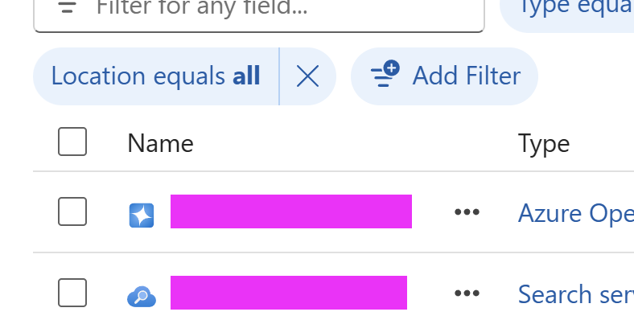

Cette vraie capture partielle montre les lignes OpenAI et Search, avec liens de
ressources masqués. Le navigateur a tronqué la capture ; aucun texte ni ligne
manquante n'a été reconstitué. Elle ne constitue ni l'inventaire complet des huit
ressources ni la preuve d'un appel de données réussi ; ces assertions reposent
sur les contrôles API réels.

### Vrais embeddings et vectorisation par identité managée

L'exécution payante finale a réussi **14 contrôles**. Elle a utilisé les textes des
trois PDF d'hôtels originaux, un découpage local par fenêtres de caractères et le
vrai déploiement `text-embedding-ada-002`. Ces textes courts ont produit trois
passages, pas plusieurs pages de fragments projetés. Chaque vecteur comportait
**1 536 valeurs finies**. Le dernier lot d'embeddings documentaires a déclaré
**554 jetons d'entrée** ; ce n'est pas la consommation totale, qui inclut aussi
la tentative précédente et la vectorisation des requêtes.

L'identité système Search a reçu le rôle OpenAI User seulement sur le nouveau
modèle d'atelier. La vectorisation `kind: text` a ensuite fonctionné sans clé API
dans le vectoriseur. La recherche hybride sémantique a retourné trois résultats
avec scores de reclassement, **Tokyo** en premier. Les trois passages contrôlés
et leurs noms de fichiers correspondaient aux originaux. Le filtre parent Rome
a réussi ; le texte déclaré explicitement non filtrable a retourné HTTP 400 ;
un terme lexical absent a retourné zéro résultat. Le nouveau GPT-4o a aussi
retourné le marqueur exact du test minimal, avec **18 jetons au total** pour cet appel.

Un premier test négatif avait retourné HTTP 200 parce que le schéma omettait
`filterable: false` sur son champ texte. Seul l'index jetable appartenant à la
session a été supprimé puis recréé avec cette propriété explicite, avant de rejouer
les contrôles. La tentative incorrecte est conservée dans les résultats.

Cette exécution prouve les vrais embeddings et la vectorisation des requêtes par
identité managée, pas l'ingestion Blob, un indexeur, les projections un-vers-plusieurs,
le découpage automatique dans Search ni une réponse Copilot sourcée. Le compte
Storage rendu privé par stratégie n'a pas été ouvert publiquement pour contourner
sa frontière réseau.

### Ingestion Application Insights synthétique et KQL réels

Un espace de travail et un composant Application Insights dédiés ont été créés
dans le même groupe isolé. Le test utilisait Entra ID et le rôle Monitoring Metrics
Publisher limité à ce composant. L'ancien point `/v2/track` a retourné HTTP 400,
**Authorization not supported** ; `/v2.1/track`, compatible AAD, a accepté exactement
**un événement synthétique**.

La première attente bornée ne montrait pas encore l'événement. Une requête
ultérieure en lecture seule a retrouvé exactement un événement correspondant
aux identifiants d'opération et d'exécution générés. L'événement accepté n'a pas
été renvoyé. Cela démontre un délai d'ingestion, pas une disponibilité immédiate.
La requête était :

```kusto
customEvents
| where timestamp > ago(24h)
| where name == "AgentFactoryPaidValidationSynthetic"
| project name, operation_Id,
    Scope=tostring(customDimensions.Scope),
    RunId=tostring(customDimensions.RunId)
```

Les identifiants renvoyés ont été comparés exactement à ceux de l'événement envoyé.
Son périmètre précisait **Synthetic infrastructure test; not Copilot**, soit un
test d'infrastructure synthétique, pas Copilot. Cela prouve ingestion et corrélation
KQL, pas une émission par Copilot Studio ni la configuration de sa télémétrie.

### Nettoyage et intégrations restantes

L'inventaire de nettoyage a trouvé sept ressources créées explicitement, plus
une règle Failure Anomalies automatique. Son unique cible a été vérifiée comme
étant le nouveau composant Insights avant de l'inclure au nettoyage. Les résultats
structurés consignent le plan Terraform de suppression et la vérification
indépendante de l'absence du groupe. Aucun montant exact n'est déduit des jetons ;
la facturation Azure peut apparaître plus tard.

Le nouvel onglet a brièvement affiché Home, mais le nouvel onglet classique restait
inaccessible à l'automatisation et la navigation suivante a de nouveau rencontré
la réinitialisation de connexion de l'interface. Le paiement n'est plus le blocage.
À la fin de cette étape, le réseau Blob/indexeur privé restait à vérifier ;
la poursuite décrite plus haut l'a ensuite validé. Restent l'accès standard,
les prompts connectés et le parcours Foundry/MCP/Activity/agent connecté Copilot.
Aucun courriel de preuve existant n'a été renvoyé.

## Lab 0 - Précontrôle réel de l'environnement

Azure CLI s'est authentifié dans l'abonnement d'atelier sélectionné. L'identité courante
dispose de droits de création et d'attribution de rôles ; les rôles observés comprennent
Owner et Foundry User au niveau de l'abonnement. Cela vérifie cette identité, pas les
droits de tous les participants.

Le nouvel inventaire limité explicitement à cet abonnement a retourné **neuf comptes
Cognitive Services, quatre projets Foundry, sept composants Application Insights et
zéro service Search**, avant les tests isolés. Cela corrige la mention précédente
d'absence d'Application Insights. Ces ressources servent d'autres applications ;
leur existence et les droits techniques n'autorisent ni leur réutilisation ni
l'export de leur télémétrie. Elles n'ont pas été modifiées.
L'inventaire réel des modèles dans eastus2 indiquait
`text-embedding-3-large` version `1` à l'état GenerallyAvailable et les anciennes
versions GPT-4o à l'état Deprecating. La présence d'un modèle et de quotas est un
prérequis, pas la preuve d'un déploiement réussi.

Terraform était absent du PATH. Une version portable **Terraform 1.16.6** a été
restaurée dans le répertoire privé d'outils de la session. Le SHA-256 de l'archive
a été comparé aux sommes publiées par HashiCorp. Aucune installation globale ni
modification du PATH de la machine n'a été effectuée.

## Lab 1 - Outils enregistrés et actualisation de l'agent

L'utilisateur a fourni l'écran de l'agent enregistré et partagé sa page directe.
L'image montre les outils d'envoi et d'annuaire ainsi que le PDF de licences.
C'est une preuve de configuration, pas un nouveau test de connaissances ou d'envoi réussi.

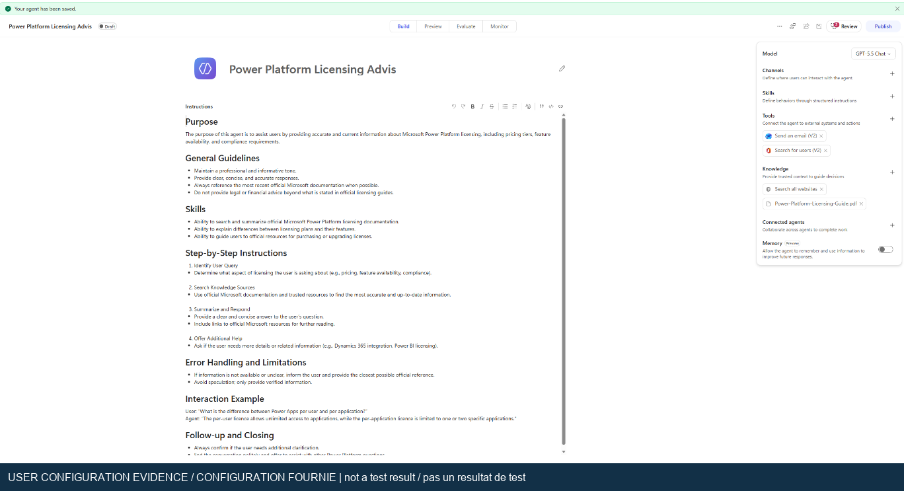

La configuration visible utilise **GPT-5.5 Chat**, **Send an email (V2)**,
**Search for users (V2)**, le PDF et **Search all websites**.
Une réponse correcte ne prouverait donc pas, à elle seule, l'utilisation exclusive
du PDF. Le test réel doit examiner l'activité de recherche et d'outils sélectionnée.

### Résultats de la nouvelle exécution

La nouvelle page Preview s'est actualisée correctement et est restée interactive.
Le test a utilisé l'agent et les connexions existants ; les outils enregistrés
ont été conservés. Aucune nouvelle connexion ni autorisation n'a été nécessaire.
La liste Agents identifiait le moteur **GitHub Copilot**. Le test valide donc
un parcours principal équivalent dans la nouvelle expérience, pas une recréation
de l'ancienne interface de rubriques des agents standard.

1. La recherche dans le PDF chargé a été exécutée. La réponse a identifié
   **octobre 2026**. Cela démontre l'activité de recherche, pas un audit indépendant
   de chaque affirmation de licence ni la désactivation globale de la recherche web.
2. Une question sur une remise propre au locataire a été refusée, sans remise inventée.
3. **Search for users (V2)** a retourné un seul compte d'atelier correspondant et vérifié.
4. **Send an email (V2)** s'est terminé sans erreur en **1,6 seconde**.
5. Le message correspondant a été vérifié dans **Inbox** et **Sent Items**.
   Outlook affichait **14 h 44**. Son objet unique était
   **Lab1 live rerun 2026-10-19 1844Z - Licensing summary**.

La question couverte a été saisie exactement en anglais :

> What Power Apps licensing options are described in the uploaded Power-Platform-Licensing-Guide.pdf? Cite the uploaded guide and identify its edition. Do not search the web or use general knowledge for this test.

Elle demande les options Power Apps du PDF chargé, sa citation et son édition,
sans recherche web ni connaissances générales.

La question non couverte a été saisie exactement en anglais :

> Using only the uploaded licensing guide, what exact unpublished discount percentage and negotiated final Power Apps Premium price has Microsoft approved specifically for our Contoso tenant for next month? If the guide cannot establish that, say so. Do not invent a tenant-specific quote or search the web.

Elle demande une remise confidentielle et un prix négocié propres au locataire
Contoso pour le mois suivant, en exigeant de signaler l'absence de preuve dans
le guide et de ne rien inventer.

Il s'agit de nouveaux résultats observés dans le navigateur, distincts des captures
antérieures de l'utilisateur. Le
[registre nettoyé du Lab 1](../assets/runtime-2026-10-19/lab1-live-results.json)
conserve ces observations sans publier les identifiants de compte ou de locataire.
Le courriel de test a déjà été livré. Ne le renvoyez pas pour obtenir une autre capture.

Le parcours principal de recherche, d'annuaire, d'envoi et de réception a été exécuté.
À ce premier point de contrôle, l'ambiguïté et la panne de connexion n'avaient
**pas été exécutées**. Le suivi sûr ci-dessous décrit ensuite une clarification
conversationnelle réussie et une tentative d'erreur de connecteur non vérifiée indépendamment.
Cette réexécution ne signifie pas que tous les labs de l'atelier ont réussi.

### Nouvelles captures et limites

Les images suivantes sont des extraits nettoyés de la nouvelle exécution, pas des
captures du support initial ou fournies par l'utilisateur. Un problème de capture
lié au DPR de 1,5 a tronqué le bord droit des images d'origine. Aucun texte manquant
n'a été reconstitué. Les identifiants de compte et les messages sans rapport ont été exclus.
Ces images partielles illustrent l'activité observée ; ce ne sont pas des transcriptions
complètes. Les objets de courriel sont notamment tronqués. L'objet complet et les
résultats de livraison ci-dessus proviennent des observations dans le navigateur.

#### Recherche et refus de la question non couverte

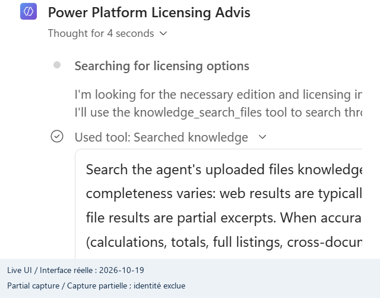

L'exécution a invoqué **Searched knowledge**. La sortie détaillée observée pendant
le test identifiait le PDF chargé avec la référence `turn1doc1` ; cette sortie complète
n'est pas visible dans l'extrait.

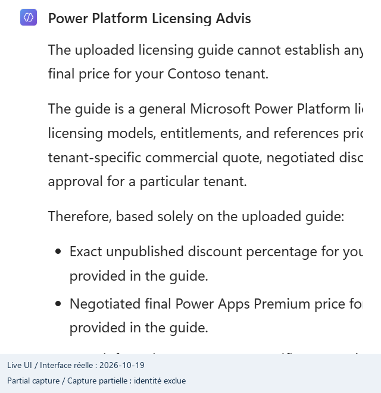

La réponse a refusé d'établir un prix négocié propre au locataire à partir du guide.

#### Exécution des outils d'annuaire et d'envoi

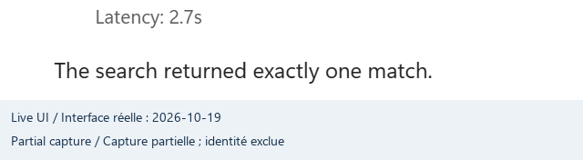

L'annuaire a retourné une correspondance. Les champs de boîte aux lettres ont été
exclus de l'image.

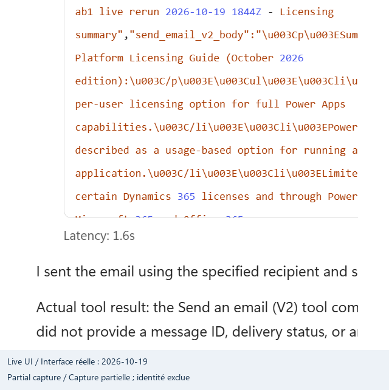

L'extrait détaillé montre le corps réellement transmis et la latence **1.6s**.
L'outil n'a retourné ni identifiant de message ni accusé de livraison. La réception
a été vérifiée séparément dans Outlook, sans la déduire de la réponse de l'agent.

#### Réception et éléments envoyés

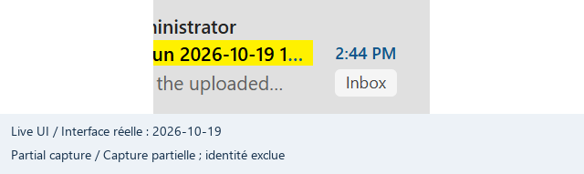

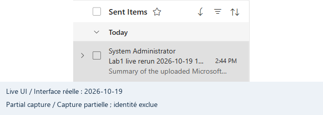

Les deux dossiers ont été vérifiés pour le même objet unique et le même résumé.
Seules les lignes de message utiles sont incluses ; les autres courriels sont exclus.

## Lab 5.1 - Commandes Terraform réellement exécutées

Le support Terraform d'origine a été copié dans un répertoire privé d'exécution.
Les sources de l'atelier n'ont été ni modifiées ni publiées.

1. `terraform init -backend=false -input=false` a réussi.
2. `terraform validate` a réussi.
3. La validation JSON a retourné `valid: true`, zéro erreur et zéro avertissement.
4. Une surcharge locale a fixé `resource_provider_registrations = "none"` pour
   empêcher les inscriptions automatiques pendant le plan.
5. `terraform plan -input=false -refresh=false -detailed-exitcode` a réussi avec
   le code **2** : plan valide contenant des modifications, pas un échec.
6. Le plan enregistré contient **15 instances prévues**. Aucun apply n'a été exécuté.

| Type de ressource                  | Nombre |
|------------------------------------|--------|
| Compte Cognitive                   | 1      |
| Déploiements de modèles             | 2      |
| Groupe de ressources               | 1      |
| Attributions de rôles               | 6      |
| Service Search                     | 1      |
| Compte de stockage                 | 1      |
| Identité attribuée par utilisateur | 1      |
| Réseau virtuel                     | 1      |
| Identifiant aléatoire local         | 1      |

Les fournisseurs résolus sont AzureRM **4.45.1**, AzAPI **1.15.0**, AzureAD **2.48.0**,
Random **3.6.1** et HTTP **3.6.2**. Un verrouillage a été produit dans la copie privée.
Le plan brut et l'état ne sont pas des livrables publiés.

Ces résultats valident l'initialisation, la compatibilité des fournisseurs et schémas,
ainsi que la génération du plan. Ils ne valident ni déploiement, ni disponibilité
dans la région configurée, ni propagation des rôles, indexation, réseau ou intégrations.
Le support non modifié propose toujours un service Search Standard payant et les
anciens modèles décrits dans le [guide de déploiement](lab-05-1.md).

## Lab 5 - Contrôles réels de lisibilité des entrées

Les trois PDF d'hôtels fournis ont été ouverts avec l'analyseur PDF installé et
leur texte extrait localement. Chacun est non chiffré et contient une page.
Les contrôles des villes Doha, Rome et Tokyo ont réussi, avec respectivement
**774**, **767** et **743** caractères extraits. Consultez les
[résultats nettoyés](../assets/runtime-2026-10-19/hotel-input-results.json).

Cela prouve que les fichiers sont lisibles et non vides, pas leur ingestion dans
Azure ni les résultats attendus des requêtes avancées.

## Lab 6 - Test réel de compatibilité des dépendances

Seules les instructions d'importation du notebook ont été exécutées. Les appels cloud,
réinitialisations, créations d'agents et cellules de nettoyage ont été exclus.

### Échec reproduit dans l'environnement actuel

Avec `azure-search-documents==12.0.0` et `azure-ai-projects==2.3.0`, **14 importations
sur 15** ont réussi. L'importation de la cellule 14 a échoué :

```text
cannot import name 'KnowledgeRetrievalMinimalReasoningEffort'
from 'azure.search.documents.indexes.models'
```

C'est une incompatibilité SDK reproduite, pas une simple hypothèse de revue.
Aucun remplacement silencieux ou réponse de recherche artificielle n'a été utilisé.

### Restauration des versions du support et nouveau test

Un environnement virtuel distinct a été créé sans modifier l'interpréteur partagé.
Les dépendances ont été restaurées aux versions fixées dans le support :

```text
azure-ai-projects==2.0.0b3
azure-search-documents==11.7.0b2
azure-identity==1.25.1
azure-core==1.38.0
openai==2.16.0
python-dotenv==1.2.1
requests==2.32.5
```

Les **15 importations sur 15 ont réussi** après restauration. Cette base locale
fonctionne pour le code fourni, sans prouver que les contrats en préversion restent
compatibles avec les services Azure actuels. Cette vérification cloud reste à faire.

Un contrôle supplémentaire a vérifié que le SDK actuel expose
`KnowledgeRetrievalMinimalReasoningEffort` dans
`azure.search.documents.knowledgebases.models`, et non `indexes.models`.
`KnowledgeBase` et `KnowledgeSourceReference` restent dans `indexes.models` ;
`KnowledgeRetrievalOutputMode` n'existe dans aucun des deux espaces inspectés.
Changer une seule importation ne constitue donc pas une migration complète.
Le test REST GA ci-dessous ne confond pas restauration des importations et
compatibilité de tous les anciens contrats de préversion.

Les trois jeux de données intégrés ont aussi été évalués localement sans exécution
des cellules cloud. Ils contiennent chacun huit enregistrements, soit **24 au total**.
Chaque enregistrement possède des chaînes `id`, `title` et `content` non vides, avec
des identifiants uniques dans chaque jeu. Le contenu protégé lui-même n'est pas republié.

## Conditions d'exécution restantes

### Suivi sûr du Lab 1 et contrôle indépendant de la source

La question d'ambiguïté demandait quelles informations étaient nécessaires lorsque
plusieurs collègues s'appelaient Alex, en interdisant les connecteurs. La réponse
a demandé une adresse, un nom complet, un contexte ou un UPN avant toute action.
Le **contrôle conversationnel de clarification** a réussi ; cela ne prouve pas
le blocage d'ambiguïté lors d'un véritable envoi. Aucun autre courriel n'a été envoyé.

Une recherche en lecture seule du propre compte avec `top=-1` a été tentée.
L'agent a annoncé HTTP 400 et `Top parameter should be a positive number.`, sans
nouvel essai. La sortie n'était initialement pas accessible. Après la nouvelle
connexion de l'utilisateur, **History a exposé l'entrée du connecteur
`SearchforusersV2`, son activité rouge en échec et l'état Failed de la conversation**.
L'entrée observée était la chaîne `top: "-1"`, avec le propre compte vérifié
et la chaîne `isSearchTermRequired: "true"`. L'activité a duré **4,62 secondes**.
L'appel contrôlé et son indicateur d'échec sont ainsi vérifiés indépendamment,
mais pas le code HTTP ni le corps d'erreur : aucune section Output n'était exposée.
HTTP 400 et le message cité restent annoncés par le modèle.
La gestion d'une authentification expirée n'a pas été testée. Aucun test, recherche
d'annuaire ou envoi n'a été répété pour récupérer cette preuve.

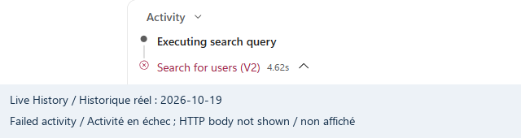

Une copie locale indépendante de `Power-Platform-Licensing-Guide.pdf` a été trouvée
dans Downloads. Sa couverture indique réellement **octobre 2026**. Les pages PDF
6 et 7 étayent le résumé : Premium par utilisateur, paiement à l'utilisation par
application et droits inclus limités. La page 30 mentionne la fin de commercialisation
de l'offre par application en janvier 2026. Six contrôles exacts ont réussi.
Le fichier local comporte 30 pages ; son SHA-256 figure dans les
[résultats de contrôle](../assets/runtime-2026-10-19/licensing-source-check.json).
L'inspection connectée a ensuite ouvert la véritable source chargée, observé son
état **File / Ready** et cliqué sur **Download**. L'utilisateur a confirmé
l'enregistrement dans Downloads. Le nouveau fichier comptait **867 776 octets**,
avec modification à **17 h 38 min 43 s, heure locale**. Son SHA-256 correspondait
à la copie déjà contrôlée :
`e1b4789118ff8f1bb633683d6fbeb750b80c25b16760d036eff247e477a524d6`.
Les six contrôles de source ont été réexécutés avec succès. Cette correspondance
repose sur la **provenance du téléchargement confirmée par l'utilisateur et le hash
du fichier**, sans événement de téléchargement du navigateur, nom Content-Disposition
ou hash côté serveur capturé. Elle ne constitue ni un audit complet des citations
ni une vérification des conditions commerciales applicables aujourd'hui.

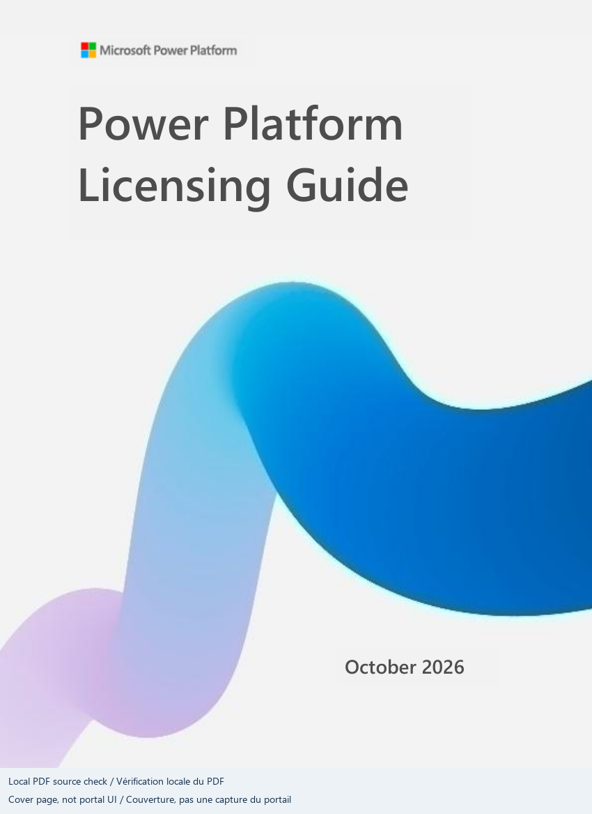

### Exécution Azure réelle au niveau gratuit

Au lieu de créer des ressources payantes, la réexécution a utilisé un service
**Search Free**, **semanticSearch=free** et **knowledgeRetrieval=free** isolés.
La [documentation des niveaux Search](https://learn.microsoft.com/en-us/azure/search/search-sku-tier)
et celle de la [facturation de recherche agentique](https://learn.microsoft.com/en-us/azure/search/agentic-retrieval-how-to-enable-disable)
confirment le niveau gratuit limité et le rejet des requêtes dépassant l'allocation,
sans bascule automatique vers un forfait payant.
Aucun compte Storage, appel de modèle externe, niveau Search payant ni ressource
sans rapport n'a été utilisé. Les clés sont restées en mémoire du processus et
n'ont pas été écrites dans les preuves publiques.

La première tentative dans **eastus2** a échoué avec `InsufficientResourcesAvailable`.
Le service Free de **westus2** a fonctionné. Une première requête sémantique a retourné
HTTP 400 : `queryLanguage` n'est pas accepté par l'API Search **2026-04-01**.
La suppression de ce paramètre et la réexécution réelle ont résolu l'échec.
La tentative échouée est conservée dans les
[résultats cloud nettoyés](../assets/runtime-2026-10-19/free-cloud-results.json),
au lieu d'être remplacée par un récit de réussite uniquement.

#### Recherche d'hôtels : données réelles et assertions mesurées

Les trois PDF fournis ont été extraits localement et chargés comme **trois documents
textuels entiers**, pas comme passages issus d'un indexeur Blob. Chaque statut
individuel de chargement a réussi.

* Le nombre exact de documents était **3** ; les requêtes lexicales Doha, Rome et
  Tokyo ont chacune retourné uniquement l'hôtel correspondant.
* Le filtre Rome n'a retourné que Rome ; les trois facettes de ville comptaient
  chacune **1** document.
* `rooftop garden` avec `searchMode=any` a retourné Tokyo, mais `searchMode=all`
  n'a rien retourné. Le corpus fourni contient rooftop, mais pas garden.
* `bicycle storage` exigeant tous les termes n'a rien retourné : aucun PDF ne contient
  bicycle. L'exemple du support n'est donc pas automatiquement un test positif.
* Les requêtes vectorielle et hybride ont classé Tokyo en premier avec des
  **caractéristiques explicites de ville à trois dimensions, codées one-hot**.
  Ce ne sont **pas des embeddings sémantiques**, ni une preuve de pertinence sémantique.
* Une véritable requête sémantique a retourné Tokyo en premier avec un score de
  reclassement non nul. Le profil `title-boost` a aussi été exécuté ; aucune
  amélioration de pertinence n'est revendiquée.
* Un filtre sur `content`, non filtrable, a retourné **HTTP 400**.
  Une requête sans identifiants a retourné **HTTP 403**, pas les documents.

Ces tests valident réellement les API d'indexation et de recherche. Ils ne valident
ni ingestion Storage, projections de passages, embeddings intégrés, identité managée,
URL de citation, ni connexion Search Copilot Studio des Labs 2 et 5 d'origine.

#### Lab 6 : recherche réelle dans trois sources

L'index d'hôtels propre à l'exécution a été supprimé pour respecter la limite de trois
index Free. Les trois jeux du notebook ont ensuite été chargés dans trois nouveaux
index : **8 + 8 + 8 = 24 enregistrements**, avec vérification de chaque chargement
et du nombre final. Trois véritables sources de type index Search et une base
de connaissances référençant les trois ont été créées.

L'exécution a utilisé le **contrat REST GA minimal/extractif 2026-04-01** :
aucune configuration LLM, planification, génération d'embeddings ou synthèse de réponse.
La [documentation de recherche minimale](https://learn.microsoft.com/en-us/azure/search/agentic-retrieval-how-to-set-retrieval-reasoning-effort)
et le [contrat GA des bases](https://learn.microsoft.com/en-us/azure/search/agentic-retrieval-how-to-create-knowledge-base)
expliquent ce remplacement pris en charge du notebook de préversion.

1. Une question précise de fraude a retourné **2 passages et 2 références**, depuis
   la source des schémas de fraude.
2. La requête multisource `fraud investigation compliance` a retourné **17 passages
   et 17 références provenant des trois sources**.
3. Une requête sans rapport, constituée d'un mot inventé, a retourné **0 passage
   et 0 référence**.
4. Les trois sources figuraient dans l'activité de chaque requête.
5. Les titres et contenus des **19 passages retournés correspondaient exactement
   aux enregistrements indexés**, reliés par le `docKey` de chaque référence.
   `sourceData` était nul ; la validation n'a pas supposé qu'il contenait le document.

La dernière exécution a réussi **34 contrôles HTTP, schéma et dénombrement**, ainsi
que les trois contrôles exacts de forme et de contenu ci-dessus. Les données et
réponses complètes restent privées ; seuls nombres, assertions et métadonnées
de test sont publiés. Cela prouve la recherche de connaissances Search, **pas**
un agent Foundry, une connexion MCP, un point Activity ou un agent connecté Copilot.

#### Nettoyage et limites restantes

Les **quatre** groupes isolés des tentatives de capacité, d'hôtels initiale,
d'hôtels corrigée et multisource ont tous été supprimés. Leur absence a été vérifiée
après chaque suppression. Seuls les groupes portant exactement l'étiquette de
l'exécution et ne contenant aucune ressource inattendue pouvaient être nettoyés.
Aucun service, agent, connexion ou boîte existants n'a été supprimé.

Aucune ressource facturable n'a été créée ou appliquée. Les demandes de budget
n'ont reçu aucune réponse humaine ; une réponse automatique d'indisponibilité
n'est pas interprétée comme une approbation. L'outil de prix n'a retourné aucun tarif
pour les requêtes de niveaux Search tentées. Aucun tarif ni plafond garanti n'est donc supposé.

Le déploiement payant d'origine, la chaîne Storage/vectoriseur, la télémétrie corrélée
de l'agent, le prompt BYOM connecté et les agents connectés Foundry/Copilot nécessitent
encore un périmètre dédié et des dépenses autorisées. Les ressources de production
existantes ne sont pas des substituts sans accord de leur propriétaire.
Les tests gratuits et vérifications de source ci-dessus sont réels, mais
**l'ensemble de l'atelier n'est pas certifié réussi**.

## Éléments restés intacts

### Dernier contrôle d'accès

Une tentative limitée antérieure a ouvert l'URL Preview exacte de l'agent existant.
Elle a redirigé vers la connexion Microsoft (`login.microsoftonline.com`) ; le
navigateur a retourné `ERR_ABORTED (-3)` sans identifiant de page utilisable.
L'utilisateur s'est ensuite reconnecté et a partagé l'agent. Le **suivi entre
21 h 35 et 21 h 44 UTC a réussi**, permettant l'inspection de History et du
fichier chargé. Le blocage d'authentification est résolu pour cette période
d'observation.
Aucune authentification, autorisation ou sélection de compte n'a été contournée.

### Interface de création inspectée après la connexion

Le [registre nettoyé du suivi](../assets/runtime-2026-10-19/signed-in-followup.json)
conserve l'inspection en lecture seule. Le modèle sélectionné est resté
**GPT-5.5 Chat** ; aucun nouvel identifiant de moteur ou numéro de version du
produit n'était exposé.

* Menu de mode : **Build, Preview, Evaluate, Monitor**
* Paramètres : **Agent details, AI & behavior, Safety & access, Greeting & prompts**
* Ajout d'outil : **Featured, MCP, Connectors, Workflows**
* Agents connectés : seuls les agents publiés peuvent être connectés ; le sélecteur
  affichait **Classic agent connections are not supported**

Les rubriques conventionnelles, la configuration Application Insights, un point
de modèle personnalisé dans son menu et un point Foundry dans le sélecteur d'agents
n'étaient **pas exposés dans les contrôles inspectés**. Il s'agit d'un constat
local à cette interface, pas d'une indisponibilité globale. Cela explique pourquoi
la supervision, le prompt BYOM et la connexion Foundry de l'agent standard d'origine
ne peuvent pas être déclarés reproduits en inspectant simplement cet agent.
Save est resté désactivé au niveau ARIA et les dialogues ont été annulés.
Aucune configuration, connexion, sélection de modèle, création d'agent ou publication
n'a été modifiée.

### Supervision native comparée à l'historique existant

Entre **21 h 49 et 21 h 54 UTC**, **Monitor** s'est ouvert pour cet agent Draft.
La période sélectionnée était **Last 7 days, 10/13/26-10/19/26**, du 13 au 19 octobre.
Le navigateur utilisait America/Toronto ; le tableau n'indiquait pas explicitement
le fuseau de ses agrégations. Les [résultats nettoyés](../assets/runtime-2026-10-19/monitor-results.json)
conservent les valeurs affichées et leurs limites.

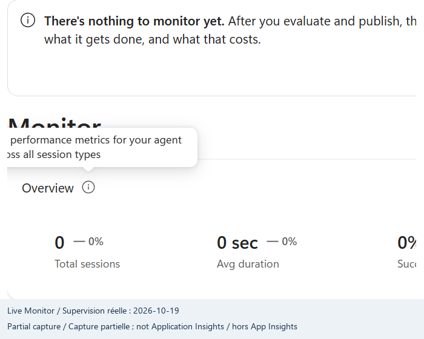

La vue affichait **0 session, 0 sec de durée moyenne, 0 % de réussite et 0 crédit**
avec **No data yet**. Son bandeau annonçait des informations après évaluation
et publication. Ce sont des agrégats vides ou indisponibles, pas la preuve d'une
consommation historique nulle, d'exécutions instantanées ou d'un véritable taux
de réussite nul. Aucune action Publish ou Evaluate n'a été exécutée pour modifier cet état.

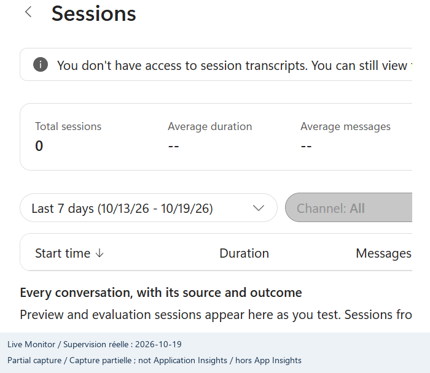

**Sessions > See all (0)** affichait zéro ligne, des moyennes `--` et un message
d'absence d'accès aux transcriptions pour l'identité courante. Le téléchargement
était désactivé. Aucune augmentation de droits ni export n'a été tenté.

La conversation **Preview > History** exposait indépendamment les appels antérieurs
d'annuaire (**2,73 s**), d'envoi au même objet (**1,63 s**) et d'annuaire échoué
(**4,62 s**). Son en-tête indiquait séparément **90,33 crédits estimés**. Ce nombre
n'est ni un montant USD ni une facture Azure ; l'agrégat Monitor nul ne le remplace pas.
La corrélation portait sur la conversation existante, les entrées d'outil et l'objet
unique du courriel, **pas** sur des lignes Monitor, qui étaient absentes.

Enfin, **Home > ... en bas du volet > Open classic experience > Skip feedback**
a été trouvé dans l'interface réelle. La fenêtre de destination n'est pas devenue
accessible ; les requêtes suivantes du chargement ont retourné `ERR_CONNECTION_RESET`.
Le parcours existe, sans preuve que ce même agent puisse utiliser les rubriques,
Application Insights et les prompts/BYOM standard. Aucune conversion ou création
d'agent n'a été tentée. L'inspection de supervision native est une preuve utile
de l'expérience actuelle, **pas une réussite Application Insights, événement
personnalisé ou KQL**.

Un inventaire en lecture seule a trouvé **23 déploiements de modèles réussis
répartis sur huit des neuf comptes Cognitive Services**. Cela établit des métadonnées,
pas l'autorisation d'envoyer les données d'atelier vers d'autres applications,
la gratuité des appels, la compatibilité des points d'accès ou la réussite BYOM.
Aucun appel d'inférence ni lecture de clé de ces comptes existants n'a été effectué.

Les documents Word, le notebook et les sources Terraform d'origine sont inchangés.
Les ressources de production ou d'autres usages n'ont pas été modifiées. Les preuves
initiales d'envoi et de réception du lab 1 restent des preuves historiques utilisateur,
distinctes de tout nouveau test exécuté par l'assistant.
